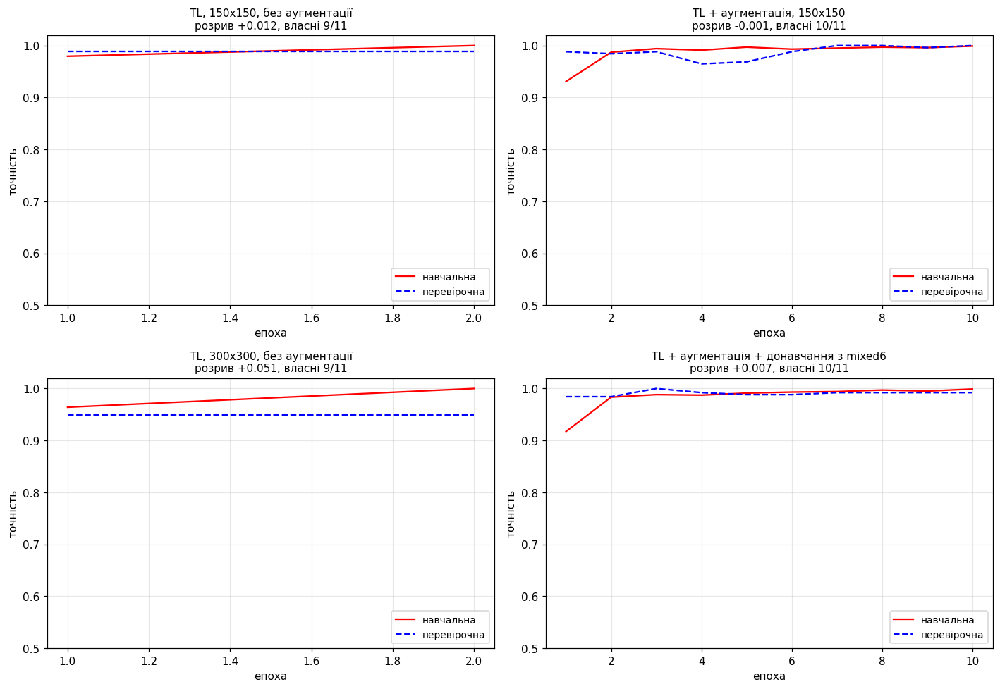
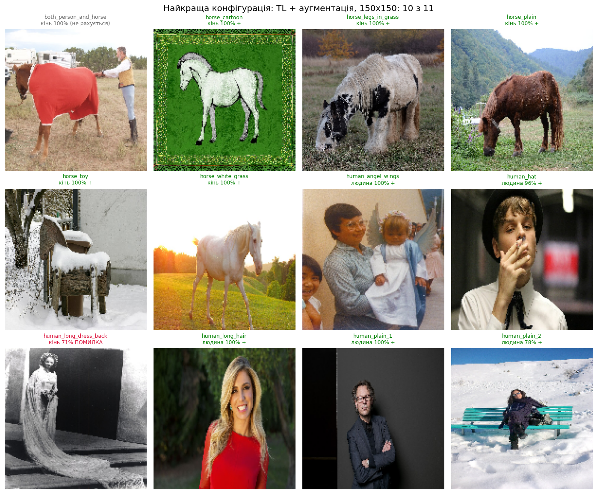
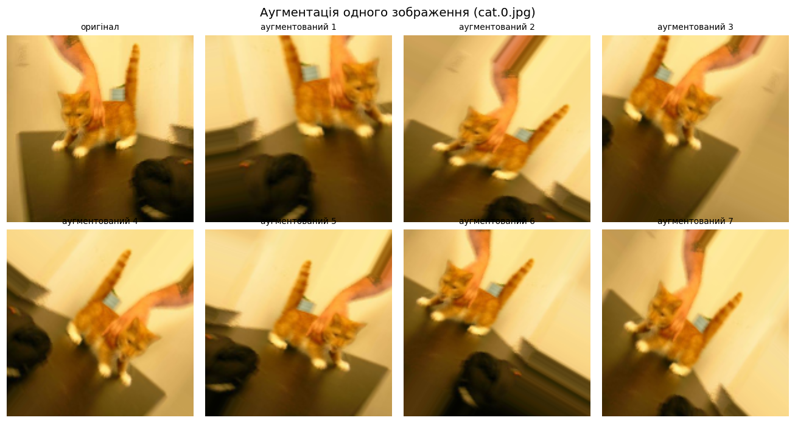
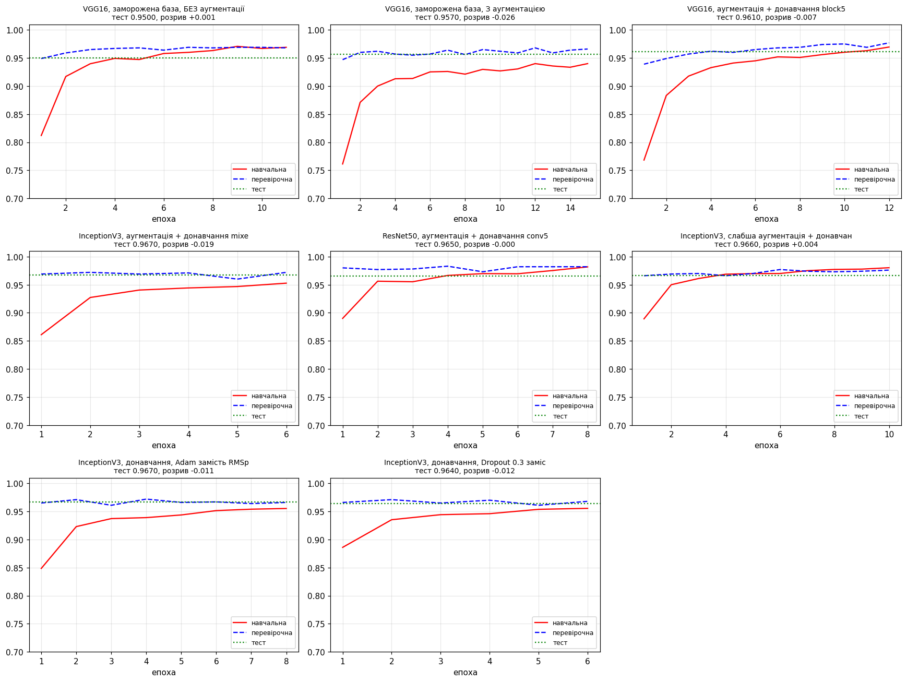
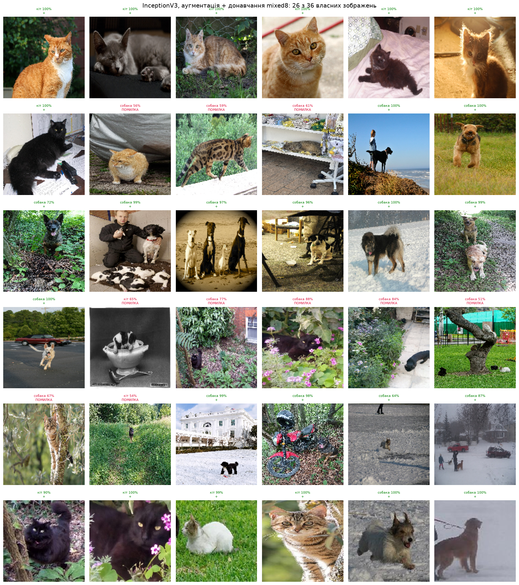
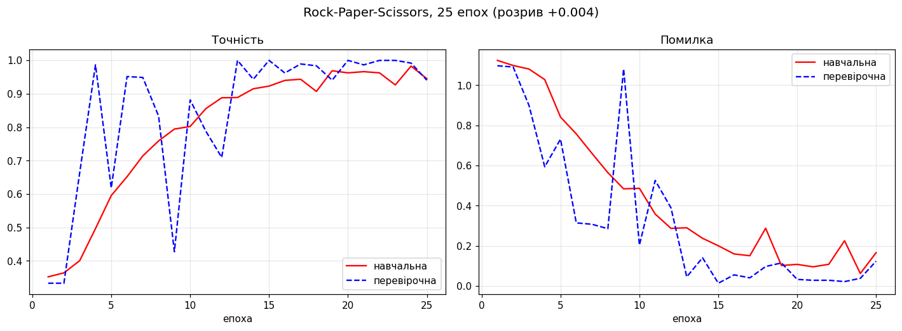
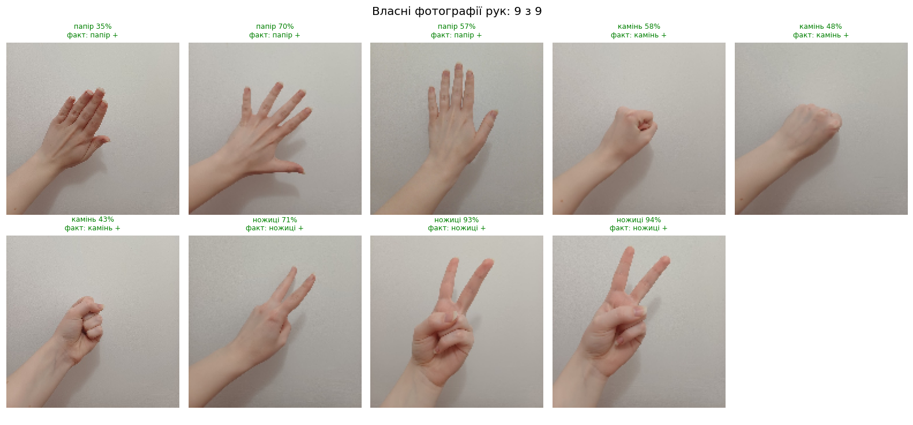
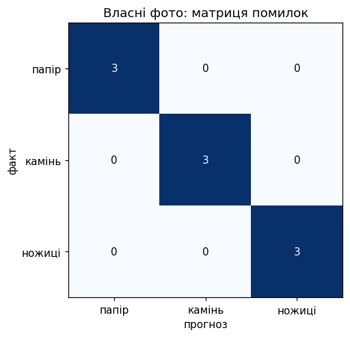

# Лабораторна 10 — Доповнення даних (Data Augmentation)

Курс «Глибокі нейронні мережі». Бінарна й мультикласова класифікація зображень
з аугментацією, перенесенням навчання і тонким налаштуванням.

Три набори даних і п'ять завдань:

| Завдання | Набір | Класів | Що досліджується |
|---|---|---|---|
| 1 | Horse or Human | 2 | перенесення навчання з InceptionV3 (базовий ноутбук) |
| 2 | Horse or Human | 2 | роздільна здатність, аугментація, донавчання |
| 3 | Dogs vs Cats, скорочений | 2 | аугментація на малому наборі, донавчання, інші мережі |
| 4 | Rock-Paper-Scissors | 3 | мультикласова класифікація, власні фото |
| 5 | Sign Language MNIST | 24 | завантаження з CSV, мультиклас |

---

## Що таке аугментація і навіщо вона тут

Аугментація — це генерація нових навчальних прикладів із наявних: поворот,
зсув, масштаб, відзеркалення. Мережа щоепохи бачить трохи інші зображення й
через це не може просто запам'ятати навчальну вибірку.

Важлива деталь, яку легко проґавити: **аугментація застосовується лише до
навчального набору**. Перевірочний і тестовий тільки нормалізуються. Якщо
аугментувати і їх, валідаційна точність перестане бути чесною оцінкою якості.

Друга деталь: аугментація не додає інформації, вона лише заважає
запам'ятовуванню. Тому вона допомагає там, де даних мало — і майже нічого не
дає там, де їх багато. Саме тому Завдання 3 навмисне працює на наборі у шість
разів меншому за той, що був у лабораторних 7 і 8.

---

## Виконання пунктів умови

| Пункт | Вимога | Де |
|---|---|---|
| 1 | Transfer Learning, InceptionV3, Functional API, колбек на 99.9% | [Task1_transfer_learning.ipynb](notebooks/Task1_transfer_learning.ipynb) |
| 2 | тестові зображення + роздільна здатність 300×300 | [Task2](notebooks/Task2_horses_humans_experiments.ipynb), конфігурації `base_150` / `base_300` |
| 3 | Transfer Learning + Data Augmentation | [Task2](notebooks/Task2_horses_humans_experiments.ipynb), `base_150` / `aug_150` |
| 4 | Transfer Learning + Fine Tuning | [Task2](notebooks/Task2_horses_humans_experiments.ipynb), `aug_150` / `aug_ft_150` |
| 5 | скрипт на 2000/500/500 зображень кожного класу | [scripts/prepare_cats_dogs_2000.py](scripts/prepare_cats_dogs_2000.py) |
| 6 | структура каталогів для генераторів | там само, `create_directory` |
| 7–9 | генератори з аугментацією, набори для перевірки й тесту | [Task3](notebooks/Task3_cats_dogs_small.ipynb), `make_generators` |
| 10 | VGG16, перенесення навчання, порівняння з аугментацією та без | [Task3](notebooks/Task3_cats_dogs_small.ipynb), `vgg16_noaug` / `vgg16_aug` |
| 11 | Fine Tuning: розморожування останнього блоку | [Task3](notebooks/Task3_cats_dogs_small.ipynb), `vgg16_aug_ft` |
| 12 | гіперпараметри, інші мережі | [Task3](notebooks/Task3_cats_dogs_small.ipynb), 5 додаткових експериментів |
| 13 | тестовий набір на найкращій моделі, висновки | [Task3](notebooks/Task3_cats_dogs_small.ipynb) + розділ «Результати» нижче |
| 14 | збереження навчених мереж | [models/README.md](models/README.md) |
| 15 | Rock-Paper-Scissors, 10 тестових зображень | [Task4](notebooks/Task4_rock_paper_scissors.ipynb) |
| 16 | власні фотографії рук | [Task4](notebooks/Task4_rock_paper_scissors.ipynb) |
| 17 | Sign Language MNIST з CSV, мультиклас | [Task5_sign_language.ipynb](notebooks/Task5_sign_language.ipynb) |

---

## Структура

```
lab10/
  base_notebooks/     оригінали базових ноутбуків, не редагуються
  notebooks/          згенеровані ноутбуки для Colab
  scripts/            генератор ноутбуків, підготовка даних, збір результатів
  data/               скорочений набір коти-собаки + архів для Drive
  my_images/          власні тестові зображення
  models/             опис збережених моделей (самі файли — на Drive)
  results/            JSON, графіки й summary.md після прогонів
```

| Ноутбук | Пункти | Приблизний час на T4 |
|---|---|---|
| [Task1_transfer_learning.ipynb](notebooks/Task1_transfer_learning.ipynb) | 1 | 5–10 хв |
| [Task2_horses_humans_experiments.ipynb](notebooks/Task2_horses_humans_experiments.ipynb) | 2–4 | 25–40 хв |
| [Task3_cats_dogs_small.ipynb](notebooks/Task3_cats_dogs_small.ipynb) | 5–14 | 50–80 хв |
| [Task4_rock_paper_scissors.ipynb](notebooks/Task4_rock_paper_scissors.ipynb) | 15–16 | 15–25 хв |
| [Task5_sign_language.ipynb](notebooks/Task5_sign_language.ipynb) | 17 | 10–15 хв |

---

## Методика і прийняті рішення

**Завдання 1 здається без жодної зміни поза блоками розв'язку.** Умова це
вимагає прямо, тому ноутбук не пишеться з нуля, а генерується з оригіналу:
`scripts/make_notebooks.py` заповнює лише текст між `### START CODE HERE` і
`### END CODE HERE`. `scripts/check_notebooks.py` це перевіряє побайтово —
кількість клітинок, тип кожної та текст до і після блоку мають збігатися з
`base_notebooks/Lab_10_1_Assignment.ipynb`.

**Дві поправки на свіжий Keras** — обидві всередині дозволених блоків:

- `layer.output_shape` прибрали в Keras 3. Замість нього
  `getattr(layer, 'output_shape', layer.output.shape)` — значення те саме,
  `(None, 7, 7, 768)`, як в Expected Output.
- Бакет `mledu-datasets`, з якого базовий ноутбук тягне ваги InceptionV3,
  більше не відкритий для анонімних запитів і віддає 403. Клітинку з `wget`
  редагувати не можна, тому `create_pre_trained_model` перевіряє, чи файл
  насправді завантажився, і якщо ні — бере ті самі ваги `notop` через
  `weights='imagenet'`. Числа параметрів збігаються з Expected Output:
  21 802 784 / 0 для бази і 47 512 481 / 38 537 217 для повної моделі.

Вивід `last layer output` виглядатиме інакше, ніж в Expected Output: Keras 3
друкує `KerasTensor` у новому форматі. Це різниця версій бібліотеки, не помилка.

**Завдання 5 — так само без змін поза блоками розв'язку.** Три пропуски з
чотирьох заповнено; четвертий, із `gdown`, викладач уже заповнив сам, тож його
не чіпали. Обидва блоки Expected Output перевірені на справжніх CSV:
`(27455, 28, 28) float64` після розбору і `(27455, 28, 28, 1)` після
генераторів. Розбір обох файлів займає близько 7 секунд — умова дає хвилину.

Два рішення, які варто пояснити на захисті:

- **25 виходів, а не 26.** Мітки в наборі йдуть від 0 (A) до 24 (Y): літери J
  і Z вимагають руху руки, тож статичних кадрів для них немає. Оскільки
  найбільша мітка — 24, шару потрібно рівно 25 виходів.
- **Аугментація без `horizontal_flip`.** Для котів і собак віддзеркалення
  нешкідливе, а дзеркальний жест — це жест іншої руки, а для деяких літер
  узагалі інша літера. Тобто фліп зіпсував би мітку.

Межі аугментації підібрані не навмання, а двома повними прогонами по 15 епох:

| Параметри | train | val |
|---|---|---|
| поворот 15°, зсуви 0.1, зум 0.1 | 0.9846 | **0.9971** |
| поворот 10°, зсуви 0.05, зум 0.05 | **0.9924** | 0.9812 |

Орієнтир умови за додаткові бали — понад 0.99 на навчанні й понад 0.95 на
перевірці за 15 епох. Перший варіант його не брав, і причина не в якості
мережі: **точність на навчанні рахується на аугментованих зображеннях**, тож
при сильних спотвореннях вона виходить нижчою за перевірочну. Другий варіант
виконує обидва пороги, тому в ноутбуці стоїть саме він.

**Завдання 2 — один ноутбук, а не три копії.** Умова просить зробити три копії
ноутбука Завдання 1 і в кожній змінити щось одне. Замість цього тут один стенд
із чотирьох конфігурацій, бо копії не можна порівняти між собою коректно: у
кожної був би свій випадковий старт і свій набір власних зображень. У стенді
зерно фіксоване, зображення ті самі, і **кожна пара конфігурацій відрізняється
рівно одним чинником**:

| Порівняння | Що змінюється | Пункт |
|---|---|---|
| `base_150` → `aug_150` | аугментація | 3 |
| `base_150` → `base_300` | роздільна здатність | 2 |
| `aug_150` → `aug_ft_150` | донавчання з `mixed6` | 4 |

**Чому 300×300 — окремий клопіт.** При вході 300×300 карта ознак після
`mixed7` має розмір 17×17 замість 7×7, тож `Flatten` дає вектор у 5.9 раза
довший, і `Dense(1024)` після нього розростається з 38.5 до **227 млн
параметрів** — сама лише його матриця важить 867 МБ. Це і є відповідь на
питання пункту 2 про вплив роздільної здатності на параметри навчання. Щоб
конфігурація все ж пройшла, у неї зменшено батч (16 замість 32), а навчання
обгорнуте в перехоплення нестачі пам'яті: якщо вона все одно не влізе, ноутбук
запише кількість параметрів і піде далі, а не впаде посередині.

**Зображення `both_*` не зараховуються.** У файлі `both_person_and_horse.jpg` є
і кінь, і людина, тож правильної відповіді для нього не існує. Він показується
в сітці, але не враховується в підрахунку — та сама умовність, що в
лабораторній 7, інакше числа між лабораторними не можна було б порівнювати.

**Завдання 3 навмисно повторює умови ЛР7 і ЛР8:** вхід 150×150, ті самі власні
тестові зображення, той самий спосіб нарізки за індексами імені файлу.
Відрізняється лише розмір набору — 6000 замість 25 000. Тому різницю в
результатах можна приписати саме набору й аугментації, а не зміні умов.

**Набір ріжеться за індексами, а не випадково.** `cat.0.jpg … cat.1999.jpg` у
навчальний, `2000…2499` у перевірочний, `2500…2999` у тестовий. Так набір
відтворюваний, а скрипт окремо перевіряє, що всі 6000 імен унікальні й жодне
зображення не потрапило у два набори.

---

## Де що лежить

| Шлях | Що це |
|---|---|
| `notebooks/` | комплект для здачі, імена без змін. Завдання 1 і 5 — ноутбуки викладача, у них відредаговано лише блоки `START/END CODE HERE` |
| `notebooks/with_results/` | ті самі п'ять ноутбуків із виводами, перейменовані за номером завдання — зручно відкривати з редактора |
| `results/` | графіки й `summary.md`; `results/raw/*.json` — усі числа |
| `my_images/rps/` | власні фотографії рук, по три на жест |
| `scripts/` | генерація ноутбуків, підготовка даних, перевірки, збір результатів |

`notebooks/with_results/` — копії, а не окремі файли: їх робить
`scripts/make_show_copies.py`, запускати після кожного нового прогону. Імена в
`notebooks/` не чіпаємо, бо на них спираються `check_notebooks.py` (звіряє
Завдання 1 і 5 з оригіналами викладача) і `verify_graded.py`.

| Для показу | Завдання |
|---|---|
| `01_horses_humans_inception.ipynb` | 1 — коні й люди, перенесення навчання |
| `02_resolution_augment_finetune.ipynb` | 2 — роздільна здатність, аугментація, донавчання |
| `03_cats_dogs_2000.ipynb` | 3 — коти й собаки на 2000/500/500 |
| `04_rock_paper_scissors.ipynb` | 4 — камінь-ножиці-папір |
| `05_sign_language.ipynb` | 5 — мова жестів |

---

## Результати

Усі п'ять ноутбуків виконані в Colab на ГП L4, 8 листопада 2026. Повні таблиці —
у `results/summary.md` (генерується `scripts/collect_results.py`); нижче —
головне для звіту.

### Завдання 1 — коні-люди, перенесення навчання з InceptionV3

| Показник | Expected Output | Отримано |
|---|---|---|
| зображень train / validation | 1027 / 256 | 1027 / 256 |
| параметрів бази / навчаних у ній | 21 802 784 / 0 | збігається |
| вихід шару `mixed7` | `(None, 7, 7, 768)` | `(None, 7, 7, 768)` |
| параметрів моделі / навчаних | 47 512 481 / 38 537 217 | збігається |

Навчання зупинив власний колбек на **99.9 % точності** (вимога умови) —
фінальна епоха: train **0.9990**, validation **1.0000**. Обидва орієнтири
(train > 0.999, validation > 0.95) виконані.

### Завдання 2 — роздільна здатність, аугментація, донавчання (пункти 2–4)



| Конфігурація | Вхід | Параметрів | Епох | Val accuracy | Розрив train−val | Власні |
|---|---|---|---|---|---|---|
| TL, без аугментації | 150×150 | 47 512 481 | 2 | 0.9883 | +0.012 | 9/11 |
| TL + аугментація | 150×150 | 47 512 481 | 10 | **1.0000** | −0.001 | **10/11** |
| TL, без аугментації | 300×300 | 236 256 161 | 2 | 0.9492 | +0.051 | 9/11 |
| TL + аугментація + донавчання з `mixed6` | 150×150 | 47 512 481 | 10 | 0.9922 | +0.007 | 10/11 |

Кожна пара відрізняється рівно одним чинником, тож різницю можна приписати саме йому.

- **Пункт 3, аугментація:** val 0.9883 → **1.0000**, розрив +0.012 → **−0.001**,
  власні зображення 9 → 10. Вплив помітний не стільки на самій точності
  (на 256 перевірочних зображеннях це 253 проти 256), скільки на **розриві**: без
  аугментації мережа доходить до 99.9 % на навчальних даних **за дві епохи** й
  зупиняється, тобто просто запам'ятовує 1027 зображень. З аугментацією їй
  потрібно десять епох, і весь цей час перевірочна точність тримається **вище**
  навчальної — від'ємний розрив означає, що мережа вчить ознаки, а не вибірку.
- **Пункт 2, 300×300:** val 0.9883 → **0.9492**, розрив +0.012 → **+0.051**.
  Збільшення входу вчетверо за площею **погіршило** результат. Причина не в
  роздільній здатності як такій: `mixed7` на вході 300×300 віддає карту 17×17×768
  замість 7×7×768, і наступний `Flatten → Dense(1024)` розростається з 47 до
  **236 млн** параметрів, тоді як навчальних зображень лишається 1027. Більший
  вхід тут купує деталізацію ціною перенавчання.
- **Пункт 4, донавчання з `mixed6`:** val 1.0000 → 0.9922. Формально нижче, але
  це 254/256 проти 256/256 — на наборі такого розміру різниця в межах шуму.
  Змістовний висновок інший: донавчанню **нема куди рости**, коли заморожена
  база вже дає 100 %. Донавчання має сенс там, де ознаки ImageNet погано
  підходять задачі; коні й люди — класи, близькі до ImageNet, тож готових ознак
  достатньо.



На власних зображеннях — **10 з 11**. Дванадцяте («і кінь, і людина в кадрі»)
виключене з підрахунку: у бінарної задачі для нього немає правильної відповіді.

### Завдання 3 — коти-собаки на скороченому наборі (пункти 5–14)



| Експеримент | Аугм. | Донавч. | Навчаних | Епох | Val | **Тест** | Розрив | Хв |
|---|---|---|---|---|---|---|---|---|
| VGG16, заморожена база | ні | ні | 131 585 | 11 | 0.9690 | 0.9500 | +0.001 | 1.8 |
| VGG16, заморожена база | так | ні | 131 585 | 15 | 0.9680 | 0.9570 | −0.026 | 6.5 |
| VGG16 + донавчання `block5` | так | так | 7 211 009 | 12 | 0.9770 | 0.9610 | −0.007 | 5.2 |
| **InceptionV3 + донавчання `mixed8`** | так | так | 11 633 153 | 6 | 0.9720 | **0.9670** | −0.019 | 3.4 |
| ResNet50 + донавчання `conv5` | так | так | 15 478 273 | 8 | 0.9830 | 0.9650 | −0.000 | 3.9 |
| InceptionV3, слабша аугментація | так | так | 11 633 153 | 10 | 0.9770 | 0.9660 | +0.004 | 4.7 |
| InceptionV3, Adam замість RMSprop | так | так | 11 633 153 | 8 | 0.9720 | 0.9670 | −0.011 | 4.0 |
| InceptionV3, Dropout 0.3 замість 0.5 | так | так | 11 633 153 | 6 | 0.9710 | 0.9640 | −0.012 | 3.1 |



Що видно з вісьмох прогонів:

- **Аугментація** (рядки 1→2) дала +0.007 на тесті, але розрив змінився з +0.001
  на **−0.026** — головний її ефект знову в тому, що мережа перестає спиратися на
  конкретні 4000 зображень.
- **Донавчання** (2→3) дало +0.004 при зростанні навчаних параметрів у 55 разів.
  Приріст малий, бо коти й собаки — класи **самого** ImageNet, тож згорткові
  ознаки вже підігнані під них.
- **Інша архітектура** важить більше за гіперпараметри: InceptionV3 обійшов VGG16
  на +0.006 і навчився **вдвічі швидше** (3.4 хв проти 5.2). Експерименти з
  оптимізатором, силою аугментації й Dropout укладаються в діапазон
  0.9640…0.9670, тобто **в межах шуму** — на тестовому наборі з 1000 зображень
  один відсоток це 10 зображень.
- Найкраща модель — **InceptionV3 з донавчанням `mixed8`, тест 0.9670**.

#### Порівняння з ЛР7 і ЛР8 (пункт 14)

| Модель | Навчальних | Тест | Звичайні | Складні | Обрізані |
|---|---|---|---|---|---|
| ЛР7, своя CNN з нуля | 17 500 | 0.8424 | 16/20 | 4/10 | 2/6 |
| **ЛР10, InceptionV3 + донавчання** | **4 000** | **0.9670** | 16/20 | 4/10 | **6/6** |

**+0.1246 на тесті при навчальному наборі в 4.4 раза меншому.** Це пряма
відповідь на питання умови: перенесення навчання перекриває брак даних, бо
мережа не вчить ознаки з нуля, а бере готові з ImageNet і навчає поверх них лише
класифікатор.



На власних зображеннях картина складніша, і саме вона найцікавіша.

**Звичайні та складні зображення — без приросту:** 16/20 і 4/10, тобто рівно
як у ЛР7, попри +12 пунктів на тесті. У `results/raw/task3.json` лежать
покадрові ймовірності, і вони показують систематичний нахил: усі **п'ять**
складних котів розпізнані як собаки з упевненістю 0.51…0.88, а три звичайні
коти, на яких модель помилилася (`cat_08`, `cat_09`, `cat_10`), дали
0.56…0.61. Помилки не випадкові — вони зосереджені на котах у захаращеному
вуличному кадрі.

**Обрізані зображення — 6 з 6 проти 2 з 6 у ЛР7.** Це ті самі складні знімки,
але кадровані по тварині. Порівняння пар пояснює все:

| Зображення | P(собака) без обрізки | P(собака) з обрізкою |
|---|---|---|
| `cat_hard_bushes` | 0.767 → собака ✗ | **0.098** → кіт ✓ |
| `cat_hard_flowers` | 0.877 → собака ✗ | **0.001** → кіт ✓ |
| `cat_hard_park` | 0.515 → собака ✗ | **0.008** → кіт ✓ |
| `cat_hard_tree` | 0.670 → собака ✗ | **0.000** → кіт ✓ |
| `dog_hard_snow` | 0.636 → собака ✓ | 0.999 → собака ✓ |
| `dog_hard_street` | 0.868 → собака ✓ | 1.000 → собака ✓ |

Чотири коти, яких модель упевнено називала собаками, після обрізки
розпізнаються як коти — причому майже з нульовою ймовірністю помилки
(0.000…0.098). Передбачення не просто перевернулося, воно стало **набагато
впевненішим**, ніж було хибне.

Звідси висновок: мережа не плутає котів із собаками. Вона не знаходить тварину
в кадрі. Вхід 150×150 на знімку, де кіт займає десяту частину площі, лишає від
тварини кілька десятків пікселів, а решту заповнює листя, трава й паркан. Варто
прибрати тло — і класифікація стає точною. Це обмеження не класифікатора, а
**відсутності етапу локалізації**: у навчальному наборі Kaggle тварина завжди
займає більшу частину кадру, тож мережа ніколи не вчилася її шукати.

Загальна відповідь на питання пункту 13 виходить двочастинною. На даних того
самого розподілу, що й навчальні, перенесення навчання дає +12 пунктів при
вчетверо меншій вибірці. На зображеннях з іншого розподілу приросту немає —
доки їх не привести до умов навчального набору, після чого він з'являється
одразу й повністю (2/6 → 6/6).

### Завдання 4 — Rock-Paper-Scissors, три класи (пункти 15–16)



| Набір | Accuracy | Вгадано |
|---|---|---|
| Тестовий набір (згенерований) | **0.9409** | — |
| 10 зображень із набору лекції | — | **10/10** |
| Власні фотографії рук | — | **9/9** |

25 епох, 3 473 475 параметрів, розрив train−val **+0.004**, 8.7 хв навчання.
Три класи замість двох вимагали `softmax`, `categorical_crossentropy` і
`class_mode='categorical'`; `horizontal_flip` лишено, бо жест
«камінь-ножиці-папір» дзеркально не змінює клас.



**Усі дев'ять власних знімків розпізнані правильно.** Це результат другого
заходу, і різниця між ними — найзмістовніша частина завдання.

| Власні зображення | Вгадано |
|---|---|
| стокові фото з інтернету (перший прогін) | 4/9 |
| свої знімки біля білої стіни (другий прогін) | **9/9** |

Набір RPS — згенерована графіка: рука на рівному світлому тлі, без сторонніх
предметів, кадр квадратний. Стокові фото цього не дотримувались — звідси 4 з 9.
Власні знімки зняті біля білої стіни, а `scripts/pack_my_images.py` бере з
вертикального кадру 3:4 **нижній квадрат** і зводить до 600×600, щоб
`target_size=(150, 150)` не розтягнув руку по вертикалі. Після цього зображення
потрапляють у той самий розподіл, на якому мережа вчилася, і точність
відновлюється повністю.

Висновок, який із цього випливає: **4/9 були не ознакою слабкої мережі, а
ознакою розходження розподілів.** Та сама модель на тих самих жестах дає 9/9,
щойно вхідні зображення приведено до умов навчального набору. Це пряма
ілюстрація межі перенесення навчання — воно переносить ознаки, але не рятує від
зсуву домену.



Чесне застереження до цих 9/9: упевненість коливається від **0.35 до 0.94**, і
в **трьох** випадках із дев'яти вона нижча за 0.50 — тобто відповідь правильна,
але відрив від інших двох класів невеликий (`paper_palm_flat` дало 0.347 проти
0.342 у «каменя» — різниця в п'ять тисячних). Усі три слабкі випадки — це
`rock` і плаcка долоня, які в маленькому кадрі справді схожі. Найвпевненіші —
ножиці: 0.93 і 0.94, бо два розставлені пальці дають обрис, що ні на що не
схожий.

### Завдання 5 — мова жестів із CSV (пункт 17)

| Показник | Expected Output | Отримано |
|---|---|---|
| форма / тип навчальних зображень | `(27455, 28, 28)`, `float64` | збігається |
| форма / тип перевірочних | `(7172, 28, 28)`, `float64` | збігається |
| генератори додали вимір каналу | `(27455, 28, 28, 1)` | збігається |
| час розбору CSV | менше 60 с | ~6 с |
| Conv2D / MaxPooling2D | не більше 2 / 2 | 2 / 2 |

Фінальна епоха: train **0.9951**, validation **0.9930** — обидва орієнтири
(> 0.99 і > 0.95) виконані.

Два місця, де тут легко помилитися, і що з ними зроблено:

- **`horizontal_flip` вимкнено.** Для котів і собак віддзеркалення нешкідливе,
  але дзеркальний жест — це жест іншої руки, а для частини літер і взагалі інша
  літера. Решта аугментації навмисно слабка (поворот 10°, зсув і зум 0.05):
  точність на навчанні рахується на **аугментованих** зображеннях, тож при
  сильних спотвореннях вона виходить нижчою за перевірочну й не дотягує до
  орієнтира 0.99. Виміряно двома повними прогонами, числа — в коментарі
  відповідної клітинки.
- **Вихідних нейронів 25, а не 26.** Мітки в наборі йдуть від 0 (A) до 24 (Y):
  літери J і Z вимагають руху руки, тож статичних кадрів для них немає. Мітки —
  цілі числа, а не one-hot, звідси `sparse_categorical_crossentropy`.

### Що лишилося зробити

- Вставити посилання «Поділитися» на п'ять ноутбуків у Colab.

---

## Запуск

### Локально — підготовка

```powershell
cd C:\uni_year_4\dl\lab10
$py = "..\lab7\.venv\Scripts\python.exe"
$env:PYTHONUTF8 = "1"

& $py scripts\prepare_cats_dogs_2000.py   # data/cats_dogs_small.zip (136 МБ)
& $py scripts\pack_my_images.py           # my_images.zip
& $py scripts\make_notebooks.py           # notebooks/*.ipynb
& $py scripts\check_notebooks.py          # синтаксис + Завдання 1 і 5 проти оригіналів
& $py scripts\verify_graded.py            # Expected Output Завдань 1 і 5 на справжніх даних
& $py scripts\smoke_notebooks.py          # прогін логіки Завдань 2-4 на CPU (довго)
```

`check_notebooks.py` стежить, щоб Завдання 1 і 5 відрізнялися від оригіналів
виключно вмістом блоків `START/END CODE HERE`; `verify_graded.py` виконує їхній
код і звіряє числа з блоками **Expected Output**; `smoke_notebooks.py` проганяє
Завдання 2–4 з підміненим `Model.fit` (одна епоха, кілька батчів), щоб помилки
в коді спливали тут, а не після години навчання в Colab.

### У Colab — навчання

Детально, клітинка за клітинкою — у [TUTORIAL.md](TUTORIAL.md). Коротко:

1. Залити на Google Drive у теку `MyDrive/dl_lab10/`:
   `cats_dogs_small.zip` і `my_images.zip`.
2. Відкрити ноутбуки в Colab, **увімкнути GPU** (Середовище виконання →
   Змінити тип → ГП T4).
3. Виконати по порядку; остання клітинка кожного сама віддасть зіп з результатами.

### Повернення результатів

```powershell
# зіпи з Colab покласти у results/incoming/
& $py scripts\unpack_results.py
& $py scripts\collect_results.py          # -> results/summary.md
```

---

## Тестові зображення Завдання 4

У `my_images/rps/{rock,paper,scissors}/` лежать по три **власні** фотографії
кожного жесту, зняті біля білої стіни. Перший прогін робився на стокових
знімках з інтернету й дав 4 з 9; після заміни на власні — 9 з 9. Обидва числа
наведені в розділі «Результати», бо різниця між ними і є відповіддю на питання
про межі перенесення навчання.

Телефон знімає кадр 3:4 і записує орієнтацію прапорцем EXIF, а не поворотом
пікселів. `scripts/pack_my_images.py` це враховує:

1. `ImageOps.exif_transpose` — інакше кадр лягає боком;
2. з вертикального кадру береться **нижній квадрат** на всю ширину (рука завжди
   там), бо `target_size=(150, 150)` у ноутбуці розтягує прямокутник у квадрат і
   рука виходить сплюснутою по вертикалі, чого в навчальному наборі немає;
3. результат зводиться до 600×600 — більше не потрібно, ноутбук усе одно
   зменшує до 150×150, а архів лишається близько 10 МБ.

Щоб замінити фотографії: покласти нові у відповідні теки, перезапустити
`scripts/pack_my_images.py`, перезалити `my_images.zip` у `MyDrive/dl_lab10/`,
видалити в Colab теку `/content/my_images` і виконати дві останні клітинки
Завдання 4 — навчання повторювати не потрібно.
