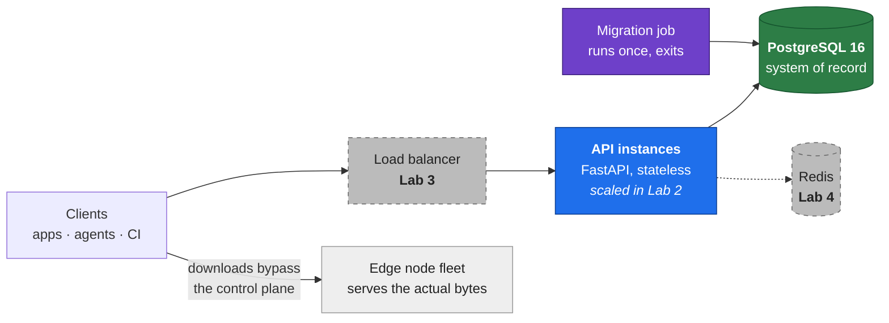

# CDN Control Plane API

Orchestration and management backend for a network of distributed edge nodes.

This service is the **brain** of a CDN, not its muscle. It never serves the content bytes.
It keeps the registry of thousands of edge servers, ingests their telemetry, decides which
node a client should download from, governs where content may be cached, and broadcasts
cache invalidations across the fleet.

> **Course:** Інженерія високонавантажених систем · **Lab 1** — System design and baseline
> prototype. The domain is fixed for the whole course; Labs 2–5 extend this codebase.

---

## Why this domain

The brief asks for a system with a genuine high-load profile. A CDN control plane has two
of them, pulling in opposite directions, and that tension is what makes every later lab
meaningful rather than academic:

| | Write-intensive | Read-intensive |
|---|---|---|
| Endpoint | `POST /nodes/{id}/heartbeat` | `GET /routing/resolve` |
| Driven by | Fleet size ÷ heartbeat interval | End-user download volume |
| At 10 000 nodes / 10 s | ~1 000 writes per second, constant | Millions of reads, bursty |
| Limited by | Physics — every write must reach disk | Repetition — the same answer recomputed |
| Answer | Make each write cheaper | Stop recomputing: cache (Lab 4) |

That asymmetry is the through-line of the whole project: **Lab 4 attacks the reads, Lab 5
measures the writes.**

### Peak load scenario — the *release storm*

The system's worst moment is a content release, because it lights up both sides at once:

1. CI publishes a new asset version → every replica is invalidated and a purge campaign
   opens against every node holding it.
2. The whole fleet acknowledges the purge — a write burst proportional to fleet size.
3. Simultaneously every client calls `/routing/resolve`, and for a window **no node is
   warm**, so routing must keep answering while the fleet re-pulls from origin.
4. Re-pulling spikes node bandwidth → raises reported load → changes routing eligibility.
   The write storm and the read storm feed each other.

Reproduced as Scenario C in the Lab 5 load tests.

---

## Quick start

One command, from a clean clone. No manual steps.

```bash
docker compose --profile demo up -d --build
```

That starts PostgreSQL, waits for it to be healthy, runs migrations **once** in a
dedicated container, seeds a deterministic demo fleet, starts the API, and launches a
simulator standing in for the agents that would run on real edge servers.

That last piece matters. Real edge nodes heartbeat continuously; a seeded database has
the nodes but not the agents, so without it every node ages past
`HEARTBEAT_STALE_AFTER_SECONDS` and routing correctly reports that none is reachable.
The `agents` service supplies the missing half of the simulation rather than hiding the
symptom behind an inflated staleness threshold.

```
http://localhost:8000/docs         interactive API documentation
http://localhost:8000/health       liveness
http://localhost:8000/health/ready readiness (verifies the database)
localhost:5434                     PostgreSQL, if you want to inspect it directly
```

`--profile demo` only gates `seed`: drop it to start with an empty database instead of
the demo fleet. `agents` is **not** profile-gated — it runs unconditionally (harmlessly,
against an empty database it just finds nothing to refresh) specifically so that a plain
`docker compose down`, with no flags, always sees and stops it. `agents` runs with
`restart: unless-stopped` to survive the readiness demo's `docker compose stop postgres`,
and a profile-gated service with that restart policy would be a trap: a `down` invocation
that didn't happen to include the matching `--profile` flag would leave it running and
orphan the network ("Resource is still in use").

Verify it end to end — registers a region, a node and an asset, reports telemetry,
resolves a route, publishes a version, watches the purge complete:

```powershell
./scripts/smoke.ps1
```

<details>
<summary>Running without Docker (host Python)</summary>

```bash
python -m venv .venv
.venv/Scripts/pip install -r requirements-dev.txt
cp config/.env.example config/.env
docker compose up -d postgres
.venv/Scripts/python -m alembic upgrade head
.venv/Scripts/python -m scripts.seed
.venv/Scripts/python -m uvicorn app.main:app --reload
```
</details>

> **Port note.** PostgreSQL is published on **5434**, not 5432. On the development machine
> 5432 belongs to a native Windows PostgreSQL service and 5433 to another project's
> container. Inside the Compose network everything still uses `postgres:5432`.
> Host port **8080 is deliberately left free** for the Lab 3 load balancer.

---

## Architecture

Full breakdown, C4 diagrams and data flows: **[docs/architecture.md](docs/architecture.md)**



### Layout

```
app/
  core/        config, instance identity, JSON logging, middleware, RFC 9457 errors, pagination
  db/          declarative base with naming convention, async engine and pooled sessions
  models/      8 SQLAlchemy models
  schemas/     Pydantic request/response contracts
  services/    all business logic — routes never touch the ORM directly
  api/routes/  HTTP layer: parse, delegate, shape a response
migrations/    Alembic (async), one verified migration
scripts/       deterministic seed, edge-agent simulator, OpenAPI export, smoke test
tests/         39 tests against a real PostgreSQL database
docker/        multi-stage Dockerfile, non-root, with HEALTHCHECK
docs/          architecture · data model · API reference · bottleneck analysis · openapi.json
```

**Why the service layer exists:** Lab 4 wraps caching around *services*, not routes. Had
the business logic lived in route handlers, adding a cache would mean editing every
endpoint.

---

## Domain model

Eight entities. Full ER diagram, column semantics and index rationale:
**[docs/data-model.md](docs/data-model.md)**

| Entity | Role |
|---|---|
| `regions` | Geographic zones; drive proximity scoring |
| `edge_nodes` | The managed fleet, with denormalized live telemetry |
| `node_heartbeats` | Append-only telemetry — the write-intensive table |
| `assets` | Content metadata: hash, size, version, TTL |
| `distribution_rules` | Where an asset may be cached |
| `asset_replicas` | Which node holds which version — what routing joins on |
| `purge_events` | Tracked invalidation campaigns |
| `purge_acknowledgements` | Per-node confirmation, idempotent by primary key |

Two decisions worth noting:

- **`node_heartbeats` uses a `BIGINT` identity key, not a UUID.** Random UUIDs scatter
  inserts across the whole index; a monotonic key keeps every insert on the rightmost
  B-tree page. On the table taking the highest insert rate in the system, that dominates.
- **Node liveness is a SQL predicate, never a background timer.** Staleness is evaluated
  as `last_heartbeat_at >= now() - threshold` inside the routing query. No instance owns a
  reaper loop, so every instance reaches the same verdict without coordinating — which is
  why Lab 2 needs no change here.

---

## API

25 operations across 17 paths. Full reference with status codes and the error catalogue:
**[docs/api.md](docs/api.md)** · machine-readable: [docs/openapi.json](docs/openapi.json)
· live: `/docs`

| Group | Endpoints |
|---|---|
| **Ops** | `GET /health` · `GET /health/ready` |
| **Regions** | `GET`/`POST /api/v1/regions` |
| **Nodes** | `GET`/`POST /nodes` · `GET`/`PATCH`/`DELETE /nodes/{id}` · **`POST /nodes/{id}/heartbeat`** · `GET /nodes/{id}/replicas` · `PUT /nodes/{id}/replicas/{asset_id}` |
| **Assets** | `GET`/`POST /assets` · `GET`/`DELETE /assets/{id}` · **`POST /assets/{id}/versions`** · `GET`/`PUT /assets/{id}/distribution` |
| **Routing** | **`GET /routing/resolve`** |
| **Purges** | `GET`/`POST /purges` · `GET /purges/{id}` · `POST /purges/{id}/acknowledgements` |
| **Stats** | `GET /stats/network` |

The three bold endpoints are where the system's character lives.

### `GET /routing/resolve` — the read hot path

Ranked edge nodes for one asset, computed entirely inside PostgreSQL — the application
never materialises the fleet in memory and never sorts in Python. Query count is constant
(2–3) regardless of fleet size: no N+1.

```
score = proximity_penalty            (0 same region | 25 same continent | 60 otherwise)
      + cold_penalty                 (0 if the node holds the current version | 40 if not)
      + 0.5 * current_load_percent   (0 .. 50)
```

Proximity outranks load because for a CDN distance is the whole product. The cold penalty
sits *between* the proximity tiers, so a warm node one continent away still beats a cold
node next door — an origin pull costs more than the extra network distance.

```bash
curl "http://localhost:8000/api/v1/routing/resolve?path=/static/app.bundle.js&client_region=eu-central&limit=3"
```

```
edge-eu-central-01   score 11.0   same region as client; holds the current version; 22% loaded
edge-eu-central-02   score 28.5   same region as client; holds the current version; 57% loaded
edge-eu-west-02      score 31.0   same continent, serving eu-central from eu-west; 12% loaded
```

`edge-eu-central-03` is absent — it reported 91% load and was automatically demoted to
`degraded`. Every candidate carries a readable `reason`, because a routing decision that
cannot be explained cannot be debugged.

### `POST /nodes/{id}/heartbeat` — the write hot path

One transaction, two statements: append a telemetry row, update the node's denormalized
liveness columns. Load is `max(cpu, memory, bandwidth ÷ capacity)` — the worst signal wins.
Crossing the overload threshold demotes the node to `degraded` and it stops receiving
traffic; dropping back promotes it. **That is the "automatically eject overloaded servers"
requirement**, with no operator action and no background job.

### `POST /assets/{id}/versions` — cross-entity business logic

Publishing new content does three things in **one transaction**: bumps the version, marks
every replica stale, and opens a purge campaign against the nodes holding it. Any partial
outcome would leave edge nodes serving bytes the control plane believes are gone.

The asset row is locked `FOR UPDATE` for the duration — two concurrent CI pipelines would
otherwise both read version N and both write N+1, losing a release.

---

## Bottleneck analysis

Six predicted degradation points in *Component / Root Cause / Symptoms* form, with
mitigations: **[docs/bottlenecks.md](docs/bottlenecks.md)**

| # | Component | Root cause | First symptom | Addressed in |
|---|---|---|---|---|
| 1 | `node_heartbeats` insert storm | WAL + index write amplification, autovacuum lag | p99 write latency, table bloat | Lab 5 measures; partitioning after |
| 2 | `edge_nodes` hot-row update | Row lock contention, MVCC churn | Lock waits, per-node tail latency | Lab 5 |
| 3 | `/routing/resolve` join | Uncached recomputation on the hottest read | DB CPU saturates before the app does | **Lab 4** |
| 4 | Connection pool | `(pool + overflow) × instances` vs `max_connections` | Queueing latency with *falling* DB CPU | Lab 3 raises it, Lab 5 sizes it |
| 5 | Synchronous purge fan-out | O(fleet) work inside one HTTP request | Timeouts, head-of-line blocking | later lab (broker) |
| 6 | Unbounded reads and aggregates | Full scans, `OFFSET` pagination, `COUNT(*)` | Memory spikes, slow deep pages | mitigated now; Lab 4 caches stats |

These are hypotheses derived from the architecture. Lab 5 confirms or refutes them with
numbers — a prediction that turns out wrong is a more useful result than one never tested.

---

## Module ownership

Solo project; every module is authored and defended by one person.

| Module | Files | Owner | Responsible for |
|---|---|---|---|
| Domain and data model | `app/models/`, `migrations/` | Kateryna Ostrovska | Entity design, indexes, constraints, migration correctness |
| Service layer | `app/services/` | Kateryna Ostrovska | Routing algorithm, telemetry ingest, purge lifecycle, transaction boundaries |
| API layer | `app/api/`, `app/schemas/` | Kateryna Ostrovska | REST design, validation, RFC 9457 error contract, OpenAPI |
| Platform | `app/core/`, `app/db/` | Kateryna Ostrovska | Configuration, logging, middleware, pooling, statelessness discipline |
| Infrastructure | `docker/`, `docker-compose.yml` | Kateryna Ostrovska | Containerization, one-command deploy, migration ordering |
| Quality | `tests/`, `.pre-commit-config.yaml` | Kateryna Ostrovska | Test suite, lint and format gates |
| Documentation | `docs/`, `README.md` | Kateryna Ostrovska | Architecture, data model, API reference, bottleneck analysis |

---

## Verification

Everything below was executed against the running stack.

| Check | Command | Result |
|---|---|---|
| Cold start, one command | `docker compose --profile demo up -d --build` | postgres healthy → migrate exit 0 → seed exit 0 → api healthy → agents running |
| Fleet stays routable unattended | left running past the staleness threshold | `/routing/resolve` still `200`; the `agents` service keeps telemetry fresh with no manual step |
| Liveness / readiness | `curl /health`, `curl /health/ready` | `200` / `200` |
| Readiness fails correctly | `docker compose stop postgres` | `/health` stays `200`, `/health/ready` returns `503` problem+json; both recover on restart |
| End-to-end business flow | `./scripts/smoke.ps1` | 14 steps, all expected status codes |
| **Data persistence** | `docker compose restart postgres` | 13 nodes / 9 assets / 74 replicas before **and** after; pool reconnects automatically |
| Migration integrity | `alembic upgrade head` → `check` → `downgrade base` → `upgrade head` | Applies, no drift, tears down and re-applies cleanly |
| Tests | `pytest` | **39 passed** |
| Lint and format | `ruff check .` · `ruff format --check .` | clean · 65 files formatted |

```bash
.venv/Scripts/python -m pytest                    # 39 tests against real PostgreSQL
.venv/Scripts/python -m ruff check .
.venv/Scripts/python -m alembic check             # no model/schema drift
.venv/Scripts/pre-commit install                  # one-time, registers the git hook
.venv/Scripts/python -m scripts.export_openapi    # regenerate docs/openapi.json
```

Tests run against a real PostgreSQL instance, not SQLite: the schema relies on native enum
types, `INET` and `INSERT ... ON CONFLICT`, so a suite on a different engine would prove
very little about the code that ships.

### Defence checklist

1. `docker compose down -v` then `docker compose --profile demo up -d --build` — cold deploy
2. `./scripts/smoke.ps1` — well past the required five endpoints, with status codes asserted
3. `docker compose restart postgres`, re-query — data persistence
4. `docker compose stop postgres`, show `/health` `200` vs `/health/ready` `503`
5. Show `edge-eu-central-03` (91% load) missing from routing — automatic ejection
6. Resolve `/downloads/patch-eu-2026.bin` from `client_region=us-east` — only EU nodes
   returned, proving the distribution policy holds

---

<!-- Lab2 -->
## Lab 2 — Stateless architecture

The application tier is stateless by design, so this lab is an audit and a proof rather
than a refactor: there were no in-memory collections, singletons, local locks or file
sessions to remove.

### State audit

| Category | What belongs here | Where it lives |
|---|---|---|
| **Ephemeral / Local Safe** | Request id, response timing, access logs, the SQLAlchemy connection pool, logging config | Per-request `Request` object (dies with the request) or per-process, never shared, never business data |
| **Shared / Externalized** | All business state: nodes, heartbeats, assets, replicas, distribution policy, purges and their acknowledgements | PostgreSQL — the single system of record every instance reads and writes |
| **Critical Stateful Dependencies** (must be removed) | In-memory collections, singletons with business data, local caches, application-level locks, local counters, file sessions | **None.** See the enforced rules in [docs/architecture.md](docs/architecture.md#statelessness-rules) |

**In-memory dependencies removed: none.** The design never introduced them. `@lru_cache`
is used only over immutable configuration (`get_settings`, `get_instance_id`); node
staleness is a SQL predicate, not an in-process reaper; the read-path cache is a
`NullCache` behind the `CacheBackend` seam, so no instance holds cached data locally.

### Stateless request flow (asset update)

`POST /assets/{id}/versions` carries no state between requests:

1. **Input** — `asset_id` in the path, new `content_hash` / `size_bytes` / `requested_by`
   in the body. No server-side session or context token.
2. **Read context** — the current asset and its replicas are read from PostgreSQL.
3. **Atomic change** — version bump, replica invalidation and the purge campaign are
   committed in one database transaction.
4. **No residual mutation** — after the response, nothing about the asset remains in the
   process; the next request re-reads it from the database, on any instance.

### Run two instances

```bash
docker compose -f docker-compose.yml -f docker-compose.lab2.yml up -d postgres migrate api1 api2
docker compose -f docker-compose.yml -f docker-compose.lab2.yml ps
```

`api1` → `http://localhost:8001` (`X-Instance-ID: cdn-api-1`), `api2` →
`http://localhost:8002` (`X-Instance-ID: cdn-api-2`). Both are built from the same image;
the base `docker-compose.yml` is unchanged.

### Cross-instance consistency

Scripted: `./scripts/lab2_consistency.ps1`. By hand (`-i` shows `X-Instance-ID`):

```bash
# POST -> Instance 1 (create), capture the returned id
curl -i -X POST http://localhost:8001/api/v1/assets \
  -H "Content-Type: application/json" \
  -d '{"origin_path":"/static/x.js","content_hash":"'$(printf 'a%.0s' {1..64})'","size_bytes":512000,"content_type":"application/javascript"}'

# GET -> Instance 2: sees version 1 written by Instance 1
curl -i http://localhost:8002/api/v1/assets/<id>

# UPDATE -> Instance 2: publish version 2
curl -i -X POST http://localhost:8002/api/v1/assets/<id>/versions \
  -H "Content-Type: application/json" \
  -d '{"content_hash":"'$(printf 'b%.0s' {1..64})'","size_bytes":521400,"requested_by":"lab2"}'

# GET -> Instance 1: sees version 2 written by Instance 2
curl -i http://localhost:8001/api/v1/assets/<id>
```

No sticky sessions: `X-Instance-ID` alternates while the data stays consistent.

### Resilience (instance loss)

```bash
docker compose -f docker-compose.yml -f docker-compose.lab2.yml kill api1
curl -i http://localhost:8002/api/v1/assets/<id>   # survivor still returns version 2
```

Killing an instance loses nothing: the business state is in PostgreSQL, and the surviving
instance keeps serving every request.

---

<!-- Lab4 -->
## Lab 4 — Distributed caching

Cache-aside on a Redis container shared by all three instances, with a deterministic key
scheme, a TTL tied to a real freshness requirement, invalidation on every mutation that
changes a cached answer, and a fail-open path that keeps the API serving when Redis stops.

All numbers come from `./scripts/lab4_experiments.ps1`; the tables are in
**[docs/lab4-results.md](docs/lab4-results.md)**.

| Requirement | Where it is |
|---|---|
| Justify the cached endpoint | "Why these two endpoints" below |
| Redis as a separate container, shared by every instance | [docker-compose.lab4.yml](docker-compose.lab4.yml); proven live — one instance stored, all three served |
| Cache-Aside (lookup → hit / miss → DB → store with TTL) | [app/services/cache_aside.py](app/services/cache_aside.py) |
| Deterministic key scheme `domain:entity:id:params_hash` | `cache_key()` in [app/services/cache.py](app/services/cache.py) |
| TTL policy | "TTL policy" below, with the measured trade-off |
| Invalidation on POST/PUT/DELETE | the invalidation map below; enforced by [tests/test_invalidation.py](tests/test_invalidation.py) |
| Hit / Miss / **Invalidation** metrics | `X-Cache` for the first two; a structured `cache.invalidated` log line for the third |
| Cold vs hot latency | C1 below |
| `docker stop redis` fallback | C5 below — 0 errors |
| Updated architecture diagram | [docs/architecture.md](docs/architecture.md) |

```bash
docker compose -f docker-compose.yml -f docker-compose.lab3.yml -f docker-compose.lab4.yml \
    --profile demo up -d postgres migrate seed api1 api2 api3 redis lb haproxy agents
```

### Why these two endpoints, and not the others

| Endpoint | Read vs write | Query cost | Tolerable staleness | Cached? |
|---|---|---|---|---|
| `GET /routing/resolve` | read on **every client download**; the underlying fleet state changes per heartbeat | 3 queries, the last a 3-table join whose `ORDER BY` is a **computed score**, so no index can serve it | seconds — being sent to a slightly sub-optimal node is harmless | **yes** |
| `GET /stats/network` | read by dashboards; changes slowly | **6** grouped aggregates over the largest tables | 30 s — nobody makes a decision on a fresher fleet summary | **yes** |
| `POST /nodes/{id}/heartbeat` | the write hot path | one insert + one update | n/a | no — caching a write is meaningless |
| `GET /assets` | moderate | indexed, paginated | seconds | no — the key space is the *product* of every filter and page offset, so the hit ratio would be poor and invalidation expensive |
| `GET /purges/{id}` | polled by the client that opened the campaign | single-row lookup | **none** — the caller is polling precisely to see the count change | no — caching it would break the feature |

The decisive property of `/routing/resolve` is that its cost is paid **per read** while its
inputs change **per write**, and reads vastly outnumber writes. That is the definition of a
cacheable read, and it is why [docs/bottlenecks.md](docs/bottlenecks.md) nominated it before
any code was written.

### Theory: cache-aside and why not the alternatives

| Pattern | Who reads/writes the cache | Why not here |
|---|---|---|
| **Cache-Aside** (chosen) | the application reads the cache, falls back to the DB on a miss, then stores | — |
| Read-Through | the cache itself loads from the DB on a miss | needs a cache that can run the query; a 3-table ranked join is not something Redis can load for us |
| Write-Through | every write goes to cache and DB together | **there is nothing to write.** A route resolution is a *derived* result: no single write produces it, it is a function of an asset, the fleet's heartbeats and the distribution rules |
| Write-Behind | writes land in the cache and are flushed to the DB later | would put a cache in the durability path of a system of record. Unacceptable: losing Redis would lose committed data |

Cache-aside also has the property this lab asks to demonstrate: the cache is **never in the
write path**, so it can fail without failing writes.

### Key design

```
cdn:v1  :  route  :  /static/app.bundle.js  :  68ac7b571abe8ec1
└ namespace └ entity └ identity              └ params_hash
```

Live from the running stack:

```console
$ docker compose … exec redis redis-cli --scan --pattern 'cdn:v1:*'
cdn:v1:route:/static/app.bundle.js:68ac7b571abe8ec1
cdn:v1:stats:network:noargs
$ docker compose … exec redis redis-cli ttl cdn:v1:stats:network:noargs
28
```

The whole parameter space of the cached read is covered:

| Parameter | Handling |
|---|---|
| `path` (required) | the **identity** segment — human-readable, so `redis-cli --scan` is a usable debugging tool |
| `client_region` (optional) | hashed; `None` is dropped, so "absent" and "explicitly null" collapse to one entry |
| `limit` (optional) | hashed **after normalisation** to the resolved integer, so `?limit=3` and an omitted `limit` — which return byte-identical bodies — share one entry instead of storing it twice |

Three properties worth defending:

- **Order-independence.** Parameters are sorted and serialised compactly before hashing, so
  `?a=1&b=2` and `?b=2&a=1` are the same key rather than two copies of one answer.
- **Collisions.** The digest is a 64-bit truncation of SHA-256. The birthday bound puts a 50 %
  collision chance at ~2³² keys *for one identity*; the real key space here is a handful of
  parameter combinations per asset. Entity and identity are separate literal segments, so a
  collision would also have to be within the same asset to matter at all.
- **Schema changes.** The namespace is versioned (`cdn:v1`). A planned response-shape change
  bumps it; an *unplanned* one is caught at read time — a payload that no longer validates is
  treated as a miss and deleted, so a fleet can never serve `ValidationError`s out of the cache.

### TTL policy

| Target | TTL | Bound by | Why |
|---|---|---|---|
| `route:{path}` | `min(asset.cache_ttl_seconds, 10 s)` | **fleet freshness, not content freshness** | the answer embeds heartbeat-derived eligibility and per-node load, so it must not outlive one `HEARTBEAT_INTERVAL_SECONDS` |
| `stats:network` | 30 s | business tolerance | a dashboard aggregate; expiration only, never invalidation |
| both | −0…10 % jitter | avalanche prevention | keys written together must not expire together |

The seeded assets declare TTLs from 300 s to 7 days, so **the 10 s ceiling is what binds, never
the asset's own value** — the freshness constraint comes from the fleet, not from the content.

Jitter is applied **downward only**. Upward jitter would breach the ceiling, and the ceiling is
a correctness statement, not a performance knob.

**Measured trade-off.** A 6× longer TTL bought almost nothing:

| Route TTL | Hit ratio |
|---|---|
| 10 s | 99.8 % |
| 60 s | 100.0 % |

At this request rate the key is re-read far more often than it expires, so there is no reason to
trade freshness for 0.2 points of hit ratio. The short TTL is free.

### Invalidation

Every mutation that changes a cached answer drops it, **after the commit** — invalidating before
would let a concurrent reader refill the key from the old row.

| Endpoint | Dropped | Why |
|---|---|---|
| `POST /assets` | that path's routes + stats | a newly published asset turns a 404 into a 200 |
| `POST /assets/{id}/versions` | that path's routes + stats | version, hash, TTL and every candidate's `cache_state` all move |
| `DELETE /assets/{id}` | that path's routes + stats | the asset stops resolving — serving a cached 200 for an archived asset is the worst staleness this system can produce |
| `PUT /assets/{id}/distribution` | that path's routes | rewrites the region allow-list in the candidate query's `WHERE` |
| `PUT /nodes/{id}/replicas/{asset}` | that asset's routes + stats | flips warm/cold, changing both the score and the body |
| `PATCH /nodes/{id}` | **all** routes + stats, on a status or capacity change | status decides eligibility for every asset at once |
| `DELETE /nodes/{id}` | **all** routes + stats | a candidate disappeared |
| `POST /nodes/{id}/heartbeat` | **all** routes + stats — **only on a real status transition** | see below |
| `POST /purges/{id}/acknowledgements` | that asset's routes (on `purged`) + stats | the node went cold for that asset |
| `POST /purges`, `POST /nodes`, `POST /regions` | stats only | no routing answer changes |

Scoping is literal and prefix-based, and the trailing colon matters: the scope for
`/static/app.bundle.js` is `cdn:v1:route:/static/app.bundle.js:` — without the colon it would
also match `/static/app.bundle.js.map`, and publishing one asset would evict another. Identities
are real data, so they are glob-escaped before `SCAN MATCH`: an asset at `/media/*.m3u8` would
otherwise match half the keyspace.

**The heartbeat decision — the one that makes the cache viable.** Every node heartbeats once per
`HEARTBEAT_INTERVAL_SECONDS`. Dropping the route keyspace on every sample would mean ~1.3
fleet-wide `SCAN`s per second for 13 nodes, and ~1 000/s for 10 000 — the hit ratio would sit
near zero *and* the invalidations would synchronise every miss into exactly the stampede the
cache exists to prevent. So only an **actual status transition** invalidates:

- crossing the overload threshold, draining, recovering → **eligibility** changes → invalidate
- load drifting 22 % → 24 % → only **ranking** changes → leave it to the TTL

That is the Expiration-vs-Invalidation distinction stated in the system's own terms, and the
answer to the assignment's *допустимий поріг застарівання*: at most one telemetry cycle of
ranking drift, and zero staleness on eligibility.

`stats:network` is the mirror image: almost every write in the system moves one of its counters,
so invalidating on each would keep the key permanently cold. It is **expired**, never
invalidated.

> A failed invalidation degrades to *bounded* staleness, not permanent staleness: the entry
> still expires on its TTL. That is the second reason the ceiling is short — it is the backstop
> for a cache that was unreachable at the moment a write committed.

#### The third metric

The lab asks for **Hit / Miss / Invalidation** metrics. Hit and miss are observable per request
in `X-Cache`; an invalidation belongs to a *write*, has no response header of its own, and is
the one of the three a reader cannot see — so it is logged, in the same structured JSON format
as every other log line:

```json
{"ts":"2026-11-04T12:48:42Z","level":"INFO","logger":"app.services.cache_redis",
 "event":"cache.invalidated prefix=cdn:v1:route:/static/app.bundle.js: keys_dropped=1 invalidations_total=1",
 "instance_id":"cdn-api-3"}
```

The scope, how many entries were actually dropped, a per-instance running total, and which
instance did it. `keys_dropped=0` is a real and common outcome — it means the TTL had already
expired the entry, which is exactly the expiration-versus-invalidation split in action.
`./scripts/lab4_demo.ps1` step 6 prints these lines straight from the instance logs.

### Measured: cold vs hot

Server-side timing (`X-Response-Time-ms`), unloaded, cache flushed first:

| | `X-Cache` | Server time |
|---|---|---|
| Cold, first request | `MISS` | **109.11 ms** |
| Hot, mean of 20 | `HIT` | **2.20 ms** |

**≈ 50× faster on a hit** — and the entry was stored by **one** instance and served by **all
three**. That is what makes the cache distributed rather than a per-process optimisation, and it
is only true because the cache is external state (see the Lab 2 amendment below).

### Measured: sustained load, cache off vs on

64 virtual users, 30 s each, identical in every respect except `CACHE_ENABLED`:

| | RPS | p50 ms | p99 ms | Hit ratio | Errors |
|---|---|---|---|---|---|
| Cache **off** | 240.7 | 224.6 | 708 | — | 0 |
| Cache **on** | **346.3** | **98.1** | 911 | 99.9 % | 0 |

**+43.9 % throughput and a 2.3× lower median.** Note the p99 *rose*: the cache did not make the
tail worse, it moved the measurement to a higher load point — the same 64 users now push 44 %
more requests through the same three single-worker instances. Reporting it rather than hiding it
is the point of measuring percentiles.

And the database, which is what the lab is actually about:

| | Rows returned per request | PostgreSQL CPU |
|---|---|---|
| Cache off | **798** | 43.9 % |
| Cache on | **4.1** | **6.5 %** |

**99.5 % fewer rows read from PostgreSQL per request** and its CPU down 6.7×, for a few per cent
of CPU on a Redis container. The expensive ranked join was replaced by a key lookup.

> Rows returned, not transactions committed. `xact_commit` was the obvious metric and it is the
> wrong one: a read-only transaction is **rolled back** when its session closes, so that counter
> mostly tracks the agent simulator's heartbeats and says nothing about the read path.

### Measured: graceful degradation when Redis dies

```powershell
docker compose … -f docker-compose.lab4.yml stop redis
```

| | Result |
|---|---|
| Time until every instance reported `BYPASS` | **824 ms** |
| HTTP statuses while Redis was down | **200**, all of them |
| Errors during a 15 s load run with Redis down | **0** |
| Throughput with Redis down | 226 req/s (the uncached baseline) |
| After restarting Redis | `MISS`, then `HIT` — refills itself, no restart |

Three things make this *graceful* rather than merely survivable:

1. **Fail-open at the boundary.** `read_through` and `invalidate` swallow backend failures and
   fall through to PostgreSQL. This is enforced in the cache-aside layer, not left to each
   backend — a test that injected a raising backend is what found a real bug here: a cache error
   escaping `invalidate` turned a perfectly good `POST /heartbeat` into a 500.
2. **A circuit breaker.** After `CACHE_BREAKER_FAILURE_THRESHOLD` consecutive failures the
   backend stops consulting Redis for a cooldown. Without it every request would pay the 250 ms
   socket timeout and the "fallback" would be functional but ~an order of magnitude slower.
3. **Honest headers.** While the breaker is open `cache.enabled` is false, so `X-Cache` reports
   `BYPASS` — "the cache was not consulted" — rather than a misleading `MISS`.

Recovery is **per instance**, because each one owns its own breaker: until a cooldown elapses
that instance still answers `BYPASS` while another is already serving hits. The pool therefore
recovers staggered, not all at once — visible in `./scripts/lab4_demo.ps1` step 8.

### Theory for the defence: stampede, avalanche, eviction

**Cache stampede / thundering herd.** N concurrent misses on one hot key become N identical
queries. Measured: 64 virtual users against a freshly flushed key produced **3 misses** — one
per instance — and a 99.9 % hit ratio, because the loader takes ~2 ms. So the herd here is
bounded by the *instance count*, not by concurrency.

Deliberately **not** mitigated, with the condition stated: a single-flight lock (or a
`SETNX`-style distributed lock) earns its place when `loader_cost × concurrency` exceeds the
database burst you can absorb. At 3 extra queries per TTL window it does not — and an
unmeasured mitigation is worse defence material than a measured problem. A per-instance
`asyncio.Lock` would also have reduced the herd only N-fold, since each instance misses
independently; genuinely solving it across the pool needs a lock *in Redis*, which reintroduces
the dependency the fail-open design just removed.

**Cache avalanche.** Many keys expiring in the same instant, sending a synchronised wave at the
database — classically after a bulk warm-up or an invalidation burst. **Mitigated:** every TTL
is jittered down by up to 10 %, which spreads the wave. A cold Redis restart is an avalanche by
another name, and it is covered by the same fail-open path plus the breaker.

**Eviction.** Configured `--maxmemory 256mb --maxmemory-policy allkeys-lru`.

| Policy | Behaviour | Fit here |
|---|---|---|
| **LRU** (chosen) | evicts least *recently* used | matches a recency-skewed workload: a release makes one path hot for minutes, then it cools |
| LFU | evicts least *frequently* used | would keep long-dead popular paths resident while evicting a path that just became hot |
| Random | evicts anything | no reason to prefer it |
| `noeviction` | writes fail at the limit | would turn a full cache into failing writes — unacceptable for an optimisation |

`allkeys-` rather than `volatile-` because every key written here already carries a TTL, which
makes them equivalent today while keeping the policy correct if one is ever written without one.

**Expiration vs invalidation.**

| | Expiration | Invalidation |
|---|---|---|
| Trigger | time | an event (a write) |
| Guarantees | staleness ≤ TTL | the next read is fresh |
| Costs | nothing | a `SCAN` + `UNLINK` per mutation, and knowing *which* keys a write affects |
| Used here for | ranking drift, and all of `stats:network` | eligibility changes and every asset mutation |

### Lab 2 amendment: the cache does not weaken statelessness

The Lab 2 audit found no instance-bound state. Adding a cache could have reintroduced exactly
that — an in-process cache would be the textbook violation. It does not, because the cache is
**shared external state**, in the same category as PostgreSQL:

- any instance serves any request from the same cached entry (proven live: stored by one,
  served by three);
- killing an instance loses no cache content;
- the only new per-process object is a Redis **connection pool**, which is *Ephemeral / Local
  Safe* in the Lab 2 taxonomy — the same category as the SQLAlchemy pool.

The one genuinely per-instance piece of state is each backend's circuit breaker, which is
health information about *that* instance's connection to Redis, not business data — which is
why recovery is staggered.

### Live demo

```powershell
./scripts/lab4_demo.ps1            # 9 clause-tagged checks, all asserted
./scripts/lab4_experiments.ps1     # the full matrix, regenerates docs/lab4-results.md
```

Or open **<http://localhost:8080/>** and press *Run invalidation demo*: it reads twice (MISS then
HIT), publishes a new version, and reads again (MISS with the new version, then HIT) — the whole
of clause 2.5 in one click.

---

## Lab 5 — Load testing and performance baseline

Subjective impressions of speed replaced with a measured baseline, an identified bottleneck and
a fixed performance card. Instrument: **k6**, run natively on the host so the generator is
isolated from the containerised system under test, as clause 2.2 requires.

Scripts: **[load-tests/](load-tests/)** · report:
**[docs/lab5-results.md](docs/lab5-results.md)** ·
Ukrainian: **[docs/lab5-results-ua.md](docs/lab5-results-ua.md)** ·
charts: **[docs/lab5-charts/](docs/lab5-charts/)** ·
live: **<http://localhost:8080/lab5-report.html>**

```powershell
./scripts/lab5_run.ps1             # the whole matrix, about 70 min; every phase re-runnable
./scripts/lab5_demo.ps1            # defence setup: stack + live runner + the report page
```

Both reports and both sets of charts come from one renderer over one set of measured JSON, and
every chart carries the sentence that says what to read in it. The prose lives in
`scripts/lab5_text.py`, so the two languages cannot drift apart any more than either can drift
from the numbers.

### The card

```
=== SYSTEM PERFORMANCE BASELINE ===
Environment Config:  0.75 CPU / 384 MiB x 3 API + nginx; PostgreSQL 2 CPU / 1 GiB,
                     max_connections 100; Redis 256 MB allkeys-lru; pool 10+10 per instance
Stable Throughput:   536.9 req/s at 100 VUs (Scenario A, p95 389 ms, 0 errors)
Saturation Point:    throughput plateaus at 10 VUs; usable ceiling A 100, B 50, C 10 VUs
p95 / p99 Latency:   p95 389 ms / p99 653 ms at the stable point
Error Rate:          0.42 % worst on the ladder (Scenario C at 200 VUs) - pool timeouts.
                     Routing 503s are excluded: proven measurement artifact, see the report
Critical Scenario:   C - complex workflow
Primary Bottleneck:  SQLAlchemy connection pool wait on the API tier
                     (up to 1 384 ms of p95 attributable to pool acquire at 200 VUs)
```

### The three scenarios, 10 to 200 VUs

| | A read · RPS / p99 | B write · RPS / p99 | C workflow · RPS / p99 |
|---:|---|---|---|
| 10 VU | 484 / 84 ms | 247 / 137 ms | 162 / 215 ms |
| 25 VU | 497 / 185 ms | 235 / 282 ms | 153 / 650 ms |
| 50 VU | 514 / 333 ms | 249 / 551 ms | 165 / 971 ms |
| 100 VU | 537 / 653 ms | 265 / 785 ms | 166 / 3 539 ms |
| 200 VU | 430 / **6 175 ms** | 262 / **5 535 ms** | 174 / **7 834 ms** |

Throughput is flat from the first rung in all three while p99 grows by one to two orders of
magnitude. That is the closed-model signature of a saturated system: by Little's law
concurrency equals throughput times residence time, so once throughput is pinned the extra
users can only turn into waiting.

### Where the limit is

`scripts/sample_docker_stats.py` samples every container around every run, and the answer
contradicts what [docs/bottlenecks.md](docs/bottlenecks.md) #3 predicted:

| At 200 VUs | API instances | PostgreSQL |
|---|---|---|
| CPU, share of own limit | **~90 %** | **~29 %** |

The database is not the bottleneck any more — **Lab 4 moved it**. With the join off the hot
path, what remains is request parsing, validation and JSON serialisation, which is CPU spent in
Python on the API tier.

### The bottleneck, isolated

`/health` and `/health/ready` differ by exactly one pooled `SELECT 1`, and the run alternates
between them one request at a time, so their p95 difference is pool-acquire wait with
everything else subtracted out:

| VUs | `/health` p95 | `/health/ready` p95 | **Attributable to the pool** |
|---:|---:|---:|---:|
| 10 | 33.2 ms | 52.2 ms | **19.1 ms** |
| 50 | 71.4 ms | 186.2 ms | **114.9 ms** |
| 100 | 80.8 ms | 614.9 ms | **534.0 ms** |
| 200 | 88.2 ms | 1 472.7 ms | **1 384.5 ms** |

The unpooled path stays flat while the pooled one explodes — a `SELECT 1` is far too cheap for
the query to be the explanation. Starving the pool to 2+0 pushes the gap to 1 758 ms, and the
instances log the predicted exception verbatim: `QueuePool limit of size 10 overflow 10
reached, connection timed out, timeout 10.00`. `max_connections` was never approached: 31
connections against a ceiling of 100, so the wall is the per-instance pool, not the server.

### Scaling — 1 instance vs 3, cache off and asserted off

| VUs | 1 instance | 3 instances | Speed-up | **SEF** |
|---:|---:|---:|---:|---:|
| 50 | 84.7 req/s | 203.2 req/s | 2.40x | **80.0 %** |
| 100 | 84.0 req/s | 192.6 req/s | 2.29x | **76.4 %** |
| 200 | 82.0 req/s | 210.7 req/s | 2.57x | **85.7 %** |

Lab 3 measured the same scale-out with a completely different instrument and got 71 % at three
instances — a structural property reproduced twice is worth more than either measurement alone.

### Caching — disabled vs cold vs warm

| State | Throughput | p95 | **PG rows per request** |
|---|---:|---:|---:|
| Disabled | 200.7 req/s | 1 961 ms | **1 368.6** |
| Cold | 585.6 req/s | 373 ms | 23.6 |
| Warm | 585.8 req/s | 355 ms | **26.6** |

**2.92x the throughput for 98.1 % fewer rows read from PostgreSQL.** Cold and warm came out
identical because with a 10 s TTL and 36 route keys the cache refills inside the first second —
the report says so rather than hiding it.

### Coordinated omission

| Model | Offered | Achieved | p99 | Errors |
|---|---|---:|---:|---:|
| Closed, `ramping-vus` | 100 VUs | 536.9 req/s | 653 ms | 0 |
| Open, `constant-arrival-rate` | 563 req/s | 289.2 req/s | **30 008 ms** | 1 412 |

Asked for the rate the closed model had just reported, the system delivered **49 % less of it**
with a p99 **46x worse**. The closed peak was never a capacity number.

### What the measurements found, and what was done about it

| Finding | Status |
|---|---|
| nginx ejects healthy backends when the application answers 503 — 20 831 of 20 866 responses were 502 at 10 VUs | **fixed** in `proxy.conf`; verified with 200 consecutive legitimate 503s, zero 502s, pool intact |
| The balancer reported itself unhealthy for its whole uptime — `localhost` resolves to `::1` while nginx listens on IPv4 | **fixed** in `docker-compose.lab3.yml` |
| Read paths hold the database connection through response serialisation, so the pool empties while PostgreSQL idles | `release_connection()` ships behind `DB_RELEASE_EARLY`, **off by default** so this matrix stays one configuration |
| 0.0 % of `edge_nodes` updates were HOT — every heartbeat rewrites the index | migration `8e41b7c90d52` (`fillfactor=70`) ships, **not applied** for the same reason |
| Scenario C's 503s are the harness, not the system: the fleet ages out while `agents` is stopped | proven (119 s gives 200, 121 s gives 503); `HEARTBEAT_STALE_AFTER_SECONDS` is the fix |
| Lab 3's throughput figures were its own probe's ceiling | k6 calibrates at 7 942 req/s against nginx static vs 1 369 for the app tier — 5.8x headroom |

The middle four ship as switches and a migration rather than as defaults, because a ladder
whose rows come from two different builds is not a baseline. Turning them on and re-running the
matrix is one command each.

### Live demo

```powershell
./scripts/lab5_demo.ps1
```

Then press **Run live** on <http://localhost:8080/lab5-report.html>: a 60-second
10 to 50 to 100 VU ladder through the same k6 script that produced everything above, drawn
second by second. Verified end to end — 56 per-second points, 24 618 requests, 0 errors, peak
597 req/s. The committed measurements are never written by it.

---

## Roadmap — and what Lab 1 already built for it

Lab 1 was designed so the next four labs are additions and configuration, not rewrites.

| Lab | Needs | Already in place |
|---|---|---|
| **2** — Stateless | State audit, ≥2 instances, `X-Instance-ID`, kill-an-instance test | **Done — see Lab 2 section above.** Statelessness rules documented and enforced (audit found nothing to remove); `X-Instance-ID` on every response; staleness in SQL rather than a local reaper; `api` has no `container_name`, so `--scale` works; one-shot `migrate` service means N replicas never race on DDL |
| **3** — Load balancing | nginx upstream pool, health checks, algorithm comparison, node-failure demo | API already containerized with its own `HEALTHCHECK`; `/health` and `/health/ready` already distinguish liveness from readiness and `503` is verified real; port 8080 reserved; deterministic seed makes 1 vs 2 vs 3 instance runs comparable |
| **4** — Distributed caching | Cache-aside, key scheme, TTL, invalidation, `X-Cache`, Redis-down fallback | `CacheBackend` protocol + `NullCache` + `cache_key()` already implementing `cdn:v1:<entity>:<identity>:<params_hash>`; `X-Cache` header already emitted; per-asset `cache_ttl_seconds` column; mutations already funnel through services where invalidation hooks belong; two targets already identified and justified |
| **5** — Load testing | k6 scenarios A/B/C, percentiles, saturation point, scaling and caching comparisons | Scenario A = `/routing/resolve`, B = `/nodes/{id}/heartbeat`, C = publish → purge → ack; idempotent UUIDv5 seed so scripts can hardcode ids and every run starts identical; structured JSON logs carrying `instance_id` and `duration_ms`; pool knobs exposed as env vars so "pool exhaustion" is a testable hypothesis |

Adding Redis in Lab 4 means writing `RedisCache` and changing **one dependency provider** —
no call site changes.

---

## Tech stack

Python 3.13 · FastAPI · SQLAlchemy 2.0 (async) · asyncpg · Alembic · PostgreSQL 16 ·
Pydantic v2 · Docker Compose · pytest · Ruff · pre-commit

Rationale and rejected alternatives: [docs/architecture.md](docs/architecture.md#technology-choices)
