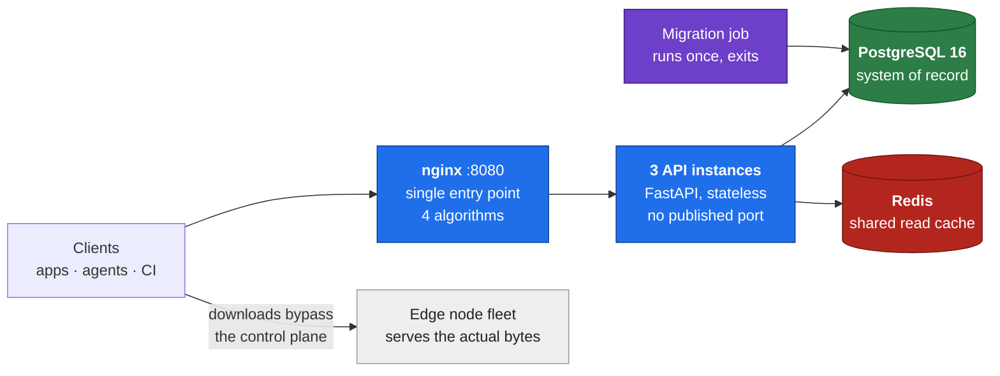
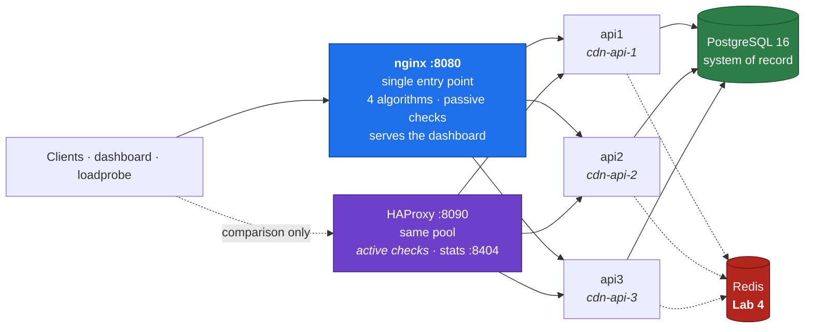

# CDN Control Plane API

Orchestration and management backend for a network of distributed edge nodes.

This service is the **brain** of a CDN, not its muscle. It never serves the content bytes.
It keeps the registry of thousands of edge servers, ingests their telemetry, decides which
node a client should download from, governs where content may be cached, and broadcasts
cache invalidations across the fleet.

> **Course:** Інженерія високонавантажених систем · **Lab 1** — System design and baseline
> prototype. The domain is fixed for the whole course; Labs 2–5 extend this codebase.

---

## Why this domain

The brief asks for a system with a genuine high-load profile. A CDN control plane has two
of them, pulling in opposite directions, and that tension is what makes every later lab
meaningful rather than academic:

| | Write-intensive | Read-intensive |
|---|---|---|
| Endpoint | `POST /nodes/{id}/heartbeat` | `GET /routing/resolve` |
| Driven by | Fleet size ÷ heartbeat interval | End-user download volume |
| At 10 000 nodes / 10 s | ~1 000 writes per second, constant | Millions of reads, bursty |
| Limited by | Physics — every write must reach disk | Repetition — the same answer recomputed |
| Answer | Make each write cheaper | Stop recomputing: cache (Lab 4) |

That asymmetry is the through-line of the whole project: **Lab 4 attacks the reads, Lab 5
measures the writes.**

### Peak load scenario — the *release storm*

The system's worst moment is a content release, because it lights up both sides at once:

1. CI publishes a new asset version → every replica is invalidated and a purge campaign
   opens against every node holding it.
2. The whole fleet acknowledges the purge — a write burst proportional to fleet size.
3. Simultaneously every client calls `/routing/resolve`, and for a window **no node is
   warm**, so routing must keep answering while the fleet re-pulls from origin.
4. Re-pulling spikes node bandwidth → raises reported load → changes routing eligibility.
   The write storm and the read storm feed each other.

Reproduced as Scenario C in the Lab 5 load tests.

---

## Quick start

One command, from a clean clone. No manual steps.

```bash
docker compose -f docker-compose.yml -f docker-compose.lab3.yml -f docker-compose.lab4.yml     --profile demo up -d --build     postgres migrate seed api1 api2 api3 redis lb haproxy agents
```

That starts PostgreSQL, waits for it to be healthy, runs migrations **once** in a
dedicated container, seeds a deterministic demo fleet, starts **three API instances behind
nginx** with a shared Redis cache, and launches a simulator standing in for the agents that
would run on real edge servers.

<details>
<summary>Single instance, without the balancer or the cache (Labs 1–2)</summary>

```bash
docker compose --profile demo up -d --build        # api has no published port since Lab 3
docker compose -f docker-compose.yml -f docker-compose.lab2.yml up -d postgres migrate api1 api2
```

The base `api` service no longer publishes a host port — Lab 3 removed it so that no instance
is reachable except through the balancer. Use the `docker-compose.lab2.yml` override, which
publishes 8001 and 8002, to reproduce the Lab 2 cross-instance demo.
</details>

That last piece matters. Real edge nodes heartbeat continuously; a seeded database has
the nodes but not the agents, so without it every node ages past
`HEARTBEAT_STALE_AFTER_SECONDS` and routing correctly reports that none is reachable.
The `agents` service supplies the missing half of the simulation rather than hiding the
symptom behind an inflated staleness threshold.

```
http://localhost:8080/             the Labs 3-4 dashboard, served by the balancer itself
http://localhost:8080/docs         interactive API documentation
http://localhost:8080/health       liveness
http://localhost:8080/health/ready readiness (verifies the database)
http://localhost:8080/lb-status    which balancing algorithm is live
http://localhost:8090/             the same pool via HAProxy (active health checks)
http://localhost:8404/             HAProxy stats: per-server state and session counts
localhost:5434                     PostgreSQL, if you want to inspect it directly
```

**No API instance publishes a host port, and neither does Redis** — the single entry point is
`:8080`. That is Lab 3's encapsulation requirement, and `./scripts/lab3_demo.ps1` asserts it.

`--profile demo` only gates `seed`: drop it to start with an empty database instead of
the demo fleet. `agents` is **not** profile-gated — it runs unconditionally (harmlessly,
against an empty database it just finds nothing to refresh) specifically so that a plain
`docker compose down`, with no flags, always sees and stops it. `agents` runs with
`restart: unless-stopped` to survive the readiness demo's `docker compose stop postgres`,
and a profile-gated service with that restart policy would be a trap: a `down` invocation
that didn't happen to include the matching `--profile` flag would leave it running and
orphan the network ("Resource is still in use").

Verify it end to end — registers a region, a node and an asset, reports telemetry,
resolves a route, publishes a version, watches the purge complete:

```powershell
./scripts/smoke.ps1                     # through the balancer on :8080 by default
```

<details>
<summary>Running without Docker (host Python)</summary>

```bash
python -m venv .venv
.venv/Scripts/pip install -r requirements-dev.txt
cp config/.env.example config/.env
docker compose up -d postgres
.venv/Scripts/python -m alembic upgrade head
.venv/Scripts/python -m scripts.seed
.venv/Scripts/python -m uvicorn app.main:app --reload
```
</details>

> **Port note.** PostgreSQL is published on **5434**, not 5432. On the development machine
> 5432 belongs to a native Windows PostgreSQL service and 5433 to another project's
> container. Inside the Compose network everything still uses `postgres:5432`.
> Host port **8080** — kept free since Lab 1 — is now the balancer, and `:8000` is gone.

---

## Architecture

Full breakdown, C4 diagrams and data flows: **[docs/architecture.md](docs/architecture.md)**



### Layout

```
app/
  core/        config, instance identity, JSON logging, middleware, RFC 9457 errors,
               pagination, fault injection (Lab 3 instrument)
  db/          declarative base with naming convention, async engine and pooled sessions
  models/      8 SQLAlchemy models
  schemas/     Pydantic request/response contracts
  services/    all business logic — routes never touch the ORM directly
               cache · cache_redis · cache_aside: the Lab 4 caching layer
  api/routes/  HTTP layer: parse, delegate, shape a response
loadbalancer/
  nginx/       nginx.conf, proxy.conf, 4 algorithm fragments, 6 pool fragments, switch.sh
  haproxy/     haproxy.cfg — the active-health-check variant
ui/            the Labs 3-4 dashboard, served by the balancer (vanilla HTML/CSS/JS)
migrations/    Alembic (async), one verified migration
scripts/       seed, edge-agent simulator, OpenAPI export, smoke test,
               loadprobe + experiment drivers + two clause-tagged defence demos
tests/         71 tests against a real PostgreSQL database, no Redis required
docker/        multi-stage Dockerfile, non-root, with HEALTHCHECK
docs/          architecture · data model · API reference · bottleneck analysis ·
               lab3-results · lab4-results · loadtest/ (raw JSON) · openapi.json
```

**Why the service layer exists:** Lab 4 wrapped caching around *services*, not routes, so the
cache benefits every caller and invalidation sits next to the mutation that triggers it. Had
the business logic lived in route handlers, adding a cache would have meant editing every
endpoint. It also turned out to be load-bearing rather than tidy: the agent simulator calls
the service layer in-process, never over HTTP, so route-level invalidation would have missed
every status transition it produces.

---

## Domain model

Eight entities. Full ER diagram, column semantics and index rationale:
**[docs/data-model.md](docs/data-model.md)**

| Entity | Role |
|---|---|
| `regions` | Geographic zones; drive proximity scoring |
| `edge_nodes` | The managed fleet, with denormalized live telemetry |
| `node_heartbeats` | Append-only telemetry — the write-intensive table |
| `assets` | Content metadata: hash, size, version, TTL |
| `distribution_rules` | Where an asset may be cached |
| `asset_replicas` | Which node holds which version — what routing joins on |
| `purge_events` | Tracked invalidation campaigns |
| `purge_acknowledgements` | Per-node confirmation, idempotent by primary key |

Two decisions worth noting:

- **`node_heartbeats` uses a `BIGINT` identity key, not a UUID.** Random UUIDs scatter
  inserts across the whole index; a monotonic key keeps every insert on the rightmost
  B-tree page. On the table taking the highest insert rate in the system, that dominates.
- **Node liveness is a SQL predicate, never a background timer.** Staleness is evaluated
  as `last_heartbeat_at >= now() - threshold` inside the routing query. No instance owns a
  reaper loop, so every instance reaches the same verdict without coordinating — which is
  why Lab 2 needs no change here.

---

## API

25 operations across 17 paths. Full reference with status codes and the error catalogue:
**[docs/api.md](docs/api.md)** · machine-readable: [docs/openapi.json](docs/openapi.json)
· live: `/docs`

| Group | Endpoints |
|---|---|
| **Ops** | `GET /health` · `GET /health/ready` |
| **Regions** | `GET`/`POST /api/v1/regions` |
| **Nodes** | `GET`/`POST /nodes` · `GET`/`PATCH`/`DELETE /nodes/{id}` · **`POST /nodes/{id}/heartbeat`** · `GET /nodes/{id}/replicas` · `PUT /nodes/{id}/replicas/{asset_id}` |
| **Assets** | `GET`/`POST /assets` · `GET`/`DELETE /assets/{id}` · **`POST /assets/{id}/versions`** · `GET`/`PUT /assets/{id}/distribution` |
| **Routing** | **`GET /routing/resolve`** |
| **Purges** | `GET`/`POST /purges` · `GET /purges/{id}` · `POST /purges/{id}/acknowledgements` |
| **Stats** | `GET /stats/network` |

The three bold endpoints are where the system's character lives.

### `GET /routing/resolve` — the read hot path

Ranked edge nodes for one asset, computed entirely inside PostgreSQL — the application
never materialises the fleet in memory and never sorts in Python. Query count is constant
(2–3) regardless of fleet size: no N+1.

```
score = proximity_penalty            (0 same region | 25 same continent | 60 otherwise)
      + cold_penalty                 (0 if the node holds the current version | 40 if not)
      + 0.5 * current_load_percent   (0 .. 50)
```

Proximity outranks load because for a CDN distance is the whole product. The cold penalty
sits *between* the proximity tiers, so a warm node one continent away still beats a cold
node next door — an origin pull costs more than the extra network distance.

```bash
curl -i "http://localhost:8080/api/v1/routing/resolve?path=/static/app.bundle.js&client_region=eu-central&limit=3"
```

```
edge-eu-central-01   score 11.0   same region as client; holds the current version; 22% loaded
edge-eu-central-02   score 28.5   same region as client; holds the current version; 57% loaded
edge-eu-west-02      score 31.0   same continent, serving eu-central from eu-west; 12% loaded
```

`edge-eu-central-03` is absent — it reported 91% load and was automatically demoted to
`degraded`. Every candidate carries a readable `reason`, because a routing decision that
cannot be explained cannot be debugged.

### `POST /nodes/{id}/heartbeat` — the write hot path

One transaction, two statements: append a telemetry row, update the node's denormalized
liveness columns. Load is `max(cpu, memory, bandwidth ÷ capacity)` — the worst signal wins.
Crossing the overload threshold demotes the node to `degraded` and it stops receiving
traffic; dropping back promotes it. **That is the "automatically eject overloaded servers"
requirement**, with no operator action and no background job.

### `POST /assets/{id}/versions` — cross-entity business logic

Publishing new content does three things in **one transaction**: bumps the version, marks
every replica stale, and opens a purge campaign against the nodes holding it. Any partial
outcome would leave edge nodes serving bytes the control plane believes are gone.

The asset row is locked `FOR UPDATE` for the duration — two concurrent CI pipelines would
otherwise both read version N and both write N+1, losing a release.

---

## Bottleneck analysis

Seven degradation points in *Component / Root Cause / Symptoms* form, with mitigations:
**[docs/bottlenecks.md](docs/bottlenecks.md)**

| # | Component | Root cause | First symptom | Status |
|---|---|---|---|---|
| 1 | `node_heartbeats` insert storm | WAL + index write amplification, autovacuum lag | p99 write latency, table bloat | Lab 5 measures; partitioning after |
| 2 | `edge_nodes` hot-row update | Row lock contention, MVCC churn | Lock waits, per-node tail latency | Lab 5 |
| 3 | `/routing/resolve` join | Uncached recomputation on the hottest read | DB CPU saturates before the app does | **Lab 4 — fixed.** Rows read per request 798 → 4.1, PostgreSQL CPU 43.9 % → 6.5 % |
| 4 | Connection pool | `(pool + overflow) × instances` vs `max_connections` | Queueing latency with *falling* DB CPU | **Lab 3 — measured.** 22 / 42 / 62 / 74 connections at 1–4 instances; a 5th would need 102 of 100 |
| 5 | Synchronous purge fan-out | O(fleet) work inside one HTTP request | Timeouts, head-of-line blocking | later lab (broker) |
| 6 | Unbounded reads and aggregates | Full scans, `OFFSET` pagination, `COUNT(*)` | Memory spikes, slow deep pages | mitigated in Lab 1; **`/stats/network` cached in Lab 4** |
| 7 | **The load balancer itself** | Single entry point: a SPOF, and eventually a capacity limit | Total outage if it dies; `worker_connections` / ephemeral ports at scale | **Introduced by Lab 3.** Measured at 4.5–8.9 % CPU, so not yet a capacity limit; the SPOF is real and discussed |

Predictions 3 and 4 were made in Lab 1 before any of this code existed, and both turned out
right — which is the useful outcome of writing them down early. Lab 5 takes on the write path.
Bottleneck 7 is one this work *created*: a solved bottleneck that hands you a new one is the
normal shape of scaling, and an analysis that never grows is one that stopped being read.

---

## Module ownership

Solo project; every module is authored and defended by one person.

| Module | Files | Owner | Responsible for |
|---|---|---|---|
| Domain and data model | `app/models/`, `migrations/` | Kateryna Ostrovska | Entity design, indexes, constraints, migration correctness |
| Service layer | `app/services/` | Kateryna Ostrovska | Routing algorithm, telemetry ingest, purge lifecycle, transaction boundaries |
| API layer | `app/api/`, `app/schemas/` | Kateryna Ostrovska | REST design, validation, RFC 9457 error contract, OpenAPI |
| Platform | `app/core/`, `app/db/` | Kateryna Ostrovska | Configuration, logging, middleware, pooling, statelessness discipline |
| Infrastructure | `docker/`, `docker-compose.yml` | Kateryna Ostrovska | Containerization, one-command deploy, migration ordering |
| Quality | `tests/`, `.pre-commit-config.yaml` | Kateryna Ostrovska | Test suite, lint and format gates |
| Documentation | `docs/`, `README.md` | Kateryna Ostrovska | Architecture, data model, API reference, bottleneck analysis |

---

## Verification

Everything below was executed against the running stack.

| Check | Command | Result |
|---|---|---|
| Cold start, one command | the three-file `up -d --build` above | postgres healthy → migrate exit 0 → seed exit 0 → three instances healthy → nginx, HAProxy, Redis and agents running |
| Fleet stays routable unattended | left running past the staleness threshold | `/routing/resolve` still `200`; the `agents` service keeps telemetry fresh with no manual step |
| Liveness / readiness | `curl /health`, `curl /health/ready` | `200` / `200` |
| Readiness fails correctly | `docker compose stop postgres` | `/health` stays `200`, `/health/ready` returns `503` problem+json; both recover on restart |
| End-to-end business flow | `./scripts/smoke.ps1` | 14 steps, all expected status codes |
| **Data persistence** | `docker compose restart postgres` | 13 nodes / 9 assets / 74 replicas before **and** after; pool reconnects automatically |
| Migration integrity | `alembic upgrade head` → `check` → `downgrade base` → `upgrade head` | Applies, no drift, tears down and re-applies cleanly |
| **Lab 3** — encapsulation | `docker compose … port api1 8000` | `invalid IP:0` for all three instances; only `:8080`, `:8090`, `:8404`, `:5434` are published |
| **Lab 3** — distribution | 45 requests per algorithm | round robin 15/15/15 · weighted 25/15/5 (= 55.6 / 33.3 / 11.1 %) · ip hash 30/0/0 |
| **Lab 3** — live algorithm switch | `./scripts/lb_switch.ps1 -Algorithm least-conn` | reload applied, **0 failed requests** across the switch |
| **Lab 3** — node failure | `docker compose stop api2` under load | **0 non-2xx** in 7 651 requests; rejoins automatically on `start` |
| **Lab 3** — alive-but-broken instance | api2 pointed at a dead database | nginx passive-only let **23 × HTTP 500** through; HAProxy's active check: **0** |
| **Lab 3** — scale-out | 1 / 2 / 3 / 4 instances, 64 VUs, cache off | 98.4 → 170.8 → 208.5 → **222.3 req/s** (efficiency 100 % → 56 %); nginx CPU only 4.0 → 12.1 % |
| **Lab 4** — cache hit | two identical reads | `X-Cache: MISS` then `HIT`; **109 ms → 2.2 ms** server-side |
| **Lab 4** — genuinely shared | 20 hot reads through the balancer | stored by one instance, served by **all three** |
| **Lab 4** — DB offload | 64 VUs, cache off vs on | rows read per request **798 → 4.1**; PostgreSQL CPU 43.9 % → 6.5 %; +43.9 % throughput |
| **Lab 4** — invalidation | publish a version, read again | `HIT` → `MISS` with the new version → `HIT` |
| **Lab 4** — Redis down | `docker compose stop redis` | every request still `200` with `X-Cache: BYPASS`, **0 errors**; degraded in 824 ms; refills itself on restart |
| Tests | `pytest` | **71 passed**, with no Redis and no balancer needed |
| Lint and format | `ruff check .` · `ruff format --check .` | clean |

```bash
.venv/Scripts/python -m pytest                    # 71 tests against real PostgreSQL
.venv/Scripts/python -m ruff check .
.venv/Scripts/python -m alembic check             # no model/schema drift
.venv/Scripts/pre-commit install                  # one-time, registers the git hook
.venv/Scripts/python -m scripts.export_openapi    # regenerate docs/openapi.json
```

The cache tests use an in-memory double injected over the `get_cache` dependency, and
`CACHE_ENABLED` defaults to false, so **the suite and CI need neither Redis nor a balancer.**
That is deliberate: "the cache tests need infrastructure" is how this kind of coverage rots.

Tests run against a real PostgreSQL instance, not SQLite: the schema relies on native enum
types, `INET` and `INSERT ... ON CONFLICT`, so a suite on a different engine would prove
very little about the code that ships.

### Defence checklist

**Labs 1–2** — one script covers both: `./scripts/defence_demo.ps1`

1. `docker compose down -v` then the cold deploy above
2. `./scripts/smoke.ps1` — well past the required five endpoints, with status codes asserted
3. `docker compose restart postgres`, re-query — data persistence
4. `docker compose stop postgres`, show `/health` `200` vs `/health/ready` `503`
5. Show `edge-eu-central-03` (91% load) missing from routing — automatic ejection
6. Resolve `/downloads/patch-eu-2026.bin` from `client_region=us-east` — only EU nodes
   returned, proving the distribution policy holds

**Lab 3** — `./scripts/lab3_demo.ps1` (12 clause-tagged checks, each asserted)

**Lab 4** — `./scripts/lab4_demo.ps1` (9 clause-tagged checks, each asserted)

Both print a PASS table and fail loudly rather than quietly, so a regression cannot slip
through a live demo. Open `http://localhost:8080/` alongside them — the dashboard shows the
distribution, the cache outcome and the request log as they happen.

---

<!-- Lab2 -->
## Lab 2 — Stateless architecture

The application tier is stateless by design, so this lab is an audit and a proof rather
than a refactor: there were no in-memory collections, singletons, local locks or file
sessions to remove.

### State audit

| Category | What belongs here | Where it lives |
|---|---|---|
| **Ephemeral / Local Safe** | Request id, response timing, access logs, the SQLAlchemy connection pool, logging config | Per-request `Request` object (dies with the request) or per-process, never shared, never business data |
| **Shared / Externalized** | All business state: nodes, heartbeats, assets, replicas, distribution policy, purges and their acknowledgements | PostgreSQL — the single system of record every instance reads and writes |
| **Critical Stateful Dependencies** (must be removed) | In-memory collections, singletons with business data, local caches, application-level locks, local counters, file sessions | **None.** See the enforced rules in [docs/architecture.md](docs/architecture.md#statelessness-rules) |

**In-memory dependencies removed: none.** The design never introduced them. `@lru_cache`
is used only over immutable configuration (`get_settings`, `get_instance_id`); node
staleness is a SQL predicate, not an in-process reaper; the read-path cache is a
`NullCache` behind the `CacheBackend` seam, so no instance holds cached data locally.

> **Amended by Lab 4.** The read-path cache is now Redis rather than `NullCache` — and that
> *demonstrates* this audit rather than weakening it. The cache is shared external state, in
> the same category as PostgreSQL: any instance serves any request from the same entry (proven
> live — stored by one instance, served by all three), and killing an instance loses no cached
> content. The only new per-process objects are a Redis connection pool and each backend's
> circuit-breaker state, both *Ephemeral / Local Safe*. An in-process cache would have been the
> textbook violation of this table; a shared one is not.

### Stateless request flow (asset update)

`POST /assets/{id}/versions` carries no state between requests:

1. **Input** — `asset_id` in the path, new `content_hash` / `size_bytes` / `requested_by`
   in the body. No server-side session or context token.
2. **Read context** — the current asset and its replicas are read from PostgreSQL.
3. **Atomic change** — version bump, replica invalidation and the purge campaign are
   committed in one database transaction.
4. **No residual mutation** — after the response, nothing about the asset remains in the
   process; the next request re-reads it from the database, on any instance.

### Run two instances

```bash
docker compose -f docker-compose.yml -f docker-compose.lab2.yml up -d postgres migrate api1 api2
docker compose -f docker-compose.yml -f docker-compose.lab2.yml ps
```

`api1` → `http://localhost:8001` (`X-Instance-ID: cdn-api-1`), `api2` →
`http://localhost:8002` (`X-Instance-ID: cdn-api-2`). Both are built from the same image;
the base `docker-compose.yml` is unchanged.

### Cross-instance consistency

Scripted: `./scripts/lab2_consistency.ps1`. By hand (`-i` shows `X-Instance-ID`):

```bash
# POST -> Instance 1 (create), capture the returned id
curl -i -X POST http://localhost:8001/api/v1/assets \
  -H "Content-Type: application/json" \
  -d '{"origin_path":"/static/x.js","content_hash":"'$(printf 'a%.0s' {1..64})'","size_bytes":512000,"content_type":"application/javascript"}'

# GET -> Instance 2: sees version 1 written by Instance 1
curl -i http://localhost:8002/api/v1/assets/<id>

# UPDATE -> Instance 2: publish version 2
curl -i -X POST http://localhost:8002/api/v1/assets/<id>/versions \
  -H "Content-Type: application/json" \
  -d '{"content_hash":"'$(printf 'b%.0s' {1..64})'","size_bytes":521400,"requested_by":"lab2"}'

# GET -> Instance 1: sees version 2 written by Instance 2
curl -i http://localhost:8001/api/v1/assets/<id>
```

No sticky sessions: `X-Instance-ID` alternates while the data stays consistent.

### Resilience (instance loss)

```bash
docker compose -f docker-compose.yml -f docker-compose.lab2.yml kill api1
curl -i http://localhost:8002/api/v1/assets/<id>   # survivor still returns version 2
```

Killing an instance loses nothing: the business state is in PostgreSQL, and the surviving
instance keeps serving every request.

---

<!-- Lab3 -->
## Lab 3 — Horizontal scaling and load balancing

Three interchangeable API instances behind one entry point, four balancing algorithms,
passive **and** active health checking, and a measured answer to the question the lab really
asks: *once you have scaled the compute tier, what becomes the limit?*

Every number in this section was produced by `./scripts/lab3_experiments.ps1` on the machine
recorded in **[docs/lab3-results.md](docs/lab3-results.md)**, which also holds the full tables,
the per-second timelines and the raw JSON.

| Requirement | Where it is |
|---|---|
| ≥2 replicas, shared storage, own Instance-ID | `api1` / `api2` / `api3` in [docker-compose.lab3.yml](docker-compose.lab3.yml); `X-Instance-ID` on every response |
| Single entry point, instances unreachable | nginx on `:8080`; no `ports:` on any instance, and the base `api` mapping removed |
| Round Robin + alternatives | [loadbalancer/nginx/algorithms/](loadbalancer/nginx/algorithms/) — round robin, least connections, weighted, IP hash |
| Asymmetric-load comparison (p99, utilisation) | E2 below, three independent instruments |
| `GET /health` readiness + auto-ejection | [app/api/routes/health.py](app/api/routes/health.py); `max_fails`/`fail_timeout` in nginx, `option httpchk` in HAProxy |
| Node failure without 5xx | E4 — 7 651 requests, **0 client-visible errors** |
| Scale-out at 1 / 2 / 3+ instances | E3 below — measured at 1, 2, 3 **and 4** |
| Next bottleneck after scaling | "What became the bottleneck" below, with the counter-evidence |
| Balancer configs committed | [loadbalancer/](loadbalancer/) |
| Updated architecture diagram | [docs/architecture.md](docs/architecture.md) |

### The topology



```bash
docker compose -f docker-compose.yml -f docker-compose.lab3.yml --profile demo up -d --build \
    postgres migrate seed api1 api2 api3 lb haproxy agents
```

### Full encapsulation

No instance publishes a host port, so the only way in is the balancer:

```console
$ docker compose … port api1 8000
invalid IP:0                          # nothing published

$ docker compose … ps
SERVICE   STATUS               PORTS
api1      Up (healthy)         8000/tcp                     <- container-internal only
api2      Up (healthy)         8000/tcp
api3      Up (healthy)         8000/tcp
lb        Up (healthy)         0.0.0.0:8080->80/tcp
haproxy   Up                   0.0.0.0:8090->8080/tcp, 0.0.0.0:8404->8404/tcp
```

The dashboard is served **by the balancer**, not by an instance, for the same reason: a page
served from `api2` would vanish the moment `api2` is killed — which is the one demo that must
keep working.

> The proof to show is "no published port", not "connection to `:8000` refused". On this
> machine another project's dev server happens to listen on 8000, which proves nothing either
> way; `docker compose port` and `ps` are the honest evidence.

### Theory: what a balancer actually decides

An L7 reverse proxy terminates the client connection, chooses a peer **per request**, and can
therefore read and rewrite HTTP. An L4 balancer forwards packets and chooses per *connection* —
cheaper, but it cannot retry a failed request, inspect a path, or add `X-Forwarded-For`. The
retry behaviour below is only possible at L7.

| Algorithm | How it picks | When it wins | Failure mode |
|---|---|---|---|
| **Round Robin** | next peer in order, by request count | homogeneous pool, uniform request cost | keeps feeding a slow peer its full 1/N share while its queue grows without bound |
| **Least Connections** | fewest in-flight requests | mixed request costs, or one degraded peer | needs accurate in-flight counts; in nginx OSS those are *per worker* |
| **Weighted RR** | share proportional to weight | genuinely heterogeneous hardware | on an even pool it only concentrates load and lowers throughput |
| **IP Hash** | hash of the client address | session affinity without cookies | one client IP ⇒ one peer; behind NAT the whole population collapses onto one peer |

**One nginx worker, deliberately.** nginx keeps balancing state *per worker*. With
`worker_processes auto` (14 workers here) each worker round-robins independently, so a
sequential client lands on peer #1 every time, and `least_conn` compares only the connections
that one worker happens to own. Measured: 9 sequential requests across 14 workers went
**9/0/0**; with one worker they go **1-2-3-1-2-3**. Setting `worker_processes 1` makes the
measurement describe the algorithm instead of the worker count — and it is the honest answer
to "is least connections exact in nginx?": no, in OSS it is per-worker approximate.

### Measured: distribution per algorithm

32 virtual users, 20 s, three identical instances.

| Algorithm | RPS | p50 ms | p95 ms | p99 ms | api1 | api2 | api3 |
|---|---|---|---|---|---|---|---|
| Round Robin | 228.4 | 63.7 | 407.8 | 691.9 | 33.3 % | 33.3 % | 33.3 % |
| Least Connections | **246.0** | 126.0 | **160.4** | **228.1** | 34.0 % | 32.8 % | 33.2 % |
| Weighted 5:3:1 | 189.9 | 190.0 | 394.5 | 533.3 | **55.5 %** | **33.3 %** | **11.1 %** |
| IP Hash | 110.2 | 282.3 | 347.2 | 411.4 | — | — | **100 %** |

Three things worth saying out loud at the defence:

- **Weighted RR reproduced its configured ratio to one decimal place** (55.5 / 33.3 / 11.1
  against the ideal 55.6 / 33.3 / 11.1) — and still came last on throughput, because the pool
  is homogeneous. Weights model hardware; inventing them on even hardware just creates a
  hotspot.
- **IP Hash reached only 110 RPS** — one third of the pool, because one client address means
  one peer. Affinity, not balancing.
- **Least Connections beat Round Robin on the tail even with no slow node** (p99 228 ms vs
  692 ms) while its p50 looked worse (126 ms vs 64 ms). Round Robin produces a *bimodal*
  distribution — most requests are fast, a minority queue behind a momentarily busy peer;
  least connections equalises queue depth, so the median rises and the tail collapses. This is
  the whole argument for reporting percentiles rather than averages.

**IP Hash, measured honestly.** From the host every request is NATed to one gateway address,
so all 30 landed on one instance. Probing from eight containers in **different /24s** spread
them across all three peers, each one stable:

| Source | 172.19.5.11 | .6.11 | .7.11 | .8.11 | .9.11 | .10.11 | .11.11 | .12.11 |
|---|---|---|---|---|---|---|---|---|
| Instance | api2 | api3 | api1 | api2 | api3 | api1 | api2 | api3 |

Six addresses *within one* /24 all went to the same peer, because **nginx hashes only the
first three octets**. So `ip_hash` buckets subnets, not clients — behind a corporate NAT or a
mobile carrier it degrades to no balancing at all, which is why cookie-based and
consistent-hash affinity replaced it in practice.

### Live algorithm switch, with no dropped requests

```powershell
./scripts/lb_switch.ps1 -Algorithm least-conn      # nginx: reload
./scripts/lb_switch.ps1 -Balancer haproxy -Algorithm roundrobin
```

The upstream is composed from two fragments — one naming the algorithm
([algorithms/](loadbalancer/nginx/algorithms/)) and one naming the pool members
([pools/](loadbalancer/nginx/pools/)) — because the algorithm and the instance count vary
independently, and a combined set would be a 4 × 3 matrix of near-identical files.
[switch.sh](loadbalancer/nginx/switch.sh) copies the chosen pair into place, runs `nginx -t`,
then `nginx -s reload`.

A reload starts new workers on the new configuration and lets the old workers finish their
in-flight requests before exiting, so **no connection is dropped** — a probe spanning the
switch records zero errors. And a configuration that fails `nginx -t` is never loaded: a
reload with a broken config is a no-op on a running master, so the worst case is "nothing
happened", never an outage. `switch.sh` validates first anyway, to turn a silent non-switch
into a visible error.

### Measured: Round Robin vs Least Connections under asymmetric load

The assignment asks for a synthetic delay on one instance. One instrument would have proved
very little, so `api2` was slowed **three different ways** — and the conclusion is reported
only where all three agree.

| Instrument | What it models | Touches app code? |
|---|---|---|
| `FAULT_CPU_SPIN_MS=120` | a saturated node: busy-loop blocks the event loop and burns real CPU | yes, [app/core/fault.py](app/core/fault.py) |
| `FAULT_DELAY_MS=150` | a slow dependency: `await asyncio.sleep`, holds a connection and a worker slot but no CPU | yes, same file |
| `cpus: "0.25"` | genuinely less hardware | **no** — [docker-compose.lab3-slow-cpu.yml](docker-compose.lab3-slow-cpu.yml) |

Both knobs default to 0, the middleware is only installed when one is set, and **`/health*` is
never delayed** — otherwise the slow node fails its readiness probe, leaves the pool, and the
latency experiment silently becomes the failover experiment.

64 virtual users, 30 s per run:

| Run | RPS | p99 ms | api1 share | api2 share | api3 share |
|---|---|---|---|---|---|
| spin, Round Robin | 58.8 | **10 462** | 45.0 % | 9.9 % | 45.1 % |
| spin, Least Conn | **197.1** | **3 002** | 48.9 % | 3.7 % | 47.3 % |
| CPU quota, Round Robin | 74.5 | **6 185** | 33.4 % | 33.3 % | 33.4 % |
| CPU quota, Least Conn | **204.8** | **1 391** | 46.2 % | 9.2 % | 44.6 % |
| sleep, Round Robin | 228.2 | 1 330 | 33.3 % | 33.3 % | 33.3 % |
| sleep, Least Conn | 216.3 | **810** | 36.9 % | 27.3 % | 35.7 % |

Shares are of *completed* responses, so a saturated peer looks smaller than the third Round
Robin actually dispatches to it — that gap **is** the symptom.

Now the resource utilisation the assignment asks about, mean CPU per container during each run:

| Run | api1 | api2 (slow) | api3 | nginx | postgres |
|---|---|---|---|---|---|
| spin, Round Robin | 20.3 % | **83.0 %** | 25.1 % | 2.1 % | 28.0 % |
| spin, Least Conn | **91.5 %** | 91.4 % | **92.5 %** | 7.2 % | 40.5 % |
| CPU quota, Round Robin | 19.9 % | **24.8 %** (at its 0.25-CPU cap) | 20.3 % | 3.7 % | 23.8 % |
| CPU quota, Least Conn | **92.5 %** | 23.1 % (capped) | **87.7 %** | 7.4 % | 44.2 % |

**The conclusion.** Under Round Robin the degraded node is pinned while the two healthy nodes
sit at ~20 % CPU: the pool is starved of work it could do, and the system's p99 is 10.5 s. Under
Least Connections the healthy nodes run at ~92 %, the slow node is shed down to 3.7 % of traffic,
throughput rises **3.4×** and p99 falls **3.5×**. The CPU-quota run — with no application code
involved at all — says the same thing, 2.7× throughput and 4.4× lower p99. Per-instance p99 makes
it vivid: under Round Robin with the CPU cap, `api2` answered at 7 965 ms while `api1` and `api3`
answered at 34 ms and 32 ms.

**And the case where it barely helps.** With `asyncio.sleep` the two algorithms are nearly
equal on throughput (228 vs 216 RPS). An async sleep adds latency without consuming capacity:
`api2` still completes its full third, it is just slower doing it, so there is little queue for
least connections to see. The honest rule is therefore narrower than "least connections is
better": **it wins when the slow peer has lost capacity, not merely when it has gained
latency** — and it still improved the tail here (p99 810 ms vs 1 330 ms) because it moved work
off the peer with the longest queue.

### Health checking: passive, active, and what each one cannot see

| | Passive (nginx OSS) | Active (HAProxy) |
|---|---|---|
| Mechanism | `max_fails` / `fail_timeout`, plus `proxy_next_upstream` to retry the failed request | `option httpchk GET /health/ready`, `check inter 2s fall 2 rise 2` |
| Detects a failure | only by failing a real client request | before any client request reaches the peer |
| Detection delay | immediate for the request that hits it | ~4 s (`inter × fall`) |
| Cost | none | one probe per peer per interval |
| Sees "alive but broken"? | **no** | **yes** |
| Recovery | re-probed with a real request after `fail_timeout` | automatic on `rise` consecutive successes |

The application supports both because Lab 1 separated the two questions: `GET /health` answers
"the process runs" and deliberately touches nothing — a liveness probe that queried the
database would turn a database blip into a fleet-wide restart — while `GET /health/ready`
executes `SELECT 1` and returns 503 when it cannot.

**`proxy_next_upstream` is what keeps failures off the client.** A connect error, a read
timeout or an upstream 5xx makes nginx try the next peer *inside the same client request*. The
balancer's own log shows it happening:

```
"GET /health/ready" 200 upstream=172.19.0.6:8000, 172.19.0.3:8000 upstream_status=504, 200
"GET /health/ready" 200 upstream=172.19.0.7:8000, 172.19.0.6:8000, 172.19.0.3:8000 upstream_status=502, 502, 200
```

Two and three upstreams tried, `200` delivered. The list includes `non_idempotent`, so POSTs
are retried too — without it the guarantee would cover reads only. The trade-off is
at-least-once delivery, which is safe *for this API specifically*: heartbeats are append-only,
purge acknowledgements are idempotent by composite key, replica reports are upserts. The one
visible cost is that a `POST /assets` whose first attempt committed and then died answers 409
instead of 201.

#### Measured: killing a node mid-run

`api2` stopped 14 s into a 40 s run and started again 14 s later.

| Through | Requests | Client-visible errors | api2 out of the pool |
|---|---|---|---|
| nginx `:8080` | 7 651 | **0** | 21 s |
| HAProxy `:8090` | 6 901 | 1 (0.014 %) | 20 s |

The per-second timeline through nginx:

| t (s) | RPS | errors | instances answering |
|---|---|---|---|
| 9 | 240 | 0 | api1 80 · api2 80 · api3 80 |
| 10 | 203 | 0 | api1 81 · **api2 40** · api3 82 |
| 11 | 171 | 0 | api1 86 · api3 85 |
| … | ~190 | 0 | two instances carry the pool |
| 32 | 147 | 0 | api1 57 · **api2 32** · api3 58 |
| 34 | 237 | 0 | api1 79 · api2 79 · api3 79 |

Throughput falls by the missing third and recovers on its own. Note that nginx's *reactive*
retry handled this better than HAProxy's active checks — which is expected: a stopped container
refuses connections instantly, and that is precisely the case `proxy_next_upstream` rescues.

#### The failure only an active check catches

A container that is *stopped* is easy. The hard case is an instance that is **alive and
listening but cannot reach the database** — nothing is "down", yet everything it serves fails.
`api2` was pointed at a non-existent database host
([docker-compose.lab3-broken-db.yml](docker-compose.lab3-broken-db.yml)):

```console
$ docker exec … curl -s -o /dev/null -w "%{http_code}" http://localhost:8000/health
200                 # liveness: the process is fine
$ docker exec … curl -s -o /dev/null -w "%{http_code}" http://localhost:8000/health/ready
503                 # readiness: it cannot serve traffic
```

| Through | Requests in 20 s | HTTP 500 at the client |
|---|---|---|
| nginx — passive only | 1 859 | **23** |
| HAProxy — active check | 3 269 | **0** |

nginx keeps routing a third of the traffic to it: a 500 is an application answer, not a
connection failure, so `max_fails` never counts it and `proxy_next_upstream` does not retry it
(deliberately — retrying a 500 on another peer multiplies the damage). Worse than the 23 errors,
throughput collapsed to single digits as virtual users piled up on the broken instance.
HAProxy removed it within ~4 s and never looked back. **That is the argument for active
checks, and it is why both configurations are committed.**

#### Passive checks conflate "slow" with "dead"

Found by accident, then reproduced. With `max_fails=1`, one connection reset from a *saturated*
peer is enough to eject it for a full `fail_timeout`. It happened first during a scale-out run —
nginx's log recorded

```
recv() failed (104: Connection reset by peer) … upstream server temporarily disabled
```

and the pool's throughput fell from ~190 to ~110 RPS for the rest of the run, with **zero
errors at the client**, because the survivor absorbed everything. Two instances at 256 virtual
users reproduce it:

| Setting | RPS | p99 ms | Errors | api1 / api2 |
|---|---|---|---|---|
| `max_fails=1 fail_timeout=10s` | 163.0 | 6 103 | 2 | **68.0 % / 32.0 %** |
| `max_fails=3 fail_timeout=5s` | **190.1** | **5 081** | **0** | 50.0 % / 50.0 % |
| `max_fails=1` (second trial) | 189.4 | 5 097 | 3 | 53.7 % / 46.3 % |
| `max_fails=3` (second trial) | 189.3 | 5 328 | 1 | 50.0 % / 50.0 % |

The magnitude varies between trials because it depends on whether a peer happens to reset a
connection; the direction does not. The shipped pools therefore require a **streak** of three
failures within five seconds. Failover correctness does not depend on that number —
`proxy_next_upstream` is what keeps a dead peer off the client — so the only thing `max_fails=1`
buys is an earlier ejection, and under load it buys it at the price of ejecting healthy peers.

### Measured: scale-out at 1, 2 and 3 instances

> **Calibrate the load generator first, or measure nothing.** One Python process driving httpx
> tops out at ~115 RPS on this machine — *below* what the pool can serve. Two processes reached
> 228 RPS and four reached 383 RPS against the same endpoint. The first version of this
> experiment used one process and reported 1 instance ≈ 3 instances ≈ 110 RPS, which was the
> probe's ceiling, not the system's. `scripts/loadprobe.py` therefore spreads the load over
> processes, and `--calibrate` re-measures the ceiling on any other machine.

64 virtual users, Round Robin, unused instances stopped:

| Instances | RPS | Speed-up | Efficiency | p50 ms | p99 ms | PG connections (idle → peak) |
|---|---|---|---|---|---|---|
| 1 | 98.4 | 1.00× | 100 % | 601.5 | 2 298 | 12 → 22 |
| 2 | 170.8 | 1.74× | 87 % | 266.7 | 1 296 | 22 → 42 |
| 3 | 208.5 | 2.12× | 71 % | 271.2 | 817 | 32 → 62 |
| **4** | **222.3** | **2.26×** | **56 %** | 102.3 | 2 084 | 6 → 74 |

Scaling is real but **sub-linear, and the efficiency falls steadily**: 87 % at two, 71 % at
three, 56 % at four. The fourth instance bought only **+6.6 %** — the curve has flattened, so
something shared is absorbing the gains.

> **The cache must be off for this measurement, and the script now enforces it.** The first
> attempt ran against the Lab 4 stack, where a *one-instance* pool answered **287.9 req/s** from
> Redis at a 99 % hit ratio while four instances managed 284.0 — a result that says nothing
> whatsoever about scaling. `lab3_experiments.ps1` disables the cache on every instance for the
> duration and aborts unless `X-Cache` reports `BYPASS`. This is why Redis lives in its own
> compose file rather than the base one.

### What became the bottleneck after scaling the compute tier

The candidates the assignment lists are database connection pool, network I/O, load-balancer
CPU and shared-storage locks. Mean CPU per container during those four runs:

| Instances | api1 | api2 | api3 | api4 | **nginx** | **postgres** |
|---|---|---|---|---|---|---|
| 1 | 87.4 % | — | — | — | **4.0 %** | **27.0 %** |
| 2 | 91.4 % | 89.1 % | — | — | **7.0 %** | **37.2 %** |
| 3 | 92.0 % | 86.4 % | 92.1 % | — | **9.2 %** | **66.0 %** |
| 4 | 96.2 % | 94.9 % | 95.6 % | 92.9 % | **12.1 %** | **58.0 %** |

Three of the four candidates are ruled out directly:

- **The load balancer.** 4.0 % → 12.1 % CPU while serving 222 req/s. One nginx worker has an
  enormous amount of headroom left.
- **Network I/O.** Throughput rose with every instance added; a saturated link would have
  flattened the curve, not bent it.
- **Shared-storage locks.** The measured endpoint is a read and every run was error-free, so
  there were no lock waits or timeouts.

**And then the fourth instance corrected the conclusion — which is exactly why it was worth
running.** From the first three points, PostgreSQL CPU rising 27 % → 37 % → 66 % extrapolated
cleanly to saturation at about four instances, and an earlier draft of this section said so. The
measurement disagrees: at four instances throughput gained only 6.6 %, **all four API containers
sat at 93–96 % CPU, and PostgreSQL CPU *fell* to 58 %.** The fourth instance never got a free
core — on one laptop four API processes, PostgreSQL, Redis, both balancers and a four-process
load generator contend for the same CPUs. The binding constraint at that point is **host CPU
contention**, not the database.

So the honest answer has two parts, and both are worth giving:

1. **On this hardware**, what limits the system after the compute tier is scaled is the host's
   own CPU: there is no spare core for a fifth single-worker instance to use, which is why the
   curve flattens rather than breaks.
2. **On hardware with a core per instance**, the next hard wall is PostgreSQL's **connection
   ceiling** — and that one is arithmetic, not extrapolation. Peak connections were
   22 / 42 / 62 / 74, i.e. `(DB_POOL_SIZE + DB_MAX_OVERFLOW) × instances + 2`, against a default
   `max_connections` of 100, so **a fifth instance would ask for 102 and start being refused.**
   Database CPU is the constraint behind it, already two thirds consumed at three instances.

The fixes are the familiar ones
and they are now *motivated by numbers*: a smaller per-instance pool (the product, not the pool,
is what matters), PgBouncer to multiplex, read replicas for the read path — and, the cheapest of
all, **caching the hottest read so it never reaches the database**, which is exactly what Lab 4
does next.

### The balancer is now the single point of failure

Lab 2 removed the instances as a single point of failure; Lab 3 introduced a new one in front of
them. Three ways to remove it, with what each costs:

| Approach | How it works | Cost / what it leaves unsolved |
|---|---|---|
| **Keepalived / VRRP** | two balancers share a floating virtual IP; the backup takes it over by advertisement | sub-second failover, but needs L2 adjacency between them and leaves one node idle |
| **Health-checked DNS round robin** | several balancer addresses in DNS, unhealthy ones withdrawn | no shared address needed, but failover is bounded by TTL and by client-side caching that ignores it |
| **L4 ECMP / anycast, or a managed cloud LB** | the network itself spreads traffic across balancer nodes | genuinely horizontal, at real operational cost |

Worth saying as well: the balancer is also a *capacity* limit in principle —
`worker_connections`, ephemeral ports, one NIC — though the measurement above shows it is
nowhere near that here. It is written up as bottleneck #7 in
[docs/bottlenecks.md](docs/bottlenecks.md), because a bottleneck this lab *created* belongs in
the analysis.

### nginx OSS limitations worth owning at the defence

- **No active health checks.** `health_check` is nginx Plus. E8 above is what that costs.
- **Upstream names are resolved once, at startup.** A recreated container with a new address is
  not picked up without a reload; HAProxy's `resolvers` section re-resolves on a timer. The
  attempt to measure this produced a **null result** — Docker handed the recreated container the
  same address back — and it is recorded as such in [docs/lab3-results.md](docs/lab3-results.md)
  rather than dressed up.
- **It fails closed on an unresolvable name.** Observed directly: with `api3` stopped, nginx
  refused to *start* at all — `host not found in upstream "api3:8000"` — and sat in a restart
  loop until the peer returned. A *stopped* peer that nginx already resolved is fine (that is
  the failure demo), but a cold start with a missing peer is not. This is why the pool size is
  a committed fragment per instance count, and why the experiment script restores the pool in a
  `finally` block.
- **Balancing state is per worker**, as described above.

### Live demo

```powershell
./scripts/lab3_demo.ps1                # clause-by-clause, with assertions
./scripts/lab3_experiments.ps1         # the full matrix, ~15 min, regenerates docs/lab3-results.md
./scripts/lb_switch.ps1 -Algorithm least-conn
```

Or open **<http://localhost:8080/>** and press *Send burst* — the dashboard shows the live
distribution per instance, switches with the algorithm, and keeps working while an instance is
killed.

---

<!-- Lab4 -->
## Lab 4 — Distributed caching

Cache-aside on a Redis container shared by all three instances, with a deterministic key
scheme, a TTL tied to a real freshness requirement, invalidation on every mutation that
changes a cached answer, and a fail-open path that keeps the API serving when Redis stops.

All numbers come from `./scripts/lab4_experiments.ps1`; the full tables are in
**[docs/lab4-results.md](docs/lab4-results.md)**.

| Requirement | Where it is |
|---|---|
| Justify the cached endpoint | "Why these two endpoints" below |
| Redis as a separate container, shared by every instance | [docker-compose.lab4.yml](docker-compose.lab4.yml); proven in C1 — one instance stored, all three served |
| Cache-Aside (lookup → hit / miss → DB → store with TTL) | [app/services/cache_aside.py](app/services/cache_aside.py) |
| Deterministic key scheme `domain:entity:id:params_hash` | `cache_key()` in [app/services/cache.py](app/services/cache.py) |
| TTL policy | "TTL policy" below, with the measured trade-off |
| Invalidation on POST/PUT/DELETE | the invalidation map below; enforced by [tests/test_invalidation.py](tests/test_invalidation.py) |
| `X-Cache: HIT / MISS` | set on both cached endpoints, visible in every example here |
| Hit / Miss / **Invalidation** metrics | `X-Cache` for the first two; a structured `cache.invalidated` log line with the scope, entries dropped and a running total for the third — see "The third metric" below |
| Cold vs hot latency | C1 and C3 below |
| `docker stop redis` fallback | C5 below — 0 errors |
| Updated architecture diagram | [docs/architecture.md](docs/architecture.md) |

```bash
docker compose -f docker-compose.yml -f docker-compose.lab3.yml -f docker-compose.lab4.yml \
    --profile demo up -d --build postgres migrate seed api1 api2 api3 redis lb haproxy agents
```

### Why these two endpoints, and not the others

| Endpoint | Read vs write | Query cost | Tolerable staleness | Cached? |
|---|---|---|---|---|
| `GET /routing/resolve` | read on **every client download**; the underlying fleet state changes per heartbeat | 3 queries, the last one a 3-table join whose `ORDER BY` is a **computed score**, so no index can serve it | seconds — being sent to a slightly sub-optimal node is harmless | **yes** |
| `GET /stats/network` | read by dashboards; changes slowly | **6** grouped aggregates over the largest tables | 30 s — nobody decides anything on a fresher fleet summary | **yes** |
| `POST /nodes/{id}/heartbeat` | the write hot path | one insert + one update | n/a | no — caching a write is meaningless |
| `GET /assets` | moderate | indexed, paginated | seconds | no — the key space is the *product* of every filter and page offset, so the hit ratio would be poor and invalidation expensive |
| `GET /purges/{id}` | polled by the client that opened the campaign | single-row lookup | **none** — the caller is polling precisely to see the count change | no — caching it would break the feature |

The decisive property of `/routing/resolve` is that its cost is paid **per read** while its
inputs change **per write**, and reads vastly outnumber writes. That is the definition of a
cacheable read, and it is why [docs/bottlenecks.md](docs/bottlenecks.md) nominated it before
any code was written.

### Theory: cache-aside and why not the alternatives

| Pattern | Who reads/writes the cache | Why not here |
|---|---|---|
| **Cache-Aside** (chosen) | the application reads the cache, falls back to the DB on a miss, then stores | — |
| Read-Through | the cache itself loads from the DB on a miss | needs a cache that can run the query; a 3-table ranked join is not something Redis can load for us |
| Write-Through | every write goes to cache and DB together | **there is nothing to write.** A route resolution is a *derived* result: no single write produces it, it is a function of an asset, the fleet's heartbeats and the distribution rules |
| Write-Behind | writes land in the cache and are flushed to the DB later | would put a cache in the durability path of a system of record. Unacceptable: losing Redis would lose committed data |

Cache-aside also has the property this lab asks to demonstrate: the cache is **never in the
write path**, so it can fail without failing writes.

### Key design

```
cdn:v1  :  route  :  /static/app.bundle.js  :  68ac7b571abe8ec1
└ namespace └ entity └ identity              └ params_hash
```

Live from the running stack:

```console
$ docker compose … exec redis redis-cli --scan --pattern 'cdn:v1:*'
cdn:v1:route:/static/app.bundle.js:68ac7b571abe8ec1
cdn:v1:stats:network:noargs
$ docker compose … exec redis redis-cli ttl cdn:v1:route:/static/app.bundle.js:68ac7b571abe8ec1
8
```

The whole parameter space of the cached read is covered:

| Parameter | Handling |
|---|---|
| `path` (required) | the **identity** segment — human-readable, so `redis-cli --scan` is a usable debugging tool |
| `client_region` (optional) | hashed; `None` is dropped, so "absent" and "explicitly null" collapse to one entry |
| `limit` (optional) | hashed **after normalisation** to the resolved integer, so `?limit=3` and an omitted `limit` — which return byte-identical bodies — share one entry instead of storing it twice |

Three properties worth defending:

- **Order-independence.** Parameters are sorted and serialised compactly before hashing, so
  `?a=1&b=2` and `?b=2&a=1` are the same key rather than two copies of one answer.
- **Collisions.** The digest is a 64-bit truncation of SHA-256. The birthday bound puts a 50 %
  collision chance at ~2³² keys *for one identity*; the real key space here is a handful of
  parameter combinations per asset. Entity and identity are separate literal segments, so a
  collision would also have to be within the same asset to matter at all.
- **Schema changes.** The namespace is versioned (`cdn:v1`). A planned response-shape change
  bumps it and abandons the old keyspace; an *unplanned* one is caught at read time — a payload
  that no longer validates is treated as a miss and deleted, so a fleet can never serve
  `ValidationError`s out of the cache.

### TTL policy

| Target | TTL | Bound by | Why |
|---|---|---|---|
| `route:{path}` | `min(asset.cache_ttl_seconds, 10 s)` | **fleet freshness, not content freshness** | the answer embeds heartbeat-derived eligibility and per-node load, so it must not outlive one `HEARTBEAT_INTERVAL_SECONDS` |
| `stats:network` | 30 s | business tolerance | a dashboard aggregate; expiration only, never invalidation (see below) |
| both | −0…10 % jitter | avalanche prevention | keys written together must not expire together |

The seeded assets declare TTLs from 300 s to 7 days, so **the 10 s ceiling is what binds, never
the asset's own value** — an observation worth making out loud, because it says the freshness
constraint comes from the fleet, not from the content.

Jitter is applied **downward only**. Upward jitter would breach the ceiling, and the ceiling is
a correctness statement, not a performance knob.

**Measured trade-off (C6).** A 6× longer TTL bought almost nothing:

| Route TTL | Hit ratio | RPS |
|---|---|---|
| 10 s | 99.8 % | 303.4 |
| 60 s | 100.0 % | 318.1 |

At this request rate the key is re-read far more often than it expires, so there is no reason to
trade freshness for 0.2 points of hit ratio. The short TTL is free.

### Invalidation

Every mutation that changes a cached answer drops it, **after the commit** — invalidating before
would let a concurrent reader refill the key from the old row.

| Endpoint | Dropped | Why |
|---|---|---|
| `POST /assets` | that path's routes + stats | a newly published asset turns a 404 into a 200 |
| `POST /assets/{id}/versions` | that path's routes + stats | version, hash, TTL and every candidate's `cache_state` all move |
| `DELETE /assets/{id}` | that path's routes + stats | the asset stops resolving — serving a cached 200 for an archived asset is the worst staleness this system can produce |
| `PUT /assets/{id}/distribution` | that path's routes | rewrites the region allow-list in the candidate query's `WHERE` |
| `PUT /nodes/{id}/replicas/{asset}` | that asset's routes + stats | flips warm/cold, changing both the score and the body |
| `PATCH /nodes/{id}` | **all** routes + stats, on a status or capacity change | status decides eligibility for every asset at once |
| `DELETE /nodes/{id}` | **all** routes + stats | a candidate disappeared |
| `POST /nodes/{id}/heartbeat` | **all** routes + stats — **only on a real status transition** | see below |
| `POST /purges/{id}/acknowledgements` | that asset's routes (on `purged`) + stats | the node went cold for that asset |
| `POST /purges`, `POST /nodes`, `POST /regions` | stats only | no routing answer changes |

Scoping is literal and prefix-based, and the trailing colon matters: the scope for
`/static/app.bundle.js` is `cdn:v1:route:/static/app.bundle.js:` — without the colon it would
also match `/static/app.bundle.js.map`, and publishing one asset would evict another. Identities
are real data, so they are glob-escaped before `SCAN MATCH`: an asset at `/media/*.m3u8` would
otherwise match half the keyspace.

**The heartbeat decision — the one that makes the cache viable.** Every node heartbeats once per
`HEARTBEAT_INTERVAL_SECONDS`. Dropping the route keyspace on every sample would mean ~1.3
fleet-wide `SCAN`s per second for 13 nodes, and ~1 000/s for 10 000 — the hit ratio would sit
near zero *and* the invalidations would synchronise every miss into exactly the stampede the
cache exists to prevent. So only an **actual status transition** invalidates:

- crossing the overload threshold, draining, recovering → **eligibility** changes → invalidate
- load drifting 22 % → 24 % → only **ranking** changes → leave it to the TTL

That is the Expiration-vs-Invalidation distinction stated in the system's own terms, and it is
the answer to the assignment's *допустимий поріг застарівання*: at most one telemetry cycle of
ranking drift, and zero staleness on eligibility.

`stats:network` is the mirror image: almost every write in the system moves one of its counters,
so invalidating on each would keep the key permanently cold. It is **expired**, never
invalidated.

> A failed invalidation degrades to *bounded* staleness, not permanent staleness: the entry
> still expires on its TTL. That is the second reason the ceiling is short — it is the backstop
> for a cache that was unreachable at the moment a write committed.

#### The third metric

The lab asks for **Hit / Miss / Invalidation** metrics. Hit and miss are observable per request
in `X-Cache`; an invalidation belongs to a *write*, has no response header of its own, and is
the one of the three a reader cannot see — so it is logged, in the same structured JSON format
as every other log line:

```json
{"ts":"2026-10-21T10:48:42Z","level":"INFO","logger":"app.services.cache_redis",
 "event":"cache.invalidated prefix=cdn:v1:route:/static/app.bundle.js: keys_dropped=1 invalidations_total=1",
 "instance_id":"cdn-api-3"}
```

The scope, how many entries were actually dropped, a per-instance running total, and which
instance did it. `keys_dropped=0` is a real and common outcome — it means the TTL had already
expired the entry, which is exactly the expiration-versus-invalidation split in action.
`./scripts/lab4_demo.ps1` step 6 prints these lines straight from the instance logs.

### Measured: cold vs hot

Server-side timing (`X-Response-Time-ms`), unloaded, cache flushed first:

| | `X-Cache` | Server time | Served by |
|---|---|---|---|
| Cold, first request | `MISS` | **109.11 ms** | cdn-api-3 |
| Hot, mean of 20 | `HIT` | **2.20 ms** | cdn-api-1, **cdn-api-2, cdn-api-3** |
| Hot, fastest | `HIT` | 1.45 ms | |

**≈ 50× faster on a hit** — and the row that matters most for this lab is the third column:
the entry was stored by **one** instance and served by **all three**. That is what makes the
cache distributed rather than a per-process optimisation, and it is only true because the cache
is external state (see the Lab 2 amendment below).

### Measured: sustained load, cache off vs on

64 virtual users, 30 s each, identical in every respect except `CACHE_ENABLED`:

| | RPS | p50 ms | p99 ms | Hit ratio | Errors |
|---|---|---|---|---|---|
| Cache **off** | 240.7 | 224.6 | 708.3 | — | 0 |
| Cache **on** | **346.3** | **98.1** | 911.5 | 99.9 % | 0 |

**+43.9 % throughput and a 2.3× lower median.** Note the p99 *rose*: the cache did not make the
tail worse, it moved the measurement to a higher load point — the same 64 users now push 44 %
more requests through the same three single-worker instances, so the tail reflects queueing at
that higher rate. Reporting it rather than hiding it is the point of measuring percentiles.

And the database, which is what the lab is actually about:

| | Rows returned per request | PostgreSQL CPU | API CPU (each) | Redis CPU |
|---|---|---|---|---|
| Cache off | **798** | 43.9 % | ~86 % | 1.4 % |
| Cache on | **4.1** | **6.5 %** | ~46 % | 5.9 % |

**99.5 % fewer rows read from PostgreSQL per request**, its CPU down 6.7×, and the API tier's own
CPU roughly halved — for 5.9 % CPU on a Redis container. The expensive ranked join was replaced
by a key lookup.

> Rows returned, not transactions committed. `xact_commit` was the obvious metric and it is the
> wrong one: a read-only transaction is **rolled back** when its session closes, so that counter
> mostly tracks the agent simulator's heartbeats and says nothing about the read path. The first
> version of this experiment reported a 73 % "reduction" that was really just a changing
> denominator.

HIT and MISS measured inside the *same* run, under identical concurrency (C3):

| Outcome | Requests | p50 ms | p99 ms |
|---|---|---|---|
| `HIT` | 9 334 | 97.9 | 911.5 |
| `MISS` | 13 | 212.8 | 386.6 |

### Measured: graceful degradation when Redis dies

```powershell
docker compose … -f docker-compose.lab4.yml stop redis
```

| | Result |
|---|---|
| Time until every instance reported `BYPASS` | **824 ms** |
| HTTP statuses while Redis was down | **200**, all of them |
| Errors during a 15 s load run with Redis down | **0** |
| Throughput with Redis down | 226.3 req/s (the uncached baseline) |
| After restarting Redis | `MISS`, then `HIT` — refills itself, no restart |

Three things make this *graceful* rather than merely survivable:

1. **Fail-open at the boundary.** `read_through` and `invalidate` swallow backend failures and
   fall through to PostgreSQL. This is enforced in the cache-aside layer, not left to each
   backend — a test that injected a raising backend is what found a real bug here: a cache error
   escaping `invalidate` turned a perfectly good `POST /heartbeat` into a 500.
2. **A circuit breaker.** After `CACHE_BREAKER_FAILURE_THRESHOLD` consecutive failures the
   backend stops consulting Redis for a cooldown. Without it every request would pay the 250 ms
   socket timeout and the "fallback" would be functional but ~an order of magnitude slower.
3. **Honest headers.** While the breaker is open `cache.enabled` is false, so `X-Cache` reports
   `BYPASS` — "the cache was not consulted" — rather than a misleading `MISS`.

Recovery is **per instance**, because each one owns its own breaker: until a cooldown elapses
that instance still answers `BYPASS` while another is already serving hits. The pool therefore
recovers staggered, not all at once — visible in `./scripts/lab4_demo.ps1` step 8.

### Theory for the defence: stampede, avalanche, eviction

**Cache stampede / thundering herd.** N concurrent misses on one hot key become N identical
queries. Measured (C7): 64 virtual users against a freshly flushed key produced **3 misses** —
one per instance — and a 99.9 % hit ratio, because the loader takes ~2 ms, far less than the
time between arrivals needed to pile up. So the herd here is bounded by the *instance count*,
not by concurrency.

Deliberately **not** mitigated, with the condition stated: a single-flight lock (or a
`SETNX`-style distributed lock) earns its place when `loader_cost × concurrency` exceeds the
database burst you can absorb. At 3 extra queries per TTL window it does not — and an
unmeasured mitigation is worse defence material than a measured problem. A per-instance
`asyncio.Lock` would also have reduced the herd only N-fold, since each instance misses
independently; genuinely solving it across the pool needs a lock *in Redis*, which reintroduces
the dependency the fail-open design just removed.

**Cache avalanche.** Many keys expiring in the same instant, sending a synchronised wave at the
database — classically after a bulk warm-up or an invalidation burst. **Mitigated:** every TTL
is jittered down by up to 10 %, which spreads the wave. A cold Redis restart is an avalanche by
another name, and it is covered by the same fail-open path plus the breaker.

**Eviction.** Configured `--maxmemory 256mb --maxmemory-policy allkeys-lru`.

| Policy | Behaviour | Fit here |
|---|---|---|
| **LRU** (chosen) | evicts least *recently* used | matches a recency-skewed workload: a release makes one path hot for minutes, then it cools |
| LFU | evicts least *frequently* used | would keep long-dead popular paths resident while evicting a path that just became hot |
| Random | evicts anything | no reason to prefer it |
| `noeviction` | writes fail at the limit | would turn a full cache into failing writes — unacceptable for an optimisation |

`allkeys-` rather than `volatile-` because every key written here already carries a TTL, which
makes them equivalent today while keeping the policy correct if one is ever written without one.

**Expiration vs invalidation.**

| | Expiration | Invalidation |
|---|---|---|
| Trigger | time | an event (a write) |
| Guarantees | staleness ≤ TTL | the next read is fresh |
| Costs | nothing | a `SCAN` + `UNLINK` per mutation, and knowing *which* keys a write affects |
| Used here for | ranking drift, and all of `stats:network` | eligibility changes and every asset mutation |

### Lab 2 amendment: the cache does not weaken statelessness

The Lab 2 audit found no instance-bound state. Adding a cache could have reintroduced exactly
that — an in-process cache would be the textbook violation. It does not, because the cache is
**shared external state**, in the same category as PostgreSQL:

- any instance serves any request from the same cached entry (proven in C1: stored by one,
  served by three);
- killing an instance loses no cache content;
- the only new per-process object is a Redis **connection pool**, which is *Ephemeral / Local
  Safe* in the Lab 2 taxonomy — the same category as the SQLAlchemy pool.

The one genuinely per-instance piece of state is each backend's circuit breaker, which is
health information about *that* instance's connection to Redis, not business data — which is
why recovery is staggered.

### Live demo

```powershell
./scripts/lab4_demo.ps1            # 9 clause-tagged checks, all asserted
./scripts/lab4_experiments.ps1     # the full matrix, regenerates docs/lab4-results.md
```

Or open **<http://localhost:8080/>** and press *Run invalidation demo*: it reads twice (MISS then
HIT), publishes a new version, and reads again (MISS with the new version, then HIT) — the whole
of clause 2.5 in one click.

---

<!-- DevOpsLab3 + DevOpsLab4 -->
## Deployment — Kubernetes and Helm

The sections above belong to the *Інженерія високонавантажених систем* course and describe
the Compose topology. The same application is also deployed to Kubernetes for the **DevOps**
course: [`docs/devops/lab-03.md`](docs/devops/lab-03.md) (hand-written manifests) and
[`docs/devops/lab-04.md`](docs/devops/lab-04.md) (the Helm chart) are the full reports.

Neither replaces the Compose stack — they run side by side, on different ports.

### Prerequisites

```bash
minikube start --driver=docker --cpus=4 --memory=3072 --disk-size=12g
minikube addons enable ingress
minikube addons enable metrics-server

# Two concrete versions, never `latest`. APP_VERSION is baked into the image and
# returned by /health, which is what makes a rolling update observable.
docker build -f docker/Dockerfile --build-arg APP_VERSION=1.0.0 \
    -t ghcr.io/ostrrovska/cdn-control-plane:1.0.0 .
docker build -f docker/Dockerfile --build-arg APP_VERSION=1.1.0 \
    -t ghcr.io/ostrrovska/cdn-control-plane:1.1.0 .
minikube image load ghcr.io/ostrrovska/cdn-control-plane:1.0.0
minikube image load ghcr.io/ostrrovska/cdn-control-plane:1.1.0
```

### Order of deployment — raw manifests

`kubectl apply -f k8s/` is the whole deployment. The filenames are numbered so that
`kubectl` applies them in a sensible order (namespace first, configuration before its
consumers), but nothing depends on that: Kubernetes has no `depends_on`, so ordering is
enforced by probes and by Job retries, not by filenames.

```bash
kubectl apply -f k8s/
kubectl wait --for=condition=complete job/cdn-migrate -n cdn-control-plane --timeout=300s
kubectl rollout status deployment/cdn-api -n cdn-control-plane

# Reach it. On Windows the minikube IP is inside the WSL VM and is not routable from the
# host, so use a tunnel rather than the node IP directly.
minikube service cdn-api -n cdn-control-plane --url
kubectl port-forward svc/cdn-api 8181:80 -n cdn-control-plane   # avoids 8080, used by nginx

kubectl delete -f k8s/          # tear the whole thing down again
```

| Object | File | Notes |
|---|---|---|
| Namespace `cdn-control-plane` | `k8s/00-namespace.yaml` | every other object pins `namespace:` explicitly |
| ConfigMap, Secret | `k8s/10`–`k8s/12` | parameters tabulated below |
| PostgreSQL + PVC | `k8s/20`–`k8s/22` | `strategy: Recreate`, 1Gi ReadWriteOnce |
| Redis | `k8s/30`–`k8s/31` | no PVC: a cache that survives a restart stale is worse than a cold one |
| Migration Job | `k8s/40` | `alembic upgrade head`, run once |
| API | `k8s/50`–`k8s/52` | 2 replicas, probes, NodePort 30080 + Ingress `cdn.local` |
| Agent simulator | `k8s/60` | 1 replica |
| Demo fleet Job | `k8s/70` | idempotent (UUIDv5 keys) |

### ConfigMap `cdn-app-config`

Read by pydantic-settings as `UPPER_SNAKE` environment variables, mounted with `envFrom`.

| Parameter | Default here | Meaning |
|---|---|---|
| `APP_ENV` | `development` | environment marker |
| `LOG_LEVEL` | `INFO` | root logger level |
| `DB_POOL_SIZE` | `10` | persistent SQLAlchemy pool |
| `DB_MAX_OVERFLOW` | `10` | connections allowed above the pool |
| `DB_POOL_TIMEOUT` | `10` | seconds to wait for a free connection |
| `HEARTBEAT_STALE_AFTER_SECONDS` | `120` | when a node counts as stale (120, not 30, so a demo fleet does not age out between two curls) |
| `HEARTBEAT_INTERVAL_SECONDS` | `10` | expected telemetry period |
| `NODE_OVERLOAD_THRESHOLD_PERCENT` | `85` | overload threshold |
| `ROUTING_DEFAULT_CANDIDATES` | `3` | edge nodes returned by default |
| `ROUTING_MAX_CANDIDATES` | `10` | ceiling for `?limit=` |
| `CACHE_ENABLED` | `true` | `false` falls back to `NullCache` |
| `REDIS_URL` | `redis://cdn-redis:6379/0` | in-cluster cache address |
| `CACHE_ROUTE_TTL_SECONDS` | `10` | equal to the heartbeat interval on purpose |
| `CACHE_STATS_TTL_SECONDS` | `30` | TTL for the cached `/stats/network` aggregate |

`POSTGRES_USER` and `POSTGRES_DB` live in a second ConfigMap, `cdn-postgres-config`: they
configure the database container, and the application never reads them.

### Secret `cdn-secrets`

| Key | Read by | Meaning |
|---|---|---|
| `POSTGRES_PASSWORD` | the `postgres` container | superuser password set by `initdb` |
| `DATABASE_URL` | `api`, `agents`, `migrate`, `seed` | full async connection string |

`DATABASE_URL` must keep the `postgresql+asyncpg://` scheme — the application and
`migrations/env.py` both build an async engine from it. These are lab credentials
(`cdn`/`cdn`, the same pair Compose uses); no production password is stored in the repo.

### Helm chart

`chart/cdn-control-plane/` packages exactly the same objects. `version` is the chart's own
number (packaging), `appVersion` is the application version it deploys by default and the
fallback for `image.tag` — the two move independently.

```bash
# development
helm install cdn-dev chart/cdn-control-plane -f chart/cdn-control-plane/values-dev.yaml \
    -n cdn-dev --create-namespace --wait

# production-like
helm install cdn-prod chart/cdn-control-plane -f chart/cdn-control-plane/values-prod.yaml \
    -n cdn-prod --create-namespace --wait \
    --set postgresql.auth.password="$PG_PASSWORD"    # real secrets never live in a values file

helm test cdn-dev -n cdn-dev
helm uninstall cdn-dev -n cdn-dev
```

Key values — the full table, with every parameter, is in
[`docs/devops/lab-04.md`](docs/devops/lab-04.md#4-значення-чарта):

| Parameter | Default | dev | prod |
|---|---|---|---|
| `image.tag` | `""` → `Chart.appVersion` | `1.0.0` | `1.1.0` |
| `api.replicaCount` | `2` | `1` | `3` |
| `api.service.type` | `NodePort` | `NodePort` (30081) | `ClusterIP` |
| `api.service.nodePort` | `""` (auto) | `30081` | — |
| `ingress.enabled` | `false` | `false` | `true` |
| `config.logLevel` | `INFO` | `DEBUG` | `WARNING` |
| `postgresql.persistence.size` | `1Gi` | `1Gi` | `10Gi` |
| `redis.maxmemory` | `192mb` | `64mb` | `512mb` |
| `seed.enabled` | `false` | `true` | `false` |

Precedence is `values.yaml` < `-f file` < `--set`, which is why a real password is passed
with `--set` and never committed. Optional objects are behind `enabled` flags:
`ingress.enabled`, `postgresql.persistence.enabled`, `redis.enabled`, `agents.enabled`,
`migrate.enabled`, `seed.enabled`.

Schema migration runs as a `post-install,pre-upgrade` hook, and `helm test` exercises the
release through its Service. Both are explained in
[`docs/devops/lab-04.md`](docs/devops/lab-04.md).

---

## Roadmap — and what Lab 1 already built for it

Lab 1 was designed so the next four labs are additions and configuration, not rewrites. Three
labs in, that has held: Lab 3 added configuration plus one lab instrument, and Lab 4 added one
backend class and a cache-aside helper without touching a single read call site.

| Lab | Needs | Status |
|---|---|---|
| **2** — Stateless | State audit, ≥2 instances, `X-Instance-ID`, kill-an-instance test | **Done — see Lab 2 section above.** Statelessness rules documented and enforced (audit found nothing to remove); `X-Instance-ID` on every response; staleness in SQL rather than a local reaper; `api` has no `container_name`, so `--scale` works; one-shot `migrate` service means N replicas never race on DDL |
| **3** — Load balancing | nginx upstream pool, health checks, algorithm comparison, node-failure demo | **Done — see the Lab 3 section.** nginx on `:8080` with four algorithms and a zero-downtime switch, HAProxy for active checks, three instances with no published port, 0 client errors through a node kill, scale-out measured at 1/2/3 and the next bottleneck identified with evidence |
| **4** — Distributed caching | Cache-aside, key scheme, TTL, invalidation, `X-Cache`, Redis-down fallback | **Done — see the Lab 4 section.** Shared Redis, `cdn:v1:<entity>:<identity>:<params_hash>`, TTL tied to the heartbeat interval with jitter, invalidation on ten mutation paths, 798 → 4.1 rows read per request, and 0 errors with Redis stopped |
| **5** — Load testing | scenarios A/B/C, percentiles, saturation point, scaling and caching comparisons | Scenario A = `/routing/resolve`, B = `/nodes/{id}/heartbeat`, C = publish → purge → ack; idempotent UUIDv5 seed so every run starts identical; structured JSON logs carrying `instance_id` and `duration_ms`; pool knobs exposed as env vars. **`scripts/loadprobe.py` already exists** — multi-process, percentile-aware, with `--calibrate` to prove the generator is not the bottleneck |

The forward investment paid off almost exactly as predicted. The one thing Lab 1 did not
anticipate is that the `CacheBackend` seam needed a *fail-open boundary* above it, not just an
implementation below it — a test with a deliberately broken backend found a cache error turning
a healthy write into a 500.

---

## Tech stack

Python 3.13 · FastAPI · SQLAlchemy 2.0 (async) · asyncpg · Alembic · PostgreSQL 16 ·
**Redis 7** · **nginx 1.27** · **HAProxy 3.0** · Pydantic v2 · Docker Compose · pytest ·
Ruff · pre-commit · httpx (the load probe)

Rationale and rejected alternatives: [docs/architecture.md](docs/architecture.md#technology-choices)
