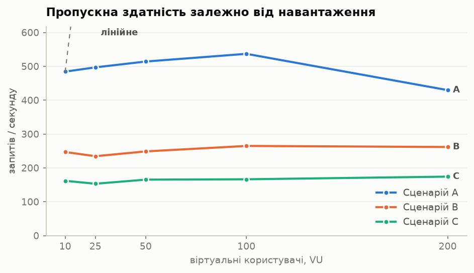
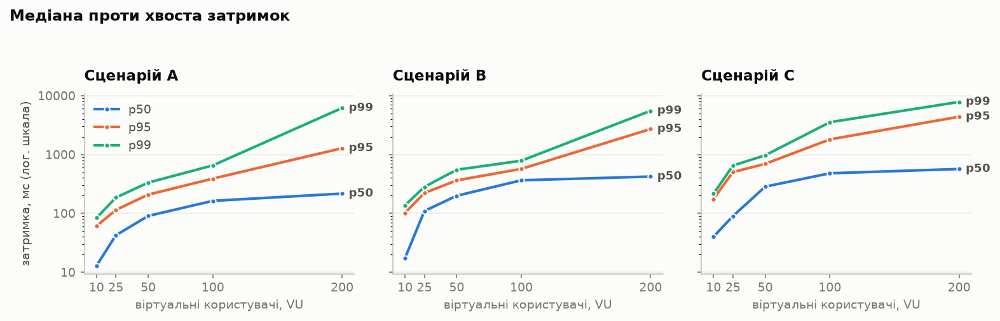
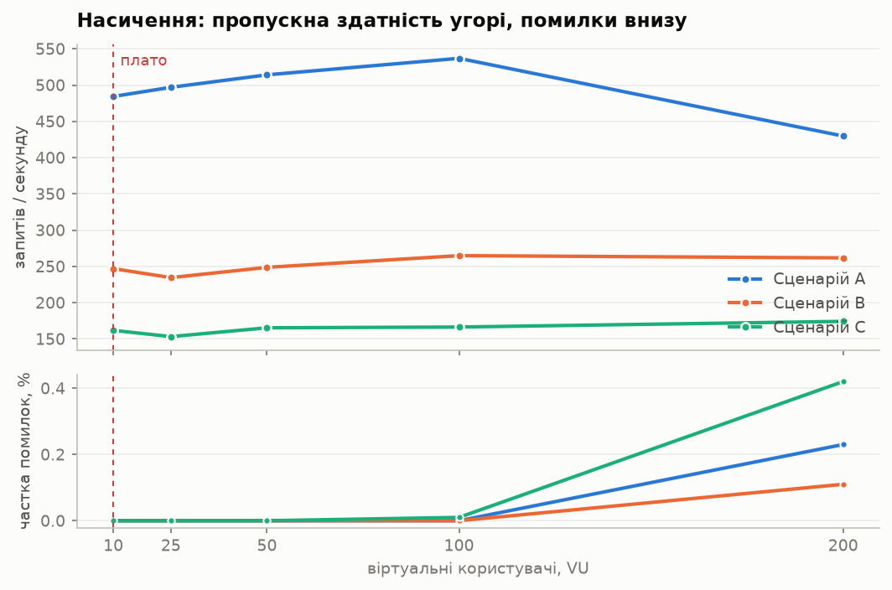
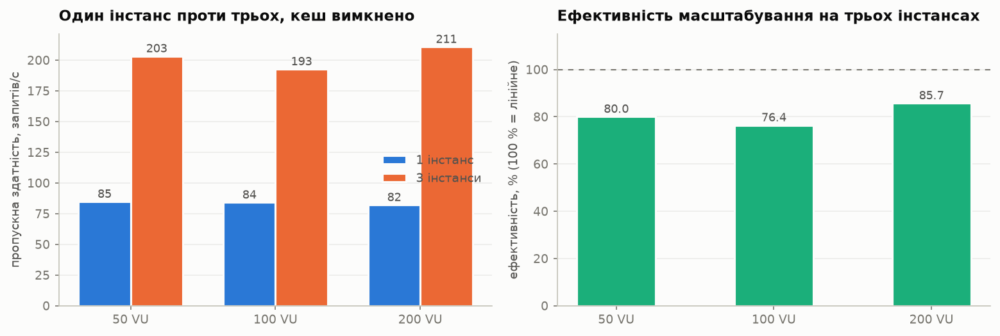
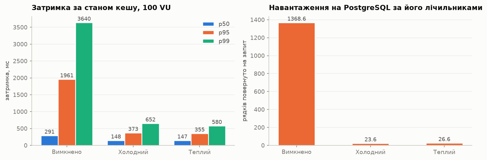
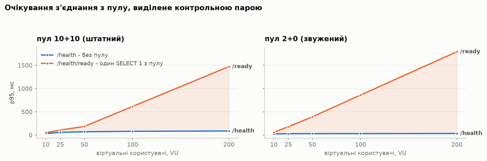
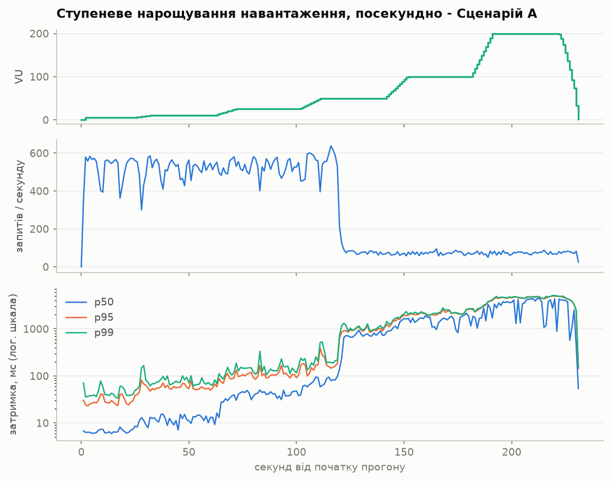
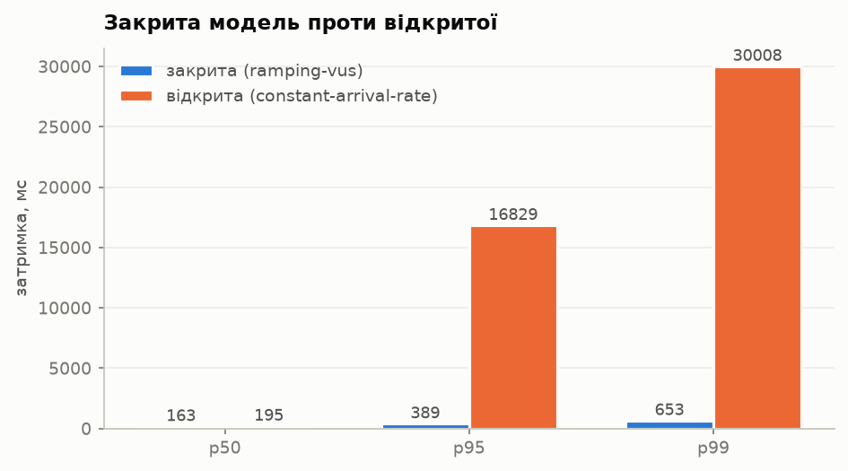

<!-- Lab5 -->
# Лабораторна робота 5 — навантажувальне тестування та базовий профіль продуктивності

Документ згенеровано командою `python -m scripts.render_lab5_results` із результатів окремих прогонів у [loadtest/lab5/](loadtest/lab5/), які записує `scripts/lab5_run.ps1`; графіки — командою `python -m scripts.render_lab5_charts`. Жодне число і жоден графік тут не внесені вручну, тому після нової серії вимірювань достатньо повторного запуску.

Скрипти навантаження: [../load-tests/](../load-tests/) · ті самі дані як інтерактивна сторінка: `http://localhost:8080/lab5-report.html` · англійська версія: [lab5-results.md](lab5-results.md)

## Специфікація базового середовища (п. 2.2)

Два прогони можна порівнювати лише тоді, коли середовище між ними не змінилося. Доки не з'явився `docker-compose.lab5.yml`, жоден compose-файл у цьому репозиторії не обмежував ані процесор, ані пам'ять, і кожен контейнер брав стільки, скільки хост мав вільного в ту мить. Для функціональної демонстрації це прийнятно, для базового профілю — ні.

| | |
|---|---|
| Generated | 2026-11-11 13:29 UTC |
| Host | Windows-10-10.0.19045-SP0 |
| Python | 3.13.14 |
| Docker | Docker version 29.7.2, build a7dcaa6 |
| Load generator | k6, host-native |
| System under test | 3 x API + nginx :8080 + Redis 7 + PostgreSQL 16 |
| Entry point | `http://127.0.0.1:8080` |
| Balancer pool | `pools/3-lab5.conf`, round-robin, `max_fails=0` |
| Connection pool | `DB_POOL_SIZE=10`, `DB_MAX_OVERFLOW=10`, `DB_POOL_TIMEOUT=10s` |
| PostgreSQL | `max_connections=100`, `shared_buffers=256MB`, `pg_stat_statements` |
| Redis | `allkeys-lru`, 256 MB, no persistence; route TTL 10 s, stats TTL 30 s |
| Warm-up | 20 s @ 5 VUs, tagged `phase:warmup`, excluded |
| Measured window | 60 s @ constant concurrency, tagged `phase:measure` |

Обмеження контейнерів у тому вигляді, в якому їх застосував Docker, зчитані через `docker inspect`:

| Container | CPUs | Memory | OOM-killed |
|---|---:|---:|---|
| `api1` | 0.75 | 384 МіБ | no |
| `api2` | 0.75 | 384 МіБ | no |
| `api3` | 0.75 | 384 МіБ | no |
| `lb` | 0.5 | 128 МіБ | no |
| `postgres` | 2 | 1024 МіБ | no |
| `redis` | 0.5 | 320 МіБ | no |

**Висновок.** Docker має 12 процесорних ядер і 3.75 ГБ. Найбільшу частку свідомо віддано PostgreSQL, щоб компонент, який за архітектурою мав би насититися першим, був дефіцитним за задумом, а не випадково. k6 працює на хості й не контейнеризується — саме так виконано вимогу ізоляції з п. 2.2: система під тестом має фіксовану частку машини, і генератор не може її відібрати.

## Калібрування генератора: чи не він сам є обмеженням?

Головний урок ЛР 3, записаний у `docs/context/10`: спершу калібруй генератор, а вже потім вір числам пропускної здатності. Тодішній зонд на Python упирався в ~115 запитів/с на процес і видавав це за межу системи. Тому перше, що вимірюється тут, — сам інструмент, на тих самих 200 VU, що й найважчий прогін.

| Target | Throughput | p50 | p95 | p99 | Errors |
|---|---:|---:|---:|---:|---:|
| nginx `/lb-health` | **7941.78 запитів/с** | 16.08 мс | 66.58 мс | 84.08 мс | 0 |
| `/health` | **1368.5 запитів/с** | 54.91 мс | 305.69 мс | 2721.23 мс | 0 |

**Висновок.** **Запас 5.8×.** k6 разом із локальним інтерфейсом і nginx витримують 7941.78 запитів/с на статичній відповіді, тоді як застосунок упирається в 1368.5 запитів/с, не виконуючи корисної роботи. Отже всі подальші числа описують систему, а не вимірювальний прилад. Звідси ж випливає, що крива масштабування ЛР 3 (98–222 запитів/с) насправді вимірювала власний зонд.

## Виміряні ступені навантаження за сценаріями (п. 2.4)

Кожен рядок — окремий прогін зі сталою кількістю користувачів і 20-секундним розігрівом, виключеним із підрахунку. Це не зріз із безперервного нарощування, і різниця тут принципова: перцентиль, узятий через вікно нарощування, усереднює кілька різних рівнів навантаження і не описує жодного з них. Затримки подано в мілісекундах так, як їх бачить клієнт, тобто разом із nginx і локальною мережею.

### Сценарій A — інтенсивне читання

| Навантаження (VU) | Пропускна здатність (RPS) | Сер. | p50 | p95 | p99 (хвіст) | p99/p50 | Помилки |
|---:|---:|---:|---:|---:|---:|---:|---:|
| 10 | 484.3 | 20.5 | 12.94 | 60.94 | **83.88** | 6.5x | 0 % |
| 25 | 496.9 | 50.18 | 42.49 | 114.28 | **185.39** | 4.4x | 0 % |
| 50 | 514.1 | 97.18 | 90.54 | 208.13 | **333.02** | 3.7x | 0 % |
| 100 | 536.87 | 186.85 | 163.24 | 389.27 | **653.09** | 4x | 0 % |
| 200 | 429.7 | 466.19 | 216.81 | 1280.13 | **6174.69** | 28.5x | 0.23 % |

Від 10 до 200 VU, тобто при зростанні навантаження у 20 разів, пропускна здатність зросла у **0.89 раза**, p50 — у 16.8 раза, а p99 — у **73.6 раза**. Пропускна здатність перестала рости, а затримка росте пропорційно до кількості користувачів. Це ознака насиченої системи: за законом Літтла кількість одночасних запитів дорівнює добутку пропускної здатності на час обробки, тож коли пропускна здатність уперлася в межу, зайвим користувачам лишається тільки черга.

### Сценарій B — інтенсивний запис

| Навантаження (VU) | Пропускна здатність (RPS) | Сер. | p50 | p95 | p99 (хвіст) | p99/p50 | Помилки |
|---:|---:|---:|---:|---:|---:|---:|---:|
| 10 | 246.9 | 40.36 | 17.45 | 102.05 | **136.86** | 7.8x | 0 % |
| 25 | 234.52 | 106.51 | 109.75 | 221.6 | **281.79** | 2.6x | 0 % |
| 50 | 248.68 | 201.06 | 199.11 | 363.74 | **551.28** | 2.8x | 0 % |
| 100 | 264.83 | 378.84 | 364.99 | 569.86 | **784.64** | 2.1x | 0 % |
| 200 | 261.73 | 769.51 | 421.99 | 2711.66 | **5534.64** | 13.1x | 0.11 % |

Від 10 до 200 VU, тобто при зростанні навантаження у 20 разів, пропускна здатність зросла у **1.06 раза**, p50 — у 24.2 раза, а p99 — у **40.4 раза**. Пропускна здатність перестала рости, а затримка росте пропорційно до кількості користувачів. Це ознака насиченої системи: за законом Літтла кількість одночасних запитів дорівнює добутку пропускної здатності на час обробки, тож коли пропускна здатність уперлася в межу, зайвим користувачам лишається тільки черга.

### Сценарій C — складний наскрізний процес

| Навантаження (VU) | Пропускна здатність (RPS) | Сер. | p50 | p95 | p99 (хвіст) | p99/p50 | Помилки |
|---:|---:|---:|---:|---:|---:|---:|---:|
| 10 | 161.82 | 61.78 | 40.15 | 175.84 | **215.19** | 5.4x | 0 % |
| 25 | 153.18 | 165.13 | 89.76 | 501.59 | **649.98** | 7.2x | 0 % |
| 50 | 165.32 | 306.4 | 284.77 | 695.61 | **970.56** | 3.4x | 0 % |
| 100 | 166.37 | 616.18 | 480 | 1806.79 | **3539.14** | 7.4x | 0.01 % |
| 200 | 174.18 | 1199.9 | 567.72 | 4386.73 | **7833.75** | 13.8x | 0.42 % |

Від 10 до 200 VU, тобто при зростанні навантаження у 20 разів, пропускна здатність зросла у **1.08 раза**, p50 — у 14.1 раза, а p99 — у **36.4 раза**. Пропускна здатність перестала рости, а затримка росте пропорційно до кількості користувачів. Це ознака насиченої системи: за законом Літтла кількість одночасних запитів дорівнює добутку пропускної здатності на час обробки, тож коли пропускна здатність уперлася в межу, зайвим користувачам лишається тільки черга.



*Пропускна здатність залежно від навантаження, усі три сценарії*

**Висновок.** Усі три криві пласкі вже з першого ступеня, а пунктир показує, яким було б лінійне зростання. Відстань між ними — це та потужність, якої немає. Сценарій A обслуговує приблизно втричі більше за C, і це заслуга кешу: читання A віддає Redis, тоді як наскрізний процес C мусить писати в базу.



*p50, p95 і p99 за сценаріями, логарифмічна вісь*

**Висновок.** Вісь логарифмічна, бо при насиченні p50 і p99 відрізняються на один-два порядки. На лінійній осі медіана виглядала б пласкою лінією по нулю, і головне — що вона лишалася прийнятною, коли хвіст уже ні — стало б непомітним. Лінії розходяться віялом, і це візуальна відповідь на питання п. 2.4. Затримка запиту складається з часу його обробки плюс часу очікування в черзі. До насичення черга майже порожня, тож обидві складові малі. Після насичення і надходження запитів, і час обробки коливаються, тож довжина черги стає нерівномірною: запит, який потрапив у момент сплеску, чекає за всіма, хто вже там. Середнє визначають численні запити, що застали коротку чергу; p99 — це ті нечисленні, що застали довгу, і їхня частка росте швидше, ніж саме навантаження. Через це середнє не може бути вимогою до продуктивності.

## Точка насичення та первинне вузьке місце (п. 2.5)

П. 2.5 вимагає рівня, на якому пропускна здатність перестає рости лінійно, *а* затримки й помилки починають різко зростати. У цій системі це два різні ступені, і наводяться обидва, бо суть саме у відстані між ними:

* **плато пропускної здатності** — перший ступінь із приростом менше 10 %; далі додаткове навантаження перетворюється на чергу, а не на роботу;
* **робоча межа** — найвищий ступінь, що ще вкладається в p95 до 500 мс без помилок. Насичений ресурс із короткою чергою лишається швидким, і тут та точка, де черга перестає бути короткою.

| Сценарій | Плато | Пропускна здатність там | Приріст далі | Робоча межа | p95 / p99 там | Найгірші помилки |
|---|---:|---:|---:|---:|---:|---:|
| A | **10 VU** | 484.3 запитів/с | +2.6 % | **100 VU** | 389.27 / 653.09 мс | 0.23 % |
| B | **10 VU** | 246.9 запитів/с | +-5 % | **50 VU** | 363.74 / 551.28 мс | 0.11 % |
| C | **10 VU** | 161.82 запитів/с | +-5.3 % | **10 VU** | 175.84 / 215.19 мс | 0.42 % |

**Висновок.** Перші дві колонки треба читати разом. У всіх трьох сценаріях пропускна здатність виходить на плато на найнижчому ступені, тобто обмежувальний ресурс уже повністю зайнятий при 10 користувачах — і кожен зі 190 додаткових користувачів на верхньому ступені чекає, а не працює. При цьому ніщо не падає, а p95 тримається в межах півсекунди значно вище плато. Це нормальний стан здорової насиченої системи, і саме тому пропускна здатність сама по собі ще не є твердженням про потужність.



*Пропускна здатність угорі, помилки внизу, спільна вісь навантаження*

**Висновок.** Дві панелі одна над одною, а не один графік із двома осями: запити за секунду і відсотки — непов'язані величини, і накладати їх означало б запрошувати до порівняння, яке нічого не означає. Верхня панель вирівнюється одразу; нижня тримається нуля. Система може бути повністю насиченою і при цьому безпомилковою — ці дві панелі й розділяють ці два стани.

### Куди насправді пішов процесорний час

`scripts/sample_docker_stats.py` знімає показники кожного контейнера раз на секунду протягом прогону. Це той доказ, якого клієнт дати не може: k6 бачить лише те, що запити сповільнилися, і тільки Docker може сказати, у якого компонента скінчився ресурс. `docker stats` подає завантаження як частку одного ядра, тож контейнер з обмеженням 0.75 ядра показує 75 %, коли зайнятий повністю. Права колонка — частка від *власного* обмеження, і лише вона відповідає на питання.

| Сценарій | Контейнер | Сер. | Макс. | Обмеження | Частка обмеження | Пік пам'яті |
|---|---|---:|---:|---:|---:|---:|
| A | `api1` | 61.77 % | 76.22 % | 75 % | **82.4 %** | 85 МіБ |
| A | `api2` | 67.36 % | 76.55 % | 75 % | **89.8 %** | 99 МіБ |
| A | `api3` | 62.25 % | 77.27 % | 75 % | **83 %** | 90 МіБ |
| A | `lb` | 15.56 % | 24.2 % | 50 % | **31.1 %** | 11 МіБ |
| A | `postgres` | 24.13 % | 191.48 % | 200 % | **12.1 %** | 292 МіБ |
| A | `redis` | 5.58 % | 9.66 % | 50 % | **11.2 %** | 16 МіБ |
| B | `api1` | 66.21 % | 75.96 % | 75 % | **88.3 %** | 91 МіБ |
| B | `api2` | 65.37 % | 75.31 % | 75 % | **87.2 %** | 85 МіБ |
| B | `api3` | 65.43 % | 75.45 % | 75 % | **87.2 %** | 84 МіБ |
| B | `lb` | 8.96 % | 13.55 % | 50 % | **17.9 %** | 14 МіБ |
| B | `postgres` | 58.67 % | 186.07 % | 200 % | **29.3 %** | 279 МіБ |
| B | `redis` | 2.66 % | 5.61 % | 50 % | **5.3 %** | 12 МіБ |
| C | `api1` | 66.99 % | 77.05 % | 75 % | **89.3 %** | 94 МіБ |
| C | `api2` | 66.73 % | 75.5 % | 75 % | **89 %** | 84 МіБ |
| C | `api3` | 65.7 % | 76.23 % | 75 % | **87.6 %** | 85 МіБ |
| C | `lb` | 6.5 % | 19.87 % | 50 % | **13 %** | 13 МіБ |
| C | `postgres` | 52.36 % | 136.27 % | 200 % | **26.2 %** | 311 МіБ |
| C | `redis` | 4.62 % | 9.45 % | 50 % | **9.2 %** | 15 МіБ |

**Висновок.** **Обмежує застосунок, а не база даних.** На верхньому ступені кожен інстанс працює на 89.8 % власного обмеження процесора, тоді як PostgreSQL не перевищує 29.3 %. Це протилежне до того, що передбачав `docs/bottlenecks.md` #3 («база насититься раніше за застосунок»), і причина в ЛР 4: кеш забрав об'єднання таблиць із гарячого шляху, тож лишилися розбір запиту, перевірка даних і формування JSON — тобто процесорний час у Python. Виправлення передбаченого вузького місця перенесло вузьке місце в інше місце; це звичайний наслідок, і саме тому базовий профіль перевимірюють, а не успадковують. Цим же пояснюється результат масштабування нижче: три інстанси допомагають, бо додають саме той ресурс, якого бракує.

## Вплив горизонтального масштабування (п. 2.6)

Один інстанс проти трьох, ті самі ступені, ті самі дані, **кеш вимкнено в обох випадках, і це перевіряється автоматично**. Перевірка не формальна: `docs/context/10` описує прогін на чотирьох інстансах, випадково виконаний на стеку ЛР 4, де один інстанс із кешем (287.9 запитів/с, 99 % влучань) обійшов чотири без кешу (284.0), і висновок вийшов протилежним. Кеш перед `/routing/resolve` робить перехід 1 → 3 майже лінійним і ховає саме ту межу, заради якої експеримент і ставиться, тож `lab5_run.ps1` перериває цю фазу, щойно побачить хоч один `X-Cache: HIT`.

**Коефіцієнт ефективності масштабування** дорівнює `RPS_N / (N × RPS_1)`: 100 % — ідеальне лінійне зростання, а недобір показує ресурс, за який інстанси конкурують.

| VU | Інстансів | Пропускна здатність | Прискорення | **Ефективність** | p50 | p95 | p99 | Помилки | З'єднань до БД |
|---:|---:|---:|---:|---:|---:|---:|---:|---:|---:|
| 50 | 1 | 84.69 запитів/с | 1x | **100 %** | 402.92 | 1571.89 | 2361.36 | 0 | 11 |
| 50 | 3 | 203.16 запитів/с | 2.4x | **80 %** | 123.7 | 970.03 | 1792.35 | 0 | 31 |
| 100 | 1 | 84.02 запитів/с | 1x | **100 %** | 842.64 | 4003.25 | 6051.41 | 3 | 11 |
| 100 | 3 | 192.56 запитів/с | 2.29x | **76.4 %** | 201.44 | 2437.69 | 4642.75 | 2 | 31 |
| 200 | 1 | 81.96 запитів/с | 1x | **100 %** | 1884.55 | 9407.94 | 10583.2 | 101 | 11 |
| 200 | 3 | 210.69 запитів/с | 2.57x | **85.7 %** | 309.34 | 4513.88 | 9302.18 | 87 | 31 |

**Висновок.** Три інстанси дають приблизно 2.42× пропускної здатності одного, а не 3×. Недобір — це спільний ресурс: спершу процесор хоста, потім PostgreSQL, адже кожен інстанс тримає власний пул з'єднань, і троє відкривають утричі більше з'єднань до однієї бази. Варто подивитися й на те, що робить один інстанс: його пропускна здатність майже не змінюється вздовж усіх ступенів, тоді як p99 росте безмежно — він уперся у власне обмеження 0.75 ядра незалежно від кількості користувачів. ЛР 3 виміряла те саме масштабування зовсім іншим інструментом і отримала 71 % ефективності на трьох інстансах: структурна властивість, відтворена двома незалежними інструментами, вартує більше за кожне з вимірювань окремо.



*Пропускна здатність за кількістю інстансів і коефіцієнт ефективності*

**Висновок.** Ліва панель — виграш, права — його ціна. Ефективність не сягає 100 %, але й не обвалюється, а це ознака конкуренції за спільний ресурс, а не жорсткої межі.

## Вплив кешування (п. 2.6)

Три стани, а не два. Вимкнений кеш узагалі не звертається до Redis; холодний звертається і промахується. Якби порівнювали лише вимкнений із теплим, вартість цього звернення віднеслася б не на ту сторону. Усі три виміряно на 100 VU, на тому самому пулі з трьох інстансів, за Сценарієм A.

| Стан кешу | Пропускна здатність | p50 | p95 | p99 | Влучань Redis | Помилки |
|---|---:|---:|---:|---:|---:|---:|
| **Disabled** | 200.69 запитів/с | 291.05 | 1961.14 | 3639.95 | - % | 0 |
| **Cold** | 585.62 запитів/с | 147.56 | 372.73 | 652.4 | 97.13 % | 0 |
| **Warm** | 585.8 запитів/с | 146.94 | 354.79 | 579.71 | 96.45 % | 0 |

### Той самий експеримент із боку бази даних

П. 2.6 вимагає зниження навантаження на СУБД, а це інше питання, ніж час відповіді. Мірою тут є кількість рядків, повернутих на один запит, за лічильником `pg_stat_database`. Саме рядків, а не зафіксованих транзакцій: транзакція лише на читання відкочується при закритті сесії, тож `xact_commit` показав би, що кеш нічого не змінив. ЛР 4 зробила той самий вибір із тієї ж причини.

| Стан кешу | Запитів | Повернуто рядків | **Рядків на запит** | Влучань у буфер | Вставок на запит |
|---|---:|---:|---:|---:|---:|
| Disabled | 9031 | 12359560 | **1368.57** | 100 % | 0 |
| Cold | 26353 | 622955 | **23.64** | 100 % | 0 |
| Warm | 26361 | 701592 | **26.61** | 100 % | 0 |

**Висновок.** **На 98.1 % менше рядків читається з PostgreSQL на кожен запит, при 2.92× пропускної здатності.** Те, що лишилося, — некешоване читання каталогу, яке Сценарій A свідомо тримає у своїй суміші: сценарій, що кешувався б до нуля, показав би нескінченне прискорення і не виміряв би нічого.

**Застереження.** Холодний і теплий стани розійшлися менш ніж на відсоток. При часі життя запису 10 с і 36 ключах маршрутів кеш наповнюється за першу секунду, тож 45-секундне «холодне» вікно насправді приблизно на 98 % тепле, і холодний стан не був зафіксований по-справжньому. Порівняння HIT проти MISS нижче цієї вади не має, бо обидва результати виміряні в одному вікні.



*Затримка за станом кешу і навантаження, яке кожен стан дає на базу*

**Висновок.** Дві панелі, дві різні величини, спільної осі немає. Ліва показує те, що відчуває користувач, права — те, чим платить база. Тут вони змінюються разом, як і має бути з кешем, але це різні вимірювання, і звіт із самою лише лівою панеллю не відповів би на п. 2.6.

### HIT проти MISS усередині одного прогону

Обидва результати виміряні в одному вікні, за однакового навантаження, на тих самих трьох інстансах. Це значно надійніше за два окремі прогони, бо між ними не відрізняється нічого, крім самого влучання в кеш.

| Результат | Запитів | p50 | p95 | p99 | макс. | p50 на сервері |
|---|---:|---:|---:|---:|---:|---:|
| `HIT` | 22356 | 136.6 | 302.97 | 373.31 | 614.27 | 99.52 |
| `MISS` | 823 | 347.94 | 983.53 | 1282.11 | 1797.9 | 293.21 |

## Ізоляція первинного вузького місця: контрольна пара

`/health` і `/health/ready` відрізняються рівно однією дією: перевірка готовності бере з'єднання з пулу й виконує `SELECT 1`. Обидві обслуговуються тими самими інстансами, через той самий балансувальник, у ту саму мить, і прогін чергує їх по одному запиту, тож кожна бачить половину навантаження. Тому `p95(ready) − p95(live)` — це **час очікування з'єднання з пулу, з якого вирахувано розбір запиту, маршрутизацію, формування відповіді, балансувальник і мережу**. `SELECT 1` надто дешевий, щоб пояснення крилося в самому запиті.

`docs/bottlenecks.md` #4 передбачав саме таку картину: затримка росте, тоді як завантаження бази падає, бо очікування відбувається ще до початку роботи. Ті самі ступені проти пулу з двох з'єднань без розширення зсувають злам у виміряний діапазон і перетворюють припущення на демонстрацію.

| Пул | VU | p95 `/health` | p95 `/health/ready` | **Через пул, p95** | Різниця p99 | Помилки |
|---|---:|---:|---:|---:|---:|---:|
| 10 + 10 | 10 | 33.19 мс | 52.25 мс | **19.06 мс** | 23.63 мс | 0 % |
| 10 + 10 | 25 | 58.28 мс | 107.98 мс | **49.7 мс** | 85.68 мс | 0 % |
| 10 + 10 | 50 | 71.37 мс | 186.23 мс | **114.86 мс** | 148.8 мс | 0 % |
| 10 + 10 | 100 | 80.81 мс | 614.86 мс | **534.05 мс** | 717.11 мс | 0 % |
| 10 + 10 | 200 | 88.24 мс | 1472.69 мс | **1384.45 мс** | 2217.09 мс | 0 % |
| 2 + 0 | 10 | 25.09 мс | 58.53 мс | **33.44 мс** | 38.33 мс | 0 % |
| 2 + 0 | 25 | 29.34 мс | 180.25 мс | **150.91 мс** | 241.19 мс | 0 % |
| 2 + 0 | 50 | 30.61 мс | 393.57 мс | **362.96 мс** | 632.25 мс | 0 % |
| 2 + 0 | 100 | 31.66 мс | 860.6 мс | **828.94 мс** | 1483.85 мс | 0 % |
| 2 + 0 | 200 | 34.27 мс | 1792.72 мс | **1758.45 мс** | 2931.85 мс | 0 % |

**Висновок.** Шлях без пулу тримається рівно, від 33.19 до 88.24 мс уздовж усіх ступенів, тоді як шлях із пулом піднімається до 1472.69 мс. Тобто **1384.45 мс із p95 — це очікування з'єднання, ще до початку будь-якої роботи**. Звуження пулу до 2+0 зсуває ту саму криву раніше й вище, і це робить результат демонстрацією механізму, а не збігом. При насиченні інстанси записали в журнал передбачену помилку дослівно: `QueuePool limit of size 10 overflow 10 reached, connection timed out, timeout 10.00`. До межі `max_connections` справа навіть не дійшла — 31 з'єднання проти 100 — отже обмежує пул кожного інстанса, а не сервер бази.



*p95 обох точок входу; заштрихована площа — очікування в пулі*

**Висновок.** Синя лінія — запит, який не торкається пулу, помаранчева — той самий запит плюс один `SELECT 1` із пулу. Усе між ними — черга за з'єднанням. Заштрихована площа, що розкривається з ростом навантаження, і є вузьким місцем: показаним, а не доведеним на словах.

Те саме голодування, побачене через справжній шлях читання, а не через зонд:

| VU | Сценарій A, пул 2 + 0 | Пропускна здатність | p95 | p99 | Помилки | З'єднань до БД |
|---:|---|---:|---:|---:|---:|---:|
| 50 | `/routing/resolve` | 544.24 запитів/с | 402.77 мс | 1380.43 мс | 0 | 7 |
| 100 | `/routing/resolve` | 517.16 запитів/с | 1252.92 мс | 2570.75 мс | 0 | 7 |
| 200 | `/routing/resolve` | 512.98 запитів/с | 2244.79 мс | 5601.75 мс | 36 | 7 |

## Ступеневе нарощування, посекундно

Прогони вище дали таблицю; тут крива. Три панелі, по одній величині на кожну: сходинка вгорі — це нарощування, а те, що роблять дві панелі під нею на кожному ступені, і є доказом насичення. Головний урок ЛР 3 полягав у тому, що її найгірший дефект — пасивна перевірка, яка виводила з пулу справні вузли — був непомітний у підсумкових числах (нуль помилок, правдоподібна пропускна здатність) і очевидний на посекундній шкалі. Тому ця панель існує, хоча оцінювані числа несуть таблиці.



*Користувачі, пропускна здатність і перцентилі затримки протягом одного прогону*

**Висновок.** Щоразу, коли верхня панель піднімається на ступінь, середня цього не робить: пропускна здатність уже на межі. Натомість піднімається нижня панель, і різниця між p50 і p99 збільшується на кожному рівні. Три панелі на спільній осі часу показують це ясніше за будь-яке підсумкове число, а посекундна точність — саме те, що виявило б дефект, який підсумок згладжує.

## Координаційна омана (coordinated omission): закрита модель проти відкритої

Усі прогони вище — **закрита** модель: фіксована кількість віртуальних користувачів, кожен надсилає наступний запит лише після відповіді на попередній. Для твердження на кшталт «200 одночасних користувачів» це правильна модель, але вона має властивість, яку треба назвати вголос: коли система сповільнюється, генератор сповільнюється разом із нею. Запити, які були б затримані, просто не надсилаються, а отже й не вимірюються. Розподіл, який вона показує, залежить від стану самої системи. Це і є координаційна омана.

Контрольним є той самий набір запитів зі сталою інтенсивністю **563 запитів/с** — тією пропускною здатністю, якої досягла закрита модель. Він продовжує надсилати незалежно від того, встигає система чи ні, і повідомляє `dropped_iterations`, коли не встигає навіть виділяти користувачів.

| Модель | Запропоновано | Досягнуто | p50 | p95 | p99 | Помилки |
|---|---|---:|---:|---:|---:|---:|
| `ramping-vus` | 100 VU | 536.87 запитів/с | 163.24 | 389.27 | **653.09** | 0 |
| `constant-arrival-rate` | 563 запитів/с | 289.23 запитів/с | 195.01 | 16829.3 | **30007.9** | 1412 |

`dropped_iterations = 16426`: відкрита модель не змогла надіслати всі запити, які мала намір, навіть зі своїм запасом користувачів. Отже й вона применшує чергу — оману зменшено, але не усунуто.

**Висновок.** **p99 у відкритій моделі гірша у 45.95 раза за однакового запропонованого навантаження.** Саме запропонованого, а не досягнутого: два прогони видали різну пропускну здатність, і це результат, а не вада порівняння. На 563 запитів/с система видала 289.23, тобто на 49 % менше, з 1412 помилками, тоді як закрита модель показала 536.87 запитів/с і жодної помилки.

Отже пік закритої моделі ніколи не був показником потужності. Це була швидкість, з якою обертався фіксований набір користувачів, кожен з яких терпляче чекав на власну відповідь. Запропонуйте ту саму швидкість без очікування — а саме з цим стикається публічна точка входу — і система видасть приблизно половину. Це найважливіше застереження до кожного числа пропускної здатності в цьому звіті, і саме тому картка базового профілю наводить *стабільну* пропускну здатність у межах припустимої затримки, а не пік.



*Ті самі три перцентилі в обох моделях навантаження*

**Висновок.** Стовпчики p50 майже однакові, а p99 — аж ніяк. Це і є ознака координаційної омани: медіана майже не страждає, бо більшість запитів в обох моделях надсилається, поки система здорова, тоді як запити, яких закрита модель не надіслала, були саме найповільнішими. Шкода зосереджена рівно в тому числі, яке найчастіше наводять у вимогах до рівня обслуговування.

## Відповіді на прогнози з docs/bottlenecks.md

Ці шість пунктів написані до будь-яких вимірювань, і сам файл це визнає: це гіпотези, сформовані з архітектури, а не вимірювання. ЛР 5 — те місце, де вони перевіряються, і хибний прогноз, як той файл і обіцяв, корисніший за неперевірений.

| № | Прогноз | Вердикт | Підстава |
|---|---|---|---|
| 1 | шторм вставок телеметрії: p99 росте нелінійно, тоді як p50 лишається рівною | **підтверджено** | Сценарій B на 200 VU: p50 421.99 мс, p99 5534.64 мс — хвіст у 13.1 раза при зміні пропускної здатності в 1.08 раза |
| 2 | конкуренція за «гарячий» рядок `edge_nodes` і накопичення мертвих версій | **підтверджено — найточніший результат роботи** | HOT-оновленнями виявилися 0 % із 17609 оновлень, що лишило 2994 мертвих версій рядків на таблиці, кількість рядків якої не змінювалася. Тобто майже кожне оновлення телеметрії переписувало й індекс `ix_edge_nodes_status_last_heartbeat_at` — рівно той запис, який називав прогноз |
| 3 | некешоване об'єднання таблиць у `/routing/resolve` насичує базу першою | **підтверджено, виправлено в ЛР 4, і очікувана ознака тепер протилежна** | кешування скоротило читання рядків на запит на 98.1 % і підняло пропускну здатність у 2.92 раза за того самого навантаження. Але застосунок тепер на 89.8 % свого обмеження процесора, тоді як PostgreSQL — на 29.3 % |
| 4 | вичерпання пулу з'єднань: затримка росте ще до початку роботи | **підтверджено — первинне вузьке місце** | віднесена до пулу p95 сягнула 1384.45 мс на 200 VU на штатному пулі 10+10 і 1758.45 мс на 200 VU на пулі 2+0, тоді як `/health`, який не торкається пулу, лишався рівним |
| 5 | синхронне розсилання очищень: помилки стрибають у Сценарії C, тоді як A і B здорові | **не підтверджено на цьому масштабі** | Сценарій C помиляється найбільше (45x HTTP 500, 175x HTTP 503) проти 60 у A та 17 у B — але жоден із цих видів помилок не є тим самим розсиланням. **503 — це дефект вимірювання, а не системи**: оркестратор зупиняє службу `agents`, щоб її телеметрія не була неконтрольованим записом, після чого ніщо не оновлює `last_heartbeat_at`, і парк вузлів застаріває за поріг у 120 с просто під час вимірювання. Доведено напряму: при останній позначці 119 с запит повертає 200, при 121 с — 503, а з піднятим порогом той самий прогін на 25 VU дав **нуль** помилок замість 175. А 500 — це таймаути пулу, тобто вузьке місце #4 вище. Сама робота, пропорційна розміру парку, реальна й вимірна — 22345 оновлень `asset_replicas` на 1949 публікацій, тобто 11.5 рядків усередині кожного запиту — але на парку з 12 вузлів вона просто дешева. Виправлення — `HEARTBEAT_STALE_AFTER_SECONDS` у `docker-compose.lab5.yml`; тут залишено типове значення, щоб кожен рядок цієї матриці походив з однієї конфігурації |
| 6 | необмежені вибірки й агрегати: повні сканування та `COUNT(*)` | **підтверджено для некешованої вибірки, не підтверджено для агрегату** | у тому самому прогоні на 200 VU посторінкове читання каталогу виявилося найповільнішою операцією сценарію (p50 320.03 мс, p99 9593.68 мс) — повільнішою за `/routing/resolve` (p50 209.6 мс), попри простіший запит, бо його `COUNT(*)` сканує таблицю повністю. А `/stats/network`, шість згрупованих агрегатів і за побудовою найважче читання, виявився найшвидшим: p50 195.49 мс. ЛР 4 його кешує, і в цьому вся різниця |

Один результат, якого не передбачав жоден пункт, і найважливіший із практичного боку: **пасивна перевірка nginx виводила з пулу справні інстанси, коли застосунок відповідав 503.** `proxy.conf` перелічував `http_503` у `proxy_next_upstream`, а `pools/3.conf` виводить вузол після трьох відмов за п'ять секунд, тож сплеск цілком законних відповідей «немає придатного вузла» чи «немає вільного з'єднання» виводив з ладу весь пул. Перший прогін повернув **20831 із 20866 відповідей як HTTP 502 за 0.000 с, і то лише на 10 VU**, а справжня затримка застосунку за ними взагалі не була виміряна. Прикладний 503 означає «цей запит зараз не може бути обслужений», а розрив з'єднання — «цей інстанс мертвий». Спільний лічильник відмов для них обох перетворює часткове відновлюване перевантаження на повну відмову, і робить це найшвидше саме тоді, коли система вже під тиском. Виправлено: `http_503` прибрано зі списку. Перевірено 200 запитами поспіль, кожен з яких законно повертає 503 — усі 200 повернулися як 503, жодного 502, і всі три інстанси лишилися в пулі.

## Картка базового профілю продуктивності (п. 2.7)

```
=== SYSTEM PERFORMANCE BASELINE ===
Environment Config:  0.75 CPU / 384 MiB x 3 API + nginx; PostgreSQL 2 CPU / 1024 MiB, max_connections 100; Redis 256 MB allkeys-lru; pool 10+10 per instance
Stable Throughput:   536.87 req/s @ 100 VU (p95 389.27 ms, 0 errors)
Saturation Point:    plateau 10 VU / 161.82 req/s (Scenario C); usable ceiling by scenario: A 100, B 50, C 10 VU
p95 / p99 Latency:   p95 389.27 ms / p99 653.09 ms
Error Rate:          0.42 % worst on the ladder (Scenario C @ 200 VU)
Critical Scenario:   C
Primary Bottleneck:  SQLAlchemy connection pool wait on the API tier (up to 1758.45 ms of p95)
```

**Висновок.** Два рядки картки є оцінковими судженнями, і це варто проговорити. **Стабільна пропускна здатність** — найвищий ступінь, який ще відповідав у межах припустимого хвоста (p95 до 500 мс без помилок), а не пік: при насиченні пропускна здатність найбільша, і черга за нею теж, тож наводити пік означало б описувати систему, яку ніхто не став би експлуатувати. **Критичний сценарій** — той, що насичується на найнижчій пропускній здатності, а не той, у якого найгірша затримка, бо саме він зламається першим зі зростанням реального навантаження.

**Висновок.** Частка помилок у картці рахує власні відмови системи: HTTP 5xx і розриви з'єднань, які на цих ступенях є таймаутами пулу — тобто тим вузьким місцем, що назване вище. Вона свідомо не враховує 503 від роутингу, бо це артефакт вимірювання, доведений у прогнозі #5: парк вузлів застаріває під час прогону, доки імітатор агентів зупинено заради детермінізму, і на 25 VU це дало 175 таких відповідей. Зарахувати дефект стенду як властивість системи означало б внести у специфікацію неправильне число.

Кеш у цьому числі є несучою конструкцією: той самий пул віддає 585.8 запитів/с теплим і 200.69 запитів/с із вимкненим кешем. Отже наведений профіль описує систему, шлях читання якої поглинає Redis, а межею, що лишилася, є пул з'єднань перед PostgreSQL.

## Чим ці числа є і чим вони не є

Це вимірювання конкретного стенду на одному ноутбуці, де база даних, кеш, три інстанси застосунку й генератор навантаження ділять дванадцять ядер. Абсолютна пропускна здатність не пережила б переїзду на справжнє обладнання, і нічого звідси не можна наводити як показник потужності для чогось, крім цієї машини.

Переноситься інше — форма результату: який сценарій насичується першим, співвідношення p50 і p99 після зламу, коефіцієнт ефективності масштабування, частка p95, що припадає на очікування з'єднання, і різниця між закритою та відкритою моделями. Це властивості архітектури, а не хоста. Найсильніший доказ — ЛР 3 виміряла 71 % ефективності масштабування на тій самій архітектурі цілком іншим інструментом, а ЛР 5 отримала те саме.

