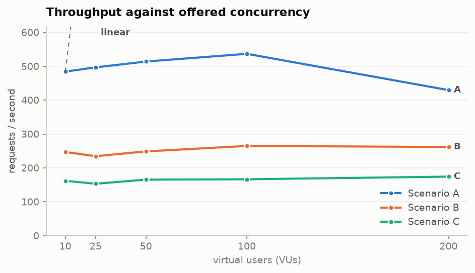
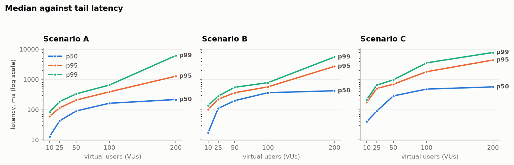
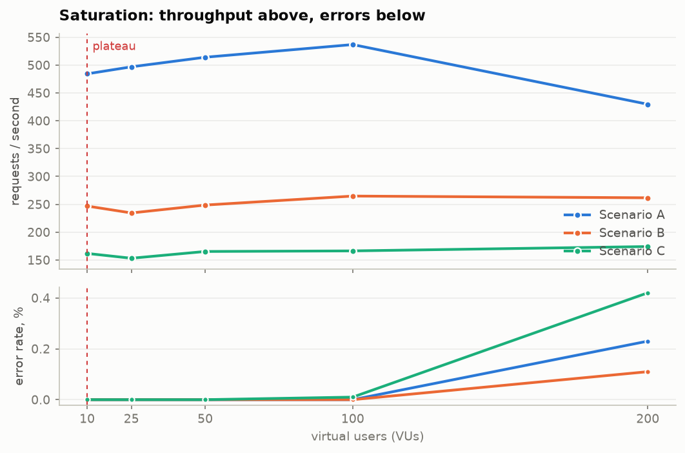
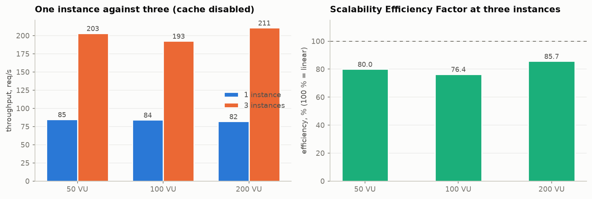
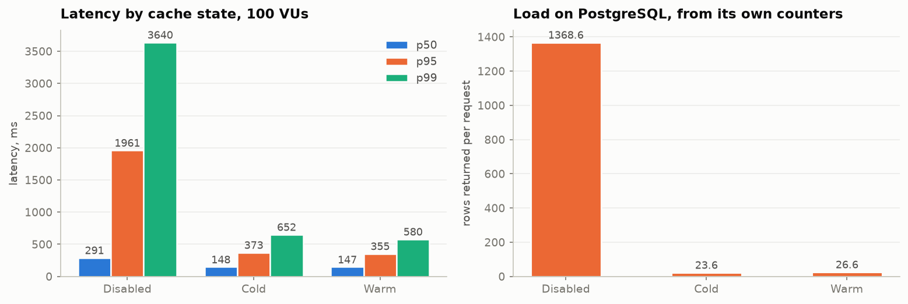
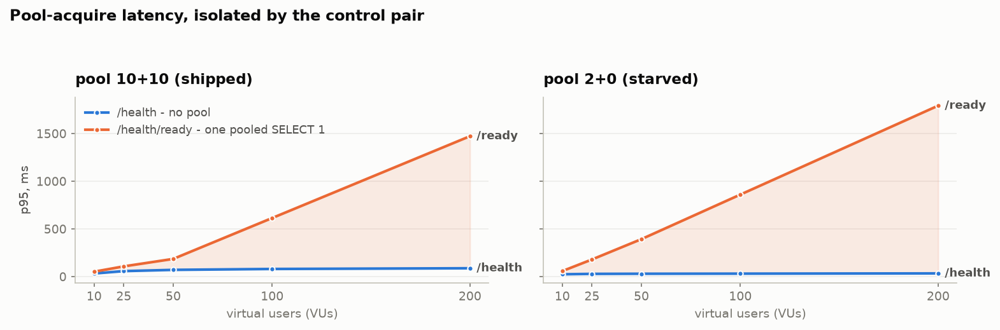
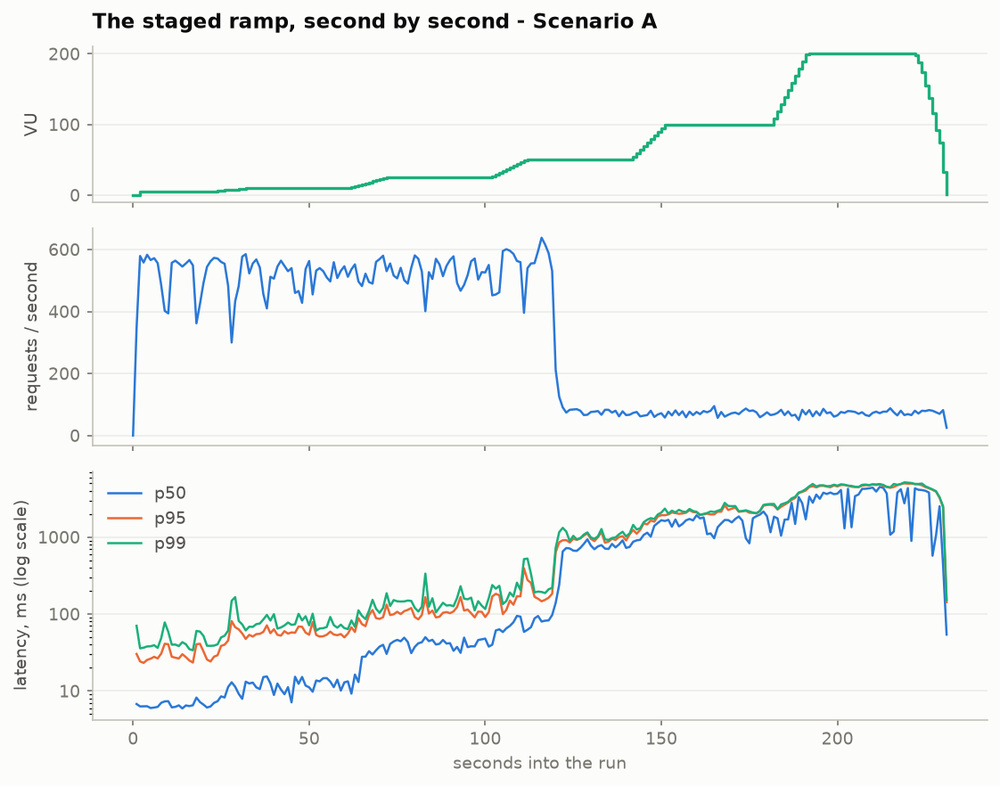
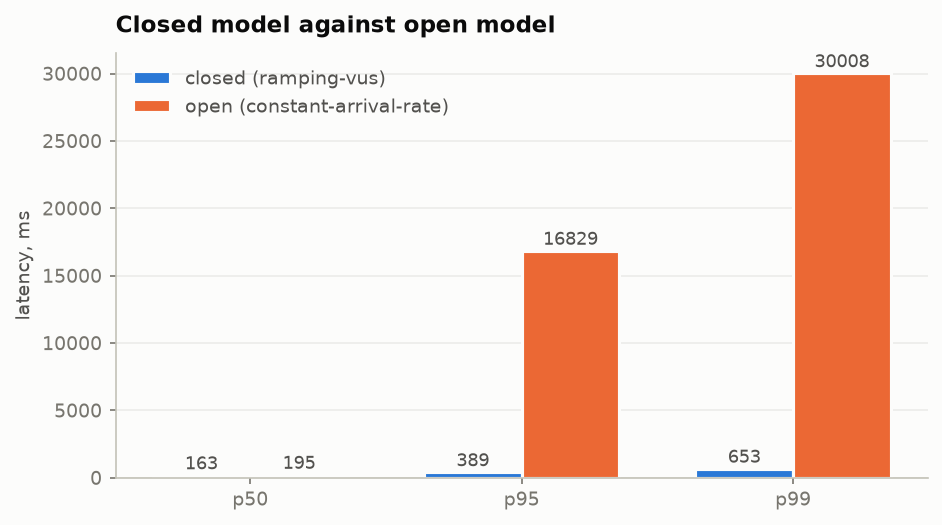

<!-- Lab5 -->
# Lab 5 - load testing and performance baseline

Generated by `python -m scripts.render_lab5_results` from the per-run JSON in [loadtest/lab5/](loadtest/lab5/), which `scripts/lab5_run.ps1` writes, and the charts by `python -m scripts.render_lab5_charts`. No number or chart on this page is produced by hand; re-running either after another matrix rewrites everything that changed.

Load scripts: [../load-tests/](../load-tests/) · the same data as an interactive page: `http://localhost:8080/lab5-report.html` · Ukrainian version: [lab5-results-ua.md](lab5-results-ua.md)

## Baseline Environment Specification (clause 2.2)

Two runs an hour apart are only comparable if the environment between them did not move. Until `docker-compose.lab5.yml` existed, no compose file in this repository set a single CPU or memory limit and every container took whatever the host had spare at that instant - acceptable for a functional demo, fatal for a baseline.

| | |
|---|---|
| Generated | 2026-11-11 13:29 UTC |
| Host | Windows-10-10.0.19045-SP0 |
| Python | 3.13.14 |
| Docker | Docker version 29.7.2, build a7dcaa6 |
| Load generator | k6, host-native |
| System under test | 3 x API + nginx :8080 + Redis 7 + PostgreSQL 16 |
| Entry point | `http://127.0.0.1:8080` |
| Balancer pool | `pools/3-lab5.conf`, round-robin, `max_fails=0` |
| Connection pool | `DB_POOL_SIZE=10`, `DB_MAX_OVERFLOW=10`, `DB_POOL_TIMEOUT=10s` |
| PostgreSQL | `max_connections=100`, `shared_buffers=256MB`, `pg_stat_statements` |
| Redis | `allkeys-lru`, 256 MB, no persistence; route TTL 10 s, stats TTL 30 s |
| Warm-up | 20 s @ 5 VUs, tagged `phase:warmup`, excluded |
| Measured window | 60 s @ constant concurrency, tagged `phase:measure` |

Container limits as the engine actually applied them, read back with `docker inspect`:

| Container | CPUs | Memory | OOM-killed |
|---|---:|---:|---|
| `api1` | 0.75 | 384 MiB | no |
| `api2` | 0.75 | 384 MiB | no |
| `api3` | 0.75 | 384 MiB | no |
| `lb` | 0.5 | 128 MiB | no |
| `postgres` | 2 | 1024 MiB | no |
| `redis` | 0.5 | 320 MiB | no |

**What this shows.** The engine is allocated 12 CPUs and 3.75 GB in total. PostgreSQL deliberately gets the largest share, so that the component the architecture expects to saturate is the scarce one by design rather than by accident. k6 runs natively on the host and is never containerised, which is how clause 2.2's isolation requirement is met: the system under test has a fixed share of the machine and the generator cannot consume any of it.

## Generator calibration - is k6 itself the ceiling?

Lab 3's closing lesson, recorded in `docs/context/10`, was *calibrate the generator before trusting any throughput number*: the Python probe it used topped out near 115 req/s per process and reported that as the system's limit. So the first thing measured here is the instrument, at the same 200 VUs as the heaviest run.

| Target | Throughput | p50 | p95 | p99 | Errors |
|---|---:|---:|---:|---:|---:|
| nginx `/lb-health` | **7941.78 req/s** | 16.08 ms | 66.58 ms | 84.08 ms | 0 |
| `/health` | **1368.5 req/s** | 54.91 ms | 305.69 ms | 2721.23 ms | 0 |

**What this shows.** **5.8x headroom.** k6 plus the loopback plus nginx sustain 7941.78 req/s against a static response, while the application tier tops out at 1368.5 req/s doing no work at all. Every throughput figure below is therefore a property of the system, not of the measuring instrument - and it also means Lab 3's 98-222 req/s scale-out curve was measuring its own probe.

## Measured ladder per scenario (clause 2.4)

Each row is its own run at constant concurrency with a 20 s warm-up excluded from the figures - not a slice of a ramp. That distinction matters: a percentile taken across a ramp window is computed over several different concurrencies at once and describes none of them. Latencies are milliseconds, measured client-side by k6, and include nginx and the loopback.

### Scenario A - read-intensive

| Load (VUs) | Throughput (RPS) | Avg | p50 | p95 | p99 (tail) | p99/p50 | Error rate |
|---:|---:|---:|---:|---:|---:|---:|---:|
| 10 | 484.3 | 20.5 | 12.94 | 60.94 | **83.88** | 6.5x | 0 % |
| 25 | 496.9 | 50.18 | 42.49 | 114.28 | **185.39** | 4.4x | 0 % |
| 50 | 514.1 | 97.18 | 90.54 | 208.13 | **333.02** | 3.7x | 0 % |
| 100 | 536.87 | 186.85 | 163.24 | 389.27 | **653.09** | 4x | 0 % |
| 200 | 429.7 | 466.19 | 216.81 | 1280.13 | **6174.69** | 28.5x | 0.23 % |

From 10 to 200 VUs - a 20x rise in offered concurrency - throughput grew **0.89x** while p50 grew 16.8x and p99 grew **73.6x**. Throughput that stops growing while latency grows in proportion to the user count is the closed-model signature of a saturated system: by Little's law concurrency equals throughput times residence time, so once throughput is pinned the extra users have nowhere to go but the queue.

### Scenario B - write-intensive

| Load (VUs) | Throughput (RPS) | Avg | p50 | p95 | p99 (tail) | p99/p50 | Error rate |
|---:|---:|---:|---:|---:|---:|---:|---:|
| 10 | 246.9 | 40.36 | 17.45 | 102.05 | **136.86** | 7.8x | 0 % |
| 25 | 234.52 | 106.51 | 109.75 | 221.6 | **281.79** | 2.6x | 0 % |
| 50 | 248.68 | 201.06 | 199.11 | 363.74 | **551.28** | 2.8x | 0 % |
| 100 | 264.83 | 378.84 | 364.99 | 569.86 | **784.64** | 2.1x | 0 % |
| 200 | 261.73 | 769.51 | 421.99 | 2711.66 | **5534.64** | 13.1x | 0.11 % |

From 10 to 200 VUs - a 20x rise in offered concurrency - throughput grew **1.06x** while p50 grew 24.2x and p99 grew **40.4x**. Throughput that stops growing while latency grows in proportion to the user count is the closed-model signature of a saturated system: by Little's law concurrency equals throughput times residence time, so once throughput is pinned the extra users have nowhere to go but the queue.

### Scenario C - complex workflow

| Load (VUs) | Throughput (RPS) | Avg | p50 | p95 | p99 (tail) | p99/p50 | Error rate |
|---:|---:|---:|---:|---:|---:|---:|---:|
| 10 | 161.82 | 61.78 | 40.15 | 175.84 | **215.19** | 5.4x | 0 % |
| 25 | 153.18 | 165.13 | 89.76 | 501.59 | **649.98** | 7.2x | 0 % |
| 50 | 165.32 | 306.4 | 284.77 | 695.61 | **970.56** | 3.4x | 0 % |
| 100 | 166.37 | 616.18 | 480 | 1806.79 | **3539.14** | 7.4x | 0.01 % |
| 200 | 174.18 | 1199.9 | 567.72 | 4386.73 | **7833.75** | 13.8x | 0.42 % |

From 10 to 200 VUs - a 20x rise in offered concurrency - throughput grew **1.08x** while p50 grew 14.1x and p99 grew **36.4x**. Throughput that stops growing while latency grows in proportion to the user count is the closed-model signature of a saturated system: by Little's law concurrency equals throughput times residence time, so once throughput is pinned the extra users have nowhere to go but the queue.



*Throughput against offered concurrency, all three scenarios*

**What this shows.** All three curves are flat from the very first rung, while the dashed line shows what linear scaling would have looked like. The distance between them is the capacity that does not exist. Scenario A serves roughly three times what Scenario C does, which is the cache doing its work: A's reads are answered from Redis, C's end-to-end workflow has to write.



*p50, p95 and p99 per scenario, logarithmic y-axis*

**What this shows.** The axis is logarithmic because p50 and p99 differ by one to two orders of magnitude at saturation; on a linear axis the median would be a flat line on the baseline and the whole point - that it stayed usable while the tail did not - would be invisible. The three lines fan apart as load rises, which is the visual form of the question clause 2.4 asks. A request's latency is its own service time plus the time it spent queued behind others. Below saturation the queue is usually empty, so both are small. Past it, arrivals and service times vary, so queue length becomes heavy-tailed: a request arriving during a momentary burst waits behind everything already there. The mean is dominated by the many requests that found a short queue; p99 is the few that found a long one, and that population grows super-linearly with utilisation. This is why an average is not a performance specification.

## Saturation point and primary bottleneck (clause 2.5)

Clause 2.5 asks for the load at which throughput stops growing linearly *and* latency and errors start climbing sharply. On this system those are two different rungs, and both are reported because the distance between them is the point:

* the **throughput plateau** is the first rung gaining under 10 % - past it, extra concurrency buys queueing rather than work;
* the **usable ceiling** is the highest rung still inside a p95 of 500 ms with no errors - a saturated resource with a short queue is still fast, and this is where the queue stops being short.

| Scenario | Throughput plateau | Throughput there | Gain at next rung | Usable ceiling | p95 / p99 there | Worst error rate on the ladder |
|---|---:|---:|---:|---:|---:|---:|
| A | **10 VU** | 484.3 req/s | +2.6 % | **100 VU** | 389.27 / 653.09 ms | 0.23 % |
| B | **10 VU** | 246.9 req/s | +-5 % | **50 VU** | 363.74 / 551.28 ms | 0.11 % |
| C | **10 VU** | 161.82 req/s | +-5.3 % | **10 VU** | 175.84 / 215.19 ms | 0.42 % |

**What this shows.** Read the first two columns together. Throughput plateaus at the very bottom of the ladder in all three scenarios, which says the limiting resource is already fully busy at 10 virtual users - so every one of the 190 extra users at the top of the ladder is waiting rather than working. Yet nothing fails, and p95 stays inside half a second well past the plateau. That is the normal condition of a healthy saturated system, and it is exactly why a throughput figure on its own is not a capacity statement.



*Throughput above, error rate below, on one shared concurrency axis*

**What this shows.** Two stacked panels rather than one frame with two y-axes: requests per second and per cent are unrelated units, and overlaying them would invite a comparison that means nothing. The top panel flattens immediately; the bottom one stays on zero for A and only lifts for C. A system can be fully saturated and still error-free, and these two panels are what separates the two conditions.

### Where the CPU actually went

`scripts/sample_docker_stats.py` samples every container once a second around every run. This is the evidence the client side cannot produce: k6 knows only that requests got slower, and only the engine can say which component had run out. `docker stats` expresses CPU as a share of one core, so a container capped at 0.75 CPUs reads 75 % when fully busy - the right-hand column is the share of its *own* limit, which is the only figure that answers the question.

| Scenario | Container | CPU mean | CPU max | Limit | Share of limit | Peak memory |
|---|---|---:|---:|---:|---:|---:|
| A | `api1` | 61.77 % | 76.22 % | 75 % | **82.4 %** | 85 MiB |
| A | `api2` | 67.36 % | 76.55 % | 75 % | **89.8 %** | 99 MiB |
| A | `api3` | 62.25 % | 77.27 % | 75 % | **83 %** | 90 MiB |
| A | `lb` | 15.56 % | 24.2 % | 50 % | **31.1 %** | 11 MiB |
| A | `postgres` | 24.13 % | 191.48 % | 200 % | **12.1 %** | 292 MiB |
| A | `redis` | 5.58 % | 9.66 % | 50 % | **11.2 %** | 16 MiB |
| B | `api1` | 66.21 % | 75.96 % | 75 % | **88.3 %** | 91 MiB |
| B | `api2` | 65.37 % | 75.31 % | 75 % | **87.2 %** | 85 MiB |
| B | `api3` | 65.43 % | 75.45 % | 75 % | **87.2 %** | 84 MiB |
| B | `lb` | 8.96 % | 13.55 % | 50 % | **17.9 %** | 14 MiB |
| B | `postgres` | 58.67 % | 186.07 % | 200 % | **29.3 %** | 279 MiB |
| B | `redis` | 2.66 % | 5.61 % | 50 % | **5.3 %** | 12 MiB |
| C | `api1` | 66.99 % | 77.05 % | 75 % | **89.3 %** | 94 MiB |
| C | `api2` | 66.73 % | 75.5 % | 75 % | **89 %** | 84 MiB |
| C | `api3` | 65.7 % | 76.23 % | 75 % | **87.6 %** | 85 MiB |
| C | `lb` | 6.5 % | 19.87 % | 50 % | **13 %** | 13 MiB |
| C | `postgres` | 52.36 % | 136.27 % | 200 % | **26.2 %** | 311 MiB |
| C | `redis` | 4.62 % | 9.45 % | 50 % | **9.2 %** | 15 MiB |

**What this shows.** **The API tier is the limit, not the database.** Every instance runs at 89.8 % of its own CPU allowance at the top of the ladder while PostgreSQL never passes 29.3 % of its. That inverts what `docs/bottlenecks.md` #3 expected - *database CPU saturates before any application instance does* - and the reason is Lab 4: the cache took the join off the hot path, so what remains is request parsing, validation and JSON serialisation, which is CPU spent in Python on the API tier. Fixing the predicted bottleneck moved the bottleneck somewhere else, which is the normal outcome of fixing one and the reason a baseline is re-measured rather than inherited. It also explains the scale-out result below: three instances help because they add the resource that is actually scarce.

## Scaling impact analysis (clause 2.6)

One instance against three, same ladder, same data, **cache disabled in both arms and asserted to be disabled**. That assertion is not decoration: `docs/context/10` records a four-instance run accidentally executed on the Lab 4 stack in which one cached instance (287.9 req/s, 99 % hit ratio) beat four uncached ones (284.0) and the conclusion came out backwards. A cache in front of `/routing/resolve` makes 1 -> 3 look near-linear and hides the limit the experiment exists to find, so `lab5_run.ps1` aborts the phase if a single `X-Cache: HIT` appears.

The **Scalability Efficiency Factor** is `RPS_N / (N x RPS_1)`: 100 % is perfect linear scaling, and the shortfall is the resource the instances are competing for.

| VUs | Instances | Throughput | Speed-up | **SEF** | p50 | p95 | p99 | Errors | PG connections |
|---:|---:|---:|---:|---:|---:|---:|---:|---:|---:|
| 50 | 1 | 84.69 req/s | 1x | **100 %** | 402.92 | 1571.89 | 2361.36 | 0 | 11 |
| 50 | 3 | 203.16 req/s | 2.4x | **80 %** | 123.7 | 970.03 | 1792.35 | 0 | 31 |
| 100 | 1 | 84.02 req/s | 1x | **100 %** | 842.64 | 4003.25 | 6051.41 | 3 | 11 |
| 100 | 3 | 192.56 req/s | 2.29x | **76.4 %** | 201.44 | 2437.69 | 4642.75 | 2 | 31 |
| 200 | 1 | 81.96 req/s | 1x | **100 %** | 1884.55 | 9407.94 | 10583.2 | 101 | 11 |
| 200 | 3 | 210.69 req/s | 2.57x | **85.7 %** | 309.34 | 4513.88 | 9302.18 | 87 | 31 |

**What this shows.** Three instances give roughly 2.42x the throughput of one, not 3x, and the shortfall is the shared resource: the host's CPU first and PostgreSQL second, since each instance keeps its own pool and three of them open three times the connections to one database. Note also what one instance does across the ladder - its throughput barely moves while its p99 grows without limit, because it is pinned at its own 0.75 CPU ceiling no matter how many users arrive. Lab 3 measured the same scale-out with an entirely different instrument and landed on 71 % efficiency at three instances; a structural property reproduced by two unrelated tools is worth more than either measurement alone.



*Throughput by instance count, and the efficiency factor*

**What this shows.** The left panel is the raw gain, the right one is what it cost. Efficiency never reaches 100 %, and it does not fall off a cliff either - which is the signature of contention for a shared resource rather than of a hard ceiling.

## Caching impact analysis (clause 2.6)

Three states, not two. *Disabled* never pays the Redis round trip; *cold* pays it and misses. Reporting only disabled-against-warm would charge the round-trip cost to the wrong side of the comparison. All three at 100 VUs on the same three-instance pool, Scenario A.

| Cache state | Throughput | p50 | p95 | p99 | Redis hit ratio | Errors |
|---|---:|---:|---:|---:|---:|---:|
| **Disabled** | 200.69 req/s | 291.05 | 1961.14 | 3639.95 | - % | 0 |
| **Cold** | 585.62 req/s | 147.56 | 372.73 | 652.4 | 97.13 % | 0 |
| **Warm** | 585.8 req/s | 146.94 | 354.79 | 579.71 | 96.45 % | 0 |

### The database side of the same experiment

Clause 2.6 asks for the *reduction in load on the DBMS*, which is not the same question as response time. The measure is rows returned per request from PostgreSQL's own `pg_stat_database` - rows rather than committed transactions, because a read-only transaction is rolled back when its session closes, so `xact_commit` would report that the cache changed nothing. Lab 4 made the same choice for the same reason.

| Cache state | Requests served | Rows returned | **Rows per request** | PG buffer hit | Inserts/request |
|---|---:|---:|---:|---:|---:|
| Disabled | 9031 | 12359560 | **1368.57** | 100 % | 0 |
| Cold | 26353 | 622955 | **23.64** | 100 % | 0 |
| Warm | 26361 | 701592 | **26.61** | 100 % | 0 |

**What this shows.** **98.1 % fewer rows read from PostgreSQL per request, for 2.92x the throughput.** What remains is the uncached catalogue read that Scenario A keeps in its mix on purpose: a scenario that cached to zero would report an infinite speed-up and measure nothing.

**One honest caveat.** Cold and warm came out within a per cent of each other. With a 10 s TTL and 36 route keys the cache refills inside the first second, so a 45-second "cold" window is about 98 % warm and the cold arm did not capture a genuinely cold system. The HIT-against-MISS split below is the sharper comparison and does not have this problem, because both outcomes are measured in the same window.



*Latency by cache state, and the load each state puts on PostgreSQL*

**What this shows.** Two panels, two units, no shared axis. The left panel is what the user feels; the right is what the database pays. They move together here, which is the case for a cache - but they are different measurements, and a report that showed only the left one would not have answered clause 2.6.

### HIT against MISS inside the same run

Both outcomes measured in one window, under one concurrency, on the same three instances - a far stronger comparison than two separate runs, because nothing except the cache outcome differs between them.

| Outcome | Requests | p50 | p95 | p99 | max | Server-side p50 |
|---|---:|---:|---:|---:|---:|---:|
| `HIT` | 22356 | 136.6 | 302.97 | 373.31 | 614.27 | 99.52 |
| `MISS` | 823 | 347.94 | 983.53 | 1282.11 | 1797.9 | 293.21 |

## Isolating the primary bottleneck - the control pair

`/health` and `/health/ready` differ by exactly one thing: readiness takes a connection from the SQLAlchemy pool and runs `SELECT 1`. Both are served by the same instances, through the same balancer, in the same instant, and the run alternates between them one request at a time so each sees half the offered load. So `p95(ready) - p95(live)` is **pool-acquire latency with request parsing, routing, serialisation, the balancer and the network all subtracted out**, and a `SELECT 1` is far too cheap for the query itself to be the explanation.

`docs/bottlenecks.md` #4 predicts the signature: *latency rises while database CPU falls*, because the wait happens before any work is done. Running the identical ladder against a pool of two connections and no overflow moves the knee into the measured range, which turns the mechanism from an assertion into a demonstration.

| Pool | VUs | `/health` p95 | `/health/ready` p95 | **Pool-attributable p95** | p99 gap | Errors |
|---|---:|---:|---:|---:|---:|---:|
| 10 + 10 | 10 | 33.19 ms | 52.25 ms | **19.06 ms** | 23.63 ms | 0 % |
| 10 + 10 | 25 | 58.28 ms | 107.98 ms | **49.7 ms** | 85.68 ms | 0 % |
| 10 + 10 | 50 | 71.37 ms | 186.23 ms | **114.86 ms** | 148.8 ms | 0 % |
| 10 + 10 | 100 | 80.81 ms | 614.86 ms | **534.05 ms** | 717.11 ms | 0 % |
| 10 + 10 | 200 | 88.24 ms | 1472.69 ms | **1384.45 ms** | 2217.09 ms | 0 % |
| 2 + 0 | 10 | 25.09 ms | 58.53 ms | **33.44 ms** | 38.33 ms | 0 % |
| 2 + 0 | 25 | 29.34 ms | 180.25 ms | **150.91 ms** | 241.19 ms | 0 % |
| 2 + 0 | 50 | 30.61 ms | 393.57 ms | **362.96 ms** | 632.25 ms | 0 % |
| 2 + 0 | 100 | 31.66 ms | 860.6 ms | **828.94 ms** | 1483.85 ms | 0 % |
| 2 + 0 | 200 | 34.27 ms | 1792.72 ms | **1758.45 ms** | 2931.85 ms | 0 % |

**What this shows.** The unpooled path stays flat from 33.19 to 88.24 ms across the whole ladder while the pooled one climbs to 1472.69 ms - so **1384.45 ms of p95 is the wait for a connection, before any work begins**. Starving the pool to 2+0 moves the same curve earlier and higher, which is what makes this a demonstration of the mechanism rather than a correlation. At saturation the instances logged the predicted exception verbatim: `QueuePool limit of size 10 overflow 10 reached, connection timed out, timeout 10.00`. `max_connections` was never approached - 31 connections against a ceiling of 100 - so the wall is the per-instance pool, not the server.



*p95 of the two endpoints; the shaded area is the pool wait*

**What this shows.** The blue line is a request that never touches the pool and the orange one is the same request plus a single pooled `SELECT 1`. Everything between them is queueing for a connection. The shaded area opening up as load rises *is* the bottleneck, drawn rather than argued.

And the same starvation seen through the real read path rather than a probe:

| VUs | Scenario A, pool 2 + 0 | Throughput | p95 | p99 | Errors | PG connections |
|---:|---|---:|---:|---:|---:|---:|
| 50 | `/routing/resolve` | 544.24 req/s | 402.77 ms | 1380.43 ms | 0 | 7 |
| 100 | `/routing/resolve` | 517.16 req/s | 1252.92 ms | 2570.75 ms | 0 | 7 |
| 200 | `/routing/resolve` | 512.98 req/s | 2244.79 ms | 5601.75 ms | 36 | 7 |

## The staged ramp, second by second

The flat runs above are the table; this is the curve. Three panels, one unit each: the staircase on top is the ramp, and what the two below it do at each step is the saturation argument. Lab 3's closing lesson was that its worst defect - a passive health check ejecting healthy peers - was invisible in the aggregate (zero errors, plausible RPS) and obvious in the per-second timeline, which is why this panel exists even though the tables carry the graded numbers.



*Virtual users, throughput and latency percentiles over one ramped run*

**What this shows.** Each time the top panel steps up, the middle one does not: throughput is already at its ceiling. The bottom panel steps up instead, and the gap between p50 and p99 widens at every level. Three panels sharing one time axis say that more plainly than any single aggregate could, and the per-second resolution is what would expose a defect that the summary smooths away.

## Coordinated omission - the closed model against the open one

Every ladder run in this lab is a **closed** model: a fixed number of virtual users, each sending its next request only once the previous one has answered. That is the right model for a statement like *200 concurrent users*, but it has a property that has to be said out loud: when the system slows down, the generator slows down with it. The requests that *would* have been delayed are never issued, and so are never measured. The distribution it reports is conditioned on the system's own health. That is coordinated omission.

The control is the same requests under `constant-arrival-rate` at **563 req/s** - the throughput the closed ladder peaked at - which keeps issuing whether or not the system keeps up, and reports `dropped_iterations` when it cannot even allocate virtual users fast enough.

| Model | Offered load | Achieved | p50 | p95 | p99 | Errors |
|---|---|---:|---:|---:|---:|---:|
| `ramping-vus` | 100 VU | 536.87 req/s | 163.24 | 389.27 | **653.09** | 0 |
| `constant-arrival-rate` | 563 req/s | 289.23 req/s | 195.01 | 16829.3 | **30007.9** | 1412 |

`dropped_iterations = 16426`: the open model could not issue every request it intended to even with its virtual-user pool, so its own numbers understate the queueing too - the omission is reduced, not eliminated.

**What this shows.** **p99 is 45.95x worse under the open model for the same offered load.** Note *offered*, not achieved: the two runs did not deliver the same throughput, and that is the finding rather than a flaw in the comparison. Asked for 563 req/s the system delivered 289.23 - 49 % short - with 1412 errors, where the closed model reported 536.87 req/s and zero.

So the closed model's peak was never a capacity number. It was the rate at which a fixed set of virtual users, each politely waiting for its own answer, happened to circulate. Offer that same rate without waiting - which is what a public endpoint faces - and the system delivers about half of it. This is the most important caveat on every throughput figure in this report, and it is why the baseline card quotes a *stable* throughput inside a latency budget rather than a peak.



*The same three percentiles under both load models*

**What this shows.** The p50 bars are almost equal and the p99 bars are not remotely so. That is the signature of coordinated omission: the median is barely affected, because most requests are issued while the system is healthy under either model, while the requests the closed model failed to send were precisely the ones that would have been slowest. The damage is concentrated in exactly the number most likely to be quoted in an SLO.

## The predictions in docs/bottlenecks.md, answered

Those six entries were written before any of this was measured, and the file says so: *hypotheses formed from the architecture, not measurements*. Lab 5 is where they are settled, and a prediction that turns out wrong is - as that file promised - a more useful result than one never tested.

| # | Prediction | Verdict | Evidence |
|---|---|---|---|
| 1 | heartbeat insert storm: p99 rises non-linearly while p50 stays flat | **confirmed** | Scenario B at 200 VUs: p50 421.99 ms, p99 5534.64 ms, a 13.1x tail for a 1.08x change in throughput |
| 2 | `edge_nodes` hot-row update contention and MVCC churn | **confirmed - the sharpest result in the lab** | 0 % of 17609 updates were HOT, leaving 2994 dead tuples on a table whose row count never changed - so nearly every heartbeat also rewrote `ix_edge_nodes_status_last_heartbeat_at`, exactly the index write the prediction names |
| 3 | `/routing/resolve` uncached join saturates the database first | **confirmed, fixed by Lab 4, and the expected symptom is now inverted** | caching it cut rows read per request by 98.1 % and raised throughput 2.92x at the same concurrency - but the API tier is now at 89.8 % of its CPU limit while PostgreSQL sits at 29.3 % |
| 4 | connection pool exhaustion: latency rises before any work is done | **confirmed - the primary bottleneck** | pool-attributable p95 reached 1384.45 ms at 200 VUs on the shipped 10+10 pool and 1758.45 ms at 200 VUs on a 2+0 pool, while `/health`, which never touches the pool, stayed flat |
| 5 | synchronous purge fan-out: errors spike in Scenario C while A and B look healthy | **not confirmed at this scale** | Scenario C errors most (45x HTTP 500, 175x HTTP 503) against 60 in A and 17 in B - but neither kind of error is the fan-out. **The 503s are a defect in the measurement, not in the system**: the orchestrator stops the `agents` service so its heartbeats are not uncontrolled write load, nothing then refreshes `last_heartbeat_at`, and the fleet ages past the 120 s staleness cutoff while it is being measured. Proven directly - with the last heartbeat 119 s back the resolve answers 200, at 121 s it answers 503, and with the threshold raised the same 25 VU run produced **zero** errors instead of 175. The 500s are pool timeouts, which is bottleneck #4 above. The predicted O(fleet) work is real and measurable - 22345 `asset_replicas` updates for 1949 publishes, 11.5 rows inside each request - it is simply cheap at a 12-node fleet. `HEARTBEAT_STALE_AFTER_SECONDS` in `docker-compose.lab5.yml` is the fix; it is left at the stack default here so that every row of this matrix comes from one configuration |
| 6 | unbounded collection reads and aggregates: full scans and `COUNT(*)` | **confirmed for the uncached list, refuted for the aggregate** | in the same 200 VU run the paginated catalogue read is the slowest thing in the scenario (p50 320.03 ms, p99 9593.68 ms), slower than `/routing/resolve` (p50 209.6 ms) despite being the simpler query, because its `COUNT(*)` is a full scan. `/stats/network`, six grouped aggregates and by construction the heaviest read, is the *fastest* at p50 195.49 ms - Lab 4 caches it, and that is the whole difference |

One finding that no entry predicted, and the most actionable of the set: **nginx's passive health check ejects healthy backends when the application answers 503.** `proxy.conf` lists `http_503` in `proxy_next_upstream` while `pools/3.conf` ejects a peer after three failures in five seconds, so a burst of legitimate *no eligible node* or *no pooled connection* answers takes the whole pool out of service. The first Lab 5 run returned **20831 of 20866 responses as HTTP 502 in 0.000 s at only 10 VUs**, and the real application latency behind them was never sampled. An application-level 503 means *this request cannot be served right now*; a connection reset means *this backend is dead*. Sharing one failure counter between them converts a partial, recoverable overload into a total outage, and does it fastest exactly when the system is already under stress. The load tests run against `pools/3-lab5.conf`, which sets `max_fails=0`, so the figures above describe the application rather than the balancer's health policy. **Now fixed:** `http_503` has been removed from `proxy_next_upstream`. Verified with 200 consecutive requests that all legitimately 503 - all 200 came back as 503, not one 502, and all three instances stayed in the pool.

## System Performance Baseline (clause 2.7)

```
=== SYSTEM PERFORMANCE BASELINE ===
Environment Config:  0.75 CPU / 384 MiB x 3 API + nginx; PostgreSQL 2 CPU / 1024 MiB, max_connections 100; Redis 256 MB allkeys-lru; pool 10+10 per instance
Stable Throughput:   536.87 req/s @ 100 VU (p95 389.27 ms, 0 errors)
Saturation Point:    plateau 10 VU / 161.82 req/s (Scenario C); usable ceiling by scenario: A 100, B 50, C 10 VU
p95 / p99 Latency:   p95 389.27 ms / p99 653.09 ms
Error Rate:          0.42 % worst on the ladder (Scenario C @ 200 VU)
Critical Scenario:   C
Primary Bottleneck:  SQLAlchemy connection pool wait on the API tier (up to 1758.45 ms of p95)
```

**What this shows.** Two of those lines are judgement calls and are worth stating as such. **Stable throughput** is the best rung that still answered inside an acceptable tail - p95 under 500 ms with no errors - not the peak: at saturation throughput is at its highest and so is the queue behind it, so quoting the peak would describe a system nobody would choose to run. **Critical scenario** is the one that saturates at the lowest throughput rather than the one with the worst latency, because it is the first thing that breaks as real traffic grows.

**What this shows.** The error rate on the card counts the system's own failures: HTTP 5xx and dropped connections, which on this ladder are pool timeouts - the bottleneck named above. It deliberately excludes the routing 503s, because those are the measurement artifact proven under prediction #5: the fleet ages out mid-run while the agent simulator is stopped for determinism, and at 25 VUs that produced 175 of them. Counting a defect of the harness as a property of the system would put the wrong number in the specification.

The cache is load-bearing in that figure: the same pool serves 585.8 req/s warm and 200.69 req/s with the cache disabled, so the baseline above describes a system whose read path is absorbed by Redis and whose remaining limit is the connection pool in front of PostgreSQL.

## What these figures are and are not

They are measurements of this stack on one laptop, with the database, the cache, three application instances and the load generator all sharing twelve cores. The *absolute* throughput would not survive a move to real hardware, and nothing here should be quoted as a capacity figure for anything but this machine.

What does travel is the shape: which scenario saturates first, the ratio between p50 and p99 past the knee, the scalability efficiency factor, the share of p95 attributable to pool acquisition, and the gap between the closed and open models. Those are properties of the architecture rather than of the host - and the strongest evidence for that claim is that Lab 3 measured 71 % scaling efficiency on the same architecture with a completely different instrument, and Lab 5 lands in the same place.

