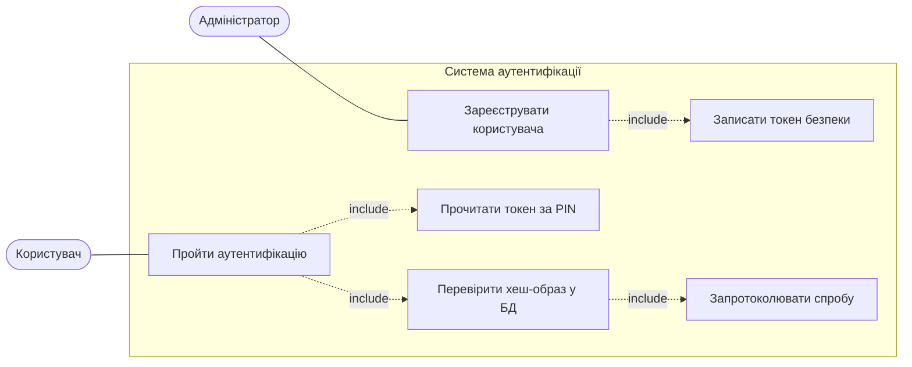
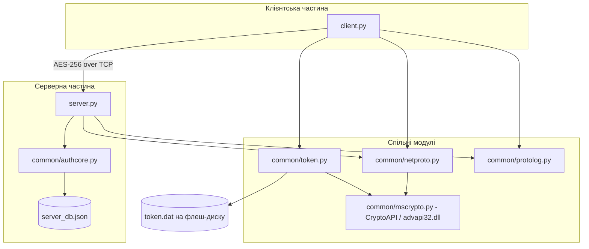
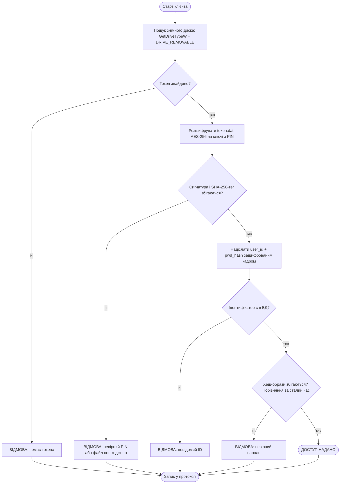

# Лабораторна робота №6. Аутентифікація користувачів на основі токенів безпеки

**Варіант 2** — проста парольна аутентифікація за хеш-образами.
Файл на токені безпеки (флеш-диск) містить ідентифікатор користувача та хеш-образ
пароля, занесені туди під час реєстрації. Під час аутентифікації система зчитує дані
з файлу на токені, співставляє хеш-образ із тим, що міститься у серверній базі даних,
і повідомляє результат. Алгоритм хешування — SHA-256 з набору Microsoft CryptoAPI.

Мова: Python 3 (тільки стандартна бібліотека + `ctypes` до `advapi32.dll`).
Жодних сторонніх пакетів — програма запускається на будь-якій Windows без `pip install`.

---

## 1. Теорія, яку перевіряємо

### Ідентифікація, аутентифікація, авторизація

Це три послідовні кроки, які часто плутають:

- **ідентифікація** — суб'єкт повідомляє системі свій унікальний ідентифікатор
  (у нашій програмі це рядок `user_id`, зчитаний з токена);
- **аутентифікація** — суб'єкт додає інформацію, якою система перевіряє, що він
  дійсно той, за кого себе видає (у нас — хеш-образ пароля, звірений із серверною БД);
- **авторизація** — після вдалої аутентифікації система виконує дії, щоб суб'єкт міг
  почати роботу (у ЛР6 це відповідь `GRANTED`; у ЛР7 на цьому місці відкривається
  сесія з підсистемою керування доступом).

### Чому саме токен, а не лише пароль

Існує три групи способів підтвердження істинності: *щось, що користувач знає*
(пароль), *щось, що користувач має* (токен, картка), *щось, чим користувач є*
(біометрія). Токен безпеки — друга група. Але сам по собі флеш-диск захищає погано:
його можна загубити або скопіювати. Тому в цій роботі застосовано **двофакторність**:
щоб аутентифікуватися, потрібен і сам носій (фактор володіння), і PIN-код, яким
розшифровується файл на ньому (фактор знання). Без PIN вміст токена — випадковий
набір байтів.

### Чому на токені зберігається хеш-образ, а не пароль

Хеш-функція SHA-256 є односторонньою: за образом `h = SHA256(salt || password)`
обчислити пароль неможливо інакше, ніж перебором. Тому навіть якщо зловмисник
подолає шифрування файлу на токені, він не дізнається пароль користувача — а отже,
не зможе використати його в інших системах, де людина вживає той самий пароль.
Додатково в образ підмішано **сіль** (16 випадкових байтів, свої для кожного
користувача): завдяки їй однакові паролі двох людей дають різні хеш-образи, і
заздалегідь обчислені «райдужні таблиці» стають марними.

### Microsoft CryptoAPI

CryptoAPI — «шаруватий» криптографічний інтерфейс Windows: прикладна програма
викликає функції з `advapi32.dll`, а ті передають роботу бібліотеці-криптопровайдеру
(CSP). Програміст працює з однаковим набором функцій незалежно від того, який
саме провайдер і де фізично зберігає ключі (реєстр, файл, смарт-картка).

Робота з провайдером починається з `CryptAcquireContext`, яка повертає дескриптор
(handle) ключового контейнера; далі цей дескриптор передається в усі решту функцій.
У цій роботі використано провайдер **`PROV_RSA_AES` (тип 24)** з прапорцем
`CRYPT_VERIFYCONTEXT` — тимчасовий контекст без постійного ключового контейнера,
бо довготривалі ключові пари нам не потрібні, лише хешування, ГВЧ і симетричне
шифрування.

---

## 2. Що реалізовано

```
security/
├── common/              спільний код, яким користуються обидві лабораторні
│   ├── mscrypto.py      обгортки Microsoft CryptoAPI через ctypes
│   ├── token.py         пошук флеш-диска, читання/запис захищеного файлу токена
│   ├── netproto.py      TCP-кадри: 4 байти довжини + AES-шифрований JSON
│   ├── userdb.py        серверна база реєстраційної інформації (JSON)
│   ├── authcore.py      ядро аутентифікації (його ж імпортує сервер ЛР7)
│   └── protolog.py      журнал подій у консоль і файл — це і є «протокол роботи»
└── lab_6/
    ├── enroll.py        реєстрація користувача: БД + запис токена
    ├── server.py        серверна частина (та, що перевіряє)
    ├── client.py        клієнтська частина (та, яку перевіряють)
    ├── demo.ps1         автоматичний прогін усіх сценаріїв
    └── logs/            згенеровані протоколи роботи
```

### Криптографічні функції CryptoAPI, які використано

| Функція модуля `mscrypto.py` | Виклики CryptoAPI | Де застосовано |
|---|---|---|
| `sha256(data)` | `CryptAcquireContextW` → `CryptCreateHash(CALG_SHA_256)` → `CryptHashData` → `CryptGetHashParam(HP_HASHVAL)` → `CryptDestroyHash` | хеш-образ пароля, тег цілісності токена |
| `random_bytes(n)` | `CryptGenRandom` | сіль користувача, вектор ініціалізації AES |
| `encrypt` / `decrypt` | `CryptCreateHash` → `CryptDeriveKey(CALG_AES_256)` → `CryptSetKeyParam(KP_IV)` → `CryptEncrypt` / `CryptDecrypt` → `CryptDestroyKey` | шифрування файлу на токені та мережевого трафіку |
| — | `CryptReleaseContext` | звільнення дескриптора провайдера |

Кожен виклик перевіряє результат і при невдачі піднімає `CryptoError` з кодом
`GetLastError`. Хешування **не** підмінене на `hashlib`: усі перетворення робить
криптопровайдер Windows. Перевірити це легко — контрольний вектор збігається з
еталонним:

```
> py -3 -c "import sys; sys.path.insert(0,'.'); from common import mscrypto; print(mscrypto.sha256(b'abc').hex())"
ba7816bf8f01cfea414140de5dae2223b00361a396177a9cb410ff61f20015ad
```

---

## 3. Склад інформації у файлі на токені безпеки

Файл: `<флешка>:\SECTOKEN\<слот>\token.dat`.

Відкритий зміст (до шифрування) — JSON із чотирьох полів:

| Поле | Призначення |
|---|---|
| `user_id` | ідентифікатор користувача в системі |
| `salt` | 16 випадкових байтів (hex), згенеровані `CryptGenRandom` |
| `pwd_hash` | хеш-образ `SHA256(salt ‖ password)` (hex) |
| `created_at` | час реєстрації — для аудиту |

Пароль у відкритому вигляді не зберігається ні на токені, ні на сервері.

**Як файл захищено.** Перед записом формується блок
`"SECTOK01" ‖ SHA256(JSON) ‖ JSON`, і весь цей блок шифрується **AES-256 у режимі
CBC** на ключі, похідному від PIN-коду (`CryptDeriveKey` з хешу PIN). Вектор
ініціалізації — випадковий, пишеться попереду шифротексту. Таким чином у файлі
одночасно забезпечено:

- **конфіденційність** — без PIN вміст не читається;
- **цілісність** — SHA-256-тег всередині шифротексту; будь-яка зміна байта в файлі
  ламає розшифрування або не збігається з тегом;
- **автентичність формату** — сигнатура `SECTOK01` відрізняє наш файл від чужого й
  одночасно служить швидкою перевіркою правильності PIN.

Реальний вміст файлу (перші 48 байт із 256) — суцільний шум, у блокноті не читається:

```
9A 2F 86 F3 89 7A C5 7E CF 4A D8 5D 6D 3C 0B 2A 92 5F 77 E4 9E 70 0E 72
93 67 D7 75 7F 36 A2 EB 00 85 97 44 E5 DC 73 6B 34 E3 A9 BC 1B 4D 1A 3D
```

### Обговорення стійкості застосованих засобів захисту

**Сильні сторони.** AES-256 — стандарт, стійкий до відомих криптоаналітичних атак;
перебір 2^256 ключів нереальний. Випадковий IV означає, що два однакові токени дають
різні шифротексти, тобто порівнянням файлів не можна дізнатися, що два користувачі
мають однакові дані. Тег цілісності робить непомітну підміну неможливою: у протоколі
нижче видно, що інверсія одного-єдиного байта робить токен непридатним.

**Слабке місце — PIN, а не AES.** Ключ виводиться безпосередньо з PIN однократним
хешуванням (`CryptDeriveKey` з SHA-256). Чотиризначний PIN — це всього 10^4 варіантів,
і той, хто вкрав флешку, перебере їх за секунди: наявність сигнатури `SECTOK01` дає
йому миттєвий критерій «вгадав/не вгадав». Тобто практична стійкість файлу дорівнює
стійкості PIN, а не довжині ключа AES.

**Як підсилити** (у навчальній роботі свідомо не реалізовано заради простоти):
уповільнене виведення ключа (PBKDF2/scrypt із сотнями тисяч ітерацій замість одного
SHA-256), довша парольна фраза замість 4 цифр, лічильник невдалих спроб із
блокуванням токена, апаратний токен (смарт-карта), з якого ключ фізично не
витягується, та прив'язка до серійного номера носія, щоб копія файлу на іншій
флешці не працювала.

---

## 4. Як запустити

### Варіант А. Автоматичний прогін усіх сценаріїв (loopback)

```powershell
cd C:\uni_year_4\security\lab_6
.\demo.ps1                       # токен — автоматично знайдений знімний диск
.\demo.ps1 -TokenDir C:\temp\tok # без флешки, токен емулюється текою
```

Скрипт реєструє трьох користувачів, піднімає сервер, виконує дві вдалі й чотири
невдалі аутентифікації та складає протокол у `logs\lab6_protocol.log`.

### Варіант Б. Руками, двома вікнами

```powershell
# вікно 1 — сервер
py -3 server.py --host 127.0.0.1 --port 5607

# вікно 2 — реєстрація і клієнт
py -3 enroll.py --user ostrovska --password "Kateryna#2026" --pin 1111 --slot u_ostrovska
py -3 client.py --pin 1111 --slot u_ostrovska
```

### Варіант В. Дві машини: хост і віртуальна машина (п.4 завдання)

Клієнт і сервер рознесено на дві машини з реальними мережевими інтерфейсами:
сервер — на хості, клієнт — у віртуальній машині VirtualBox з мостовим (bridged)
адаптером. Обидві машини отримують адреси від того самого роутера, тож у протоколі
сервера видно адресу іншої машини, а не `127.0.0.1` — це і є підтвердження
розподіленого запуску.

**Токен несе все необхідне.** На флешці, окрім теки `SECTOKEN` з токенами, лежать
`python\` (Python embeddable, ~10 МБ), `security\` (код обох лабораторних) і
`RUN_ON_VM.bat`. У віртуальну машину нічого не встановлюється: клієнт запускається
прямо з токена. Адресу сервера теж передано через токен — скрипт на хості пише її
у файл `server_ip.txt`, звідки клієнт її читає, тому вводити нічого не треба.

Налаштування VM (один раз, машина має бути вимкнена):

```powershell
$vb = "$env:ProgramFiles\Oracle\VirtualBox\VBoxManage.exe"
& $vb modifyvm "Win 11 Lab 1" --nic2 bridged --bridge-adapter2 "MediaTek Wi-Fi 6 MT7921 Wireless LAN Card"
& $vb modifyvm "Win 11 Lab 1" --usb-ohci on
& $vb usbfilter add 0 --target "Win 11 Lab 1" --name "SecurityToken" --vendorid abcd --productid 1234
```

Перший адаптер лишається NAT (щоб у VM був інтернет), другий — мостовий;
USB-контролера 1.1 достатньо для флешки й він не потребує Extension Pack;
USB-фільтр підключає токен до VM автоматично при старті.

Дозвіл портів у брандмауері хоста (один раз, з правами адміністратора):

```powershell
netsh advfirewall firewall add rule name="BPD lab6-7" dir=in action=allow protocol=TCP localport=5607,5707
```

Сам прогін:

```powershell
# на хості
.\vm\start_servers_host.ps1 -Enroll
```

Скрипт визначає адресу хоста в локальній мережі, записує її на токен, реєструє
користувачів і піднімає два сервери на `0.0.0.0` (порт 5607 — ЛР6, 5707 — ЛР7)
у видимих вікнах. Далі у віртуальній машині достатньо відкрити флешку й двічі
клікнути `RUN_ON_VM.bat` — він виконає вдалу аутентифікацію, дві невдалі та сесію
керування доступом з ЛР7, а журнал запише на сам токен (`vm_run.log`). У вікнах
серверів на хості з'являться рядки з адресою віртуальної машини.

> **Чому саме мостовий адаптер, а не host-only.** Спершу зв'язок було зроблено
> через host-only мережу `192.168.56.0/24`, і на канальному рівні вона працювала
> (VM отримувала адресу по DHCP), проте TCP-з'єднання завершувалось таймаутом.
> Причина виявилась повчальною: Windows класифікує host-only мережу як *Public*,
> а для `python.exe` у цьому профілі існували **блокуючі** правила брандмауера,
> створені колись при відмові у вікні «Дозволити доступ до мережі». У Windows
> Firewall блокуюче правило має пріоритет над дозвільним, тому явний дозвіл портів
> не допомагав: пакети мовчки відкидались, що й дає таймаут замість «connection
> refused». Мостовий адаптер переводить трафік на домашню мережу з профілем
> *Private*, де блокуючих правил немає. Це показова ілюстрація того, що підсистема
> керування доступом операційної системи діє незалежно від прикладної програми.

---

## 5. Протокол роботи програми

Повний журнал — [logs/lab6_protocol.log](logs/lab6_protocol.log). Нижче ключові фрагменти.

### 5.1 Реєстрація трьох користувачів

> Цей прогін виконано з текою-замінником токена: програма сама переходить у цей
> режим, коли знімного диска немає. Формат файлу й усі засоби його захисту при
> цьому ті самі, відрізняється лише носій. Протокол роботи з **фізичним**
> флеш-диском наведено в розділі 5.4 і в журналах теки `vm/logs/`.

```
[ENROLL] DB WRITE     user='ostrovska' salt=e1600abb95e12321... hash=6fb25e68d5d50d22...
[ENROLL] TOKEN WRITE  C:\Users\Kateryna\AppData\Local\BPD_TOKEN\SECTOKEN\u_ostrovska\token.dat (256 bytes, AES-256 + SHA-256 tag)
[ENROLL] DB WRITE     user='shevchenko' salt=b6cc2098d164ef16... hash=28c18f86ff79118b...
[ENROLL] TOKEN WRITE  C:\Users\Kateryna\AppData\Local\BPD_TOKEN\SECTOKEN\u_shevchenko\token.dat (256 bytes, AES-256 + SHA-256 tag)
[ENROLL] DB WRITE     user='kovalenko' salt=c4f4869df968130a... hash=65d8431ab1f1bc00...
[ENROLL] TOKEN WRITE  C:\Users\Kateryna\AppData\Local\BPD_TOKEN\SECTOKEN\u_kovalenko\token.dat (256 bytes, AES-256 + SHA-256 tag)
```

### 5.2 Вдала аутентифікація

```
[SERVER] START        listening on 127.0.0.1:5607, users in database: ['kovalenko', 'ostrovska', 'shevchenko']
[CLIENT] TOKEN READ   C:\Users\Kateryna\AppData\Local\BPD_TOKEN\SECTOKEN\u_ostrovska\token.dat -> user='ostrovska' hash=6fb25e68d5d50d22...
[CLIENT] SENT         encrypted AES-256 frame to 127.0.0.1:5607
[SERVER] REQUEST      peer=127.0.0.1:49998 user='ostrovska' hash=6fb25e68d5d50d22...
[SERVER] AUTH OK      user='ostrovska' peer=127.0.0.1:49998 :: hash image matches the database
[CLIENT] RESPONSE     status=ok reason=hash image matches the database
[CLIENT] RESULT       AUTHENTICATION GRANTED
```

### 5.3 Невдалі аутентифікації — чотири різні причини відмови

**Невірний PIN** — файл на токені не піддається розшифруванню, до сервера справа
навіть не доходить:

```
[CLIENT] TOKEN FAIL   cannot decrypt the token file: wrong PIN or the file is damaged
[CLIENT] RESULT       AUTHENTICATION DENIED (token unavailable)
```

**Підроблений токен** — правильний ідентифікатор, але хеш-образ іншого пароля:

```
[CLIENT] TOKEN READ   C:\Users\Kateryna\AppData\Local\BPD_TOKEN\SECTOKEN\u_forged\token.dat -> user='ostrovska' hash=8eda120a2bfa3f5a...
[SERVER] AUTH FAIL    user='ostrovska' peer=127.0.0.1:50060 :: hash image does not match the database
[CLIENT] RESULT       AUTHENTICATION DENIED
```

**Незареєстрований ідентифікатор:**

```
[CLIENT] TOKEN READ   C:\Users\Kateryna\AppData\Local\BPD_TOKEN\SECTOKEN\u_mallory\token.dat -> user='mallory' hash=a30642f4914010e8...
[SERVER] AUTH FAIL    user='mallory' peer=127.0.0.1:50061 :: unknown identifier 'mallory'
[CLIENT] RESULT       AUTHENTICATION DENIED
```

**Пошкоджений файл токена** (інвертовано один байт у копії дійсного токена, PIN
правильний) — спрацював контроль цілісності:

```
[CLIENT] TOKEN FAIL   wrong PIN or the token file is not ours
[CLIENT] RESULT       AUTHENTICATION DENIED (token unavailable)
```

### 5.4 Протокол розподіленого запуску (дві машини)

Серверна частина — на хості `192.168.31.232`, клієнтська — у віртуальній машині
`192.168.31.76`; обидві адреси видані домашнім роутером, адаптер VM — мостовий.
Клієнт запускався з самого токена вбудованим Python, у віртуальній машині нічого
не встановлювалось. Повний журнал серверної частини —
[../vm/logs/vm_host_servers.log](../vm/logs/vm_host_servers.log).

Клієнтська частина (вікно у віртуальній машині). Варто звернути увагу, що токен
там отримав іншу літеру — `E:`, і автовизначення знімного диска знайшло його без
жодних налаштувань:

```
Security token: E:\
Server        : 192.168.31.232
   IPv4 Address. . . . . . . . . . . : 10.0.2.15
   IPv4 Address. . . . . . . . . . . : 192.168.31.76

=== LAB 6 / TEST 1: successful authentication over the network ===
[CLIENT] TOKEN READ   E:\SECTOKEN\u_ostrovska\token.dat -> user='ostrovska' hash=0d0dd3d62dc09c55...
[CLIENT] SENT         encrypted AES-256 frame to 192.168.31.232:5607
[CLIENT] RESPONSE     status=ok reason=hash image matches the database
[CLIENT] RESULT       AUTHENTICATION GRANTED

=== LAB 6 / TEST 2: wrong PIN, the token does not open ===
[CLIENT] TOKEN FAIL   cannot decrypt the token file: wrong PIN or the file is damaged
[CLIENT] RESULT       AUTHENTICATION DENIED (token unavailable)

=== LAB 6 / TEST 3: identifier unknown to the server ===
[CLIENT] TOKEN READ   E:\SECTOKEN\u_mallory\token.dat -> user='mallory' hash=ef6cc83e4729b905...
[CLIENT] SENT         encrypted AES-256 frame to 192.168.31.232:5607
[CLIENT] RESPONSE     status=fail reason=unknown identifier 'mallory'
[CLIENT] RESULT       AUTHENTICATION DENIED
```

Серверна частина (вікно на хості) — у полі `peer` стоїть адреса віртуальної
машини, а не `127.0.0.1`, що й підтверджує роботу з фізично рознесеними
клієнтом і сервером:

```
[SERVER] START        listening on 0.0.0.0:5607, users in database: ['kovalenko', 'ostrovska', 'shevchenko']
[SERVER] REQUEST      peer=192.168.31.76:52590 user='ostrovska' hash=0d0dd3d62dc09c55...
[SERVER] AUTH OK      user='ostrovska' peer=192.168.31.76:52590 :: hash image matches the database
[SERVER] REQUEST      peer=192.168.31.76:52591 user='mallory' hash=ef6cc83e4729b905...
[SERVER] AUTH FAIL    user='mallory' peer=192.168.31.76:52591 :: unknown identifier 'mallory'
```

Показовою є відмова через невірний PIN: у серверному журналі її немає взагалі.
Токен не розшифрувався на боці клієнта, тому жодного мережевого запиту не було
надіслано — перший рубіж оборони спрацював ще до звернення до сервера.

---

## 6. Діаграми

### 6.1 Діаграма прецедентів



### 6.2 Діаграма модулів



### 6.3 Блок-схема аутентифікації



---

## 7. Відповіді на контрольні запитання

**1. Дайте означення процесів ідентифікації, аутентифікації та авторизації.**
*Ідентифікація* — повідомлення суб'єктом свого унікального ідентифікатора системі
захисту. *Аутентифікація* — надання додаткової інформації, якою система перевіряє,
що суб'єкт справді той, кого стосується ідентифікатор. *Авторизація* — дії системи
після успішної аутентифікації, що надають суб'єктові можливість почати роботу
(відкриття сесії, визначення його повноважень). У програмі це три послідовні кроки:
`user_id` з токена → звірка `pwd_hash` із БД → відповідь `GRANTED` і відкриття сесії.

**2. Які способи підтвердження особи користувача існують? Чим вони відрізняються?**
Три групи: *щось, що користувач знає* (паролі, PIN-коди) — дешево й звично, але
паролі забуваються, підглядаються й підбираються; *щось, що користувач має* (ключі,
магнітні та смарт-картки, флеш-токени) — не підбирається перебором, але носій можна
вкрасти чи загубити; *щось, чим користувач є* (відбитки пальців, сітківка, голос,
клавіатурний почерк) — неможливо передати іншому й важко підробити, але потребує
спеціального обладнання, має похибки першого та другого роду, а скомпрометовану
біометрію не можна «змінити», як пароль. На практиці групи комбінують: ця робота
поєднує першу й другу (PIN + флеш-токен).

**3. Де використовуються токени безпеки? Які типи токенів Ви знаєте?**
Банківські системи (генератори одноразових кодів), корпоративний вхід у домен і VPN,
кваліфікований електронний підпис, двофакторна автентифікація вебсервісів. Типи:
пасивні носії пам'яті (флеш-диск, магнітна картка) — зберігають дані, але не
обчислюють; контактні смарт-картки та USB-токени з криптопроцесором — виконують
криптооперації всередині, ключ назовні не виходить; безконтактні RFID/NFC-токени;
автономні OTP-генератори (TOTP/HOTP); програмні токени (застосунок-автентифікатор);
апаратні ключі стандарту FIDO2/WebAuthn. У цій роботі — пасивний носій (флеш-диск),
тому вся криптографія виконується на боці ПК, а не токена.

**4. Охарактеризуйте призначення та можливості інтерфейсу CryptoAPI.**
CryptoAPI — стандартний прикладний криптографічний інтерфейс Windows, зосереджений
у `advapi32.dll`. Його призначення — відокремити прикладну програму від конкретної
реалізації алгоритмів: програма викликає уніфіковані функції, а виконує їх
криптопровайдер (CSP), обраний за іменем і типом. CryptoAPI 1.0 (базові функції)
охоплює хешування, генерування випадкових чисел, симетричне й асиметричне
шифрування, ЕЦП; CryptoAPI 2.0 додає роботу з сертифікатами X.509, повідомленнями
PKCS#7 та інфраструктурою відкритих ключів. Завдяки цьому той самий код працює і з
програмним провайдером Microsoft, і зі смарт-карткою стороннього виробника.

**5. Охарактеризуйте основні способи аутентифікації, розглянуті у цій роботі.**
*Простий пароль* — найпростіший і найпоширеніший (вхід в ОС, вебсервіси), але
вразливий до розголошення, перехоплення й повторного використання. *Список паролів* —
стійкіший до втрати одного пароля, проте незручний і дає плутанину при збоях.
*Одноразові паролі* (ланцюжок хешів) — перехоплений пароль нічого не дає, бо вже
недійсний; застосовується в банківських токенах, але потребує синхронізації й
періодичної переініціалізації. *Рукостискання* — конфіденційна інформація взагалі не
передається мережею, добре працює у протоколах виклик-відповідь (CHAP, Kerberos), але
вимагає спільного секрету й стійкої функції перетворення. *Аутентифікація за
хеш-образами* (наш варіант) — компроміс: ні на сервері, ні на токені немає відкритого
пароля, реалізація проста, але образ є «еквівалентом пароля» для мережі (див. п.8).

**6. Опишіть та дайте характеристику стійкості Вашого способу захисту файлу на токені.**
Детально — у розділі 3. Коротко: AES-256-CBC із випадковим IV на ключі, похідному від
PIN, плюс сигнатура та SHA-256-тег цілісності. Конфіденційність і цілісність
забезпечені на рівні сучасних стандартів, але фактична стійкість обмежена ентропією
PIN: чотири цифри перебираються миттєво, бо сигнатура дає критерій успіху. Підсилення —
повільна функція виведення ключа (PBKDF2/scrypt), довга парольна фраза, лічильник
спроб, апаратний токен.

**7. Опишіть криптографічні функції з набору CryptoAPI, які Ви використали.**
Таблиця в розділі 2. `CryptAcquireContextW` — отримання дескриптора провайдера
`PROV_RSA_AES` з прапорцем `CRYPT_VERIFYCONTEXT`; `CryptCreateHash` / `CryptHashData` /
`CryptGetHashParam` / `CryptDestroyHash` — обчислення SHA-256 (`CALG_SHA_256`);
`CryptGenRandom` — криптографічний ГВЧ для солі та IV; `CryptDeriveKey` — виведення
сесійного ключа AES-256 (`CALG_AES_256`) з хеш-об'єкта; `CryptSetKeyParam(KP_IV)` —
встановлення вектора ініціалізації; `CryptEncrypt` / `CryptDecrypt` — шифрування і
розшифрування; `CryptDestroyKey` і `CryptReleaseContext` — звільнення ресурсів.

**8. Охарактеризуйте основні атаки на метод аутентифікації, використаний Вами.**
- *Крадіжка токена* — нейтралізується PIN-кодом, але лише настільки, наскільки PIN
  стійкий до перебору.
- *Офлайн-перебір PIN* по викраденому файлу — головна практична загроза.
- *Клонування токена*: файл можна побайтово скопіювати на іншу флешку, і копія
  працюватиме; апаратної прив'язки немає.
- *Атака повторного відтворення (replay)*: хеш-образ статичний і виконує роль
  «еквівалента пароля» — хто його дізнався, той аутентифікується без знання пароля.
  У нашій реалізації трафік зашифровано AES, тож пасивне прослуховування не допомагає,
  але ключ каналу спільний для всіх клієнтів, тобто від легітимного інсайдера це не
  захищає.
- *Компрометація серверної БД*: `server_db.json` — звичайний файл; маючи його, можна
  виготовити токен із правильним образом. Сіль захищає лише від райдужних таблиць.
- *Перебір пароля за образом* — ускладнено сіллю, але SHA-256 швидка, тож слабкий
  пароль підбирається.
- *Підміна сервера (MITM)*: аутентифікація одностороння, клієнт сервер не перевіряє.

**9. Запропонуйте способи підсилення стійкості до атак п.8.**
Замінити однократний SHA-256 на повільну KDF (PBKDF2, scrypt, Argon2) і для PIN, і
для пароля; додати лічильник невдалих спроб із блокуванням токена й облікового
запису; перейти від статичного образу до схеми «виклик-відповідь» (сервер шле nonce,
клієнт повертає `SHA256(nonce ‖ pwd_hash)`) — це знімає replay і робить образ
непридатним для повторного використання; зробити аутентифікацію двосторонньою й
перевести канал на TLS із сертифікатом сервера замість спільного ключа; прив'язати
токен до серійного номера носія або перейти на смарт-картку, де ключ не залишає
пристрою; зберігати серверну БД у захищеному сховищі та протоколювати всі спроби з
виявленням аномалій.

---

## 8. Висновки

У роботі реалізовано робочу систему аутентифікації за токеном безпеки з
клієнт-серверною взаємодією по TCP/IP. Усі криптографічні перетворення виконує
Microsoft CryptoAPI, викликаний напряму з Python через `ctypes`, тобто без
сторонніх бібліотек: SHA-256 для хеш-образів і контролю цілісності, `CryptGenRandom`
для солі та IV, AES-256 для захисту файлу на токені й усього мережевого трафіку.

Практично підтверджено, що схема коректно відрізняє п'ять ситуацій: легітимного
користувача, невірний PIN, підроблений токен із хибним паролем, незареєстрований
ідентифікатор і пошкоджений файл токена. Кожну з них зафіксовано в протоколі роботи.

Головний висновок щодо безпеки: найслабша ланка схеми — не алгоритми, а ентропія
PIN-коду та статичність хеш-образу. Перший недолік усувається повільною функцією
виведення ключа, другий — переходом до схеми «виклик-відповідь». Саме тому реальні
системи використовують апаратні токени, де ключ фізично не залишає пристрою, і
одноразові або динамічні автентифікатори замість статичних образів.

Аутентифікація сама по собі лише встановлює, *хто* працює із системою. Відповідь на
питання, *що саме* йому дозволено робити, дає підсистема керування доступом —
її побудовано в [лабораторній роботі №7](../lab_7/README.md) поверх цього самого коду.
