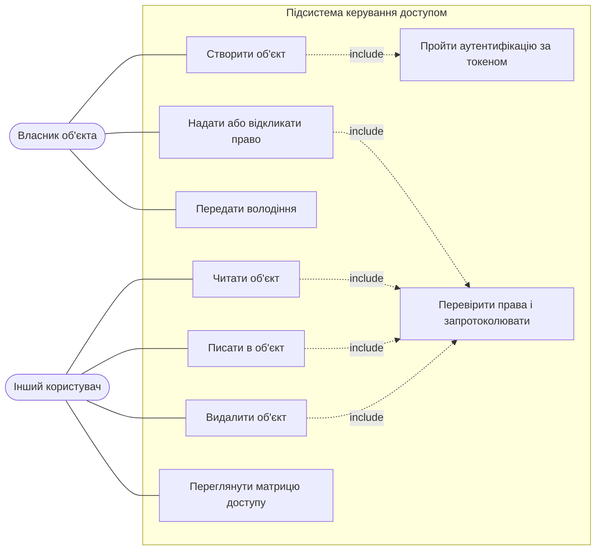
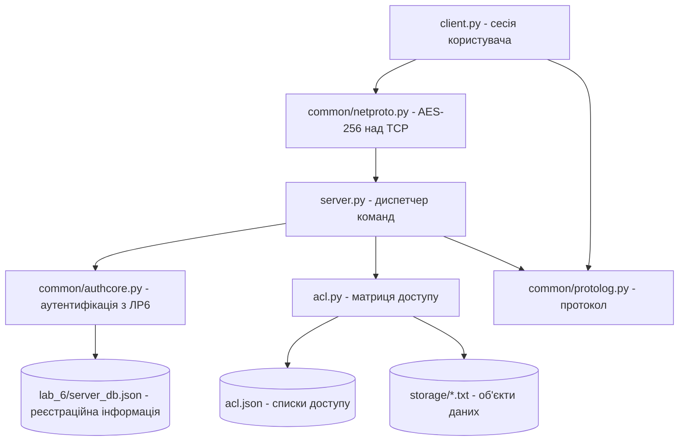
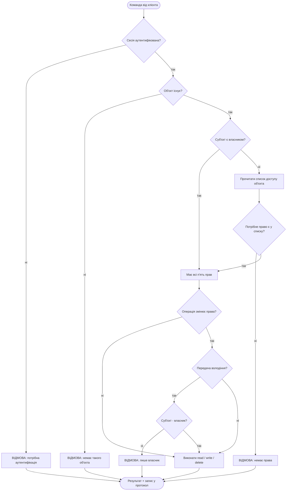

# Лабораторна робота №7. Підсистема керування доступом

**Варіант 1** — довірче (дискреційне) керування доступом.
Клієнт працює з об'єктами даних, що знаходяться на «серверному» боці; доступ до
кожного об'єкта визначається матрицею доступу, а всі права на зміну прав належать
власникові об'єкта. Реалізовано **п'ять прав доступу** (вимога — не менше чотирьох,
враховуючи право власника): `read`, `write`, `delete`, `grant`, `own`.

Програму побудовано поверх [лабораторної роботи №6](../lab_6/README.md): сервер
імпортує той самий модуль аутентифікації `common/authcore.py`, тож сесія керування
доступом відкривається лише після успішної перевірки токена безпеки.

---

## 1. Теорія, яку перевіряємо

### Матрична модель Д. Деннінг

Обчислювальну систему з погляду безпеки описують кортежем **⟨S, O, A⟩**, де
S — множина суб'єктів (активних сутностей: користувачі, процеси), O — множина
об'єктів (пасивних сутностей, що потребують захисту), A — матриця доступу.
Рядок матриці відповідає суб'єктові Sᵢ, стовпчик — об'єктові Oⱼ, а елемент
A(Sᵢ, Oⱼ) — список прав, які Sᵢ має щодо Oⱼ.

Задача підсистеми керування доступом — виконувати політику безпеки, тобто набір
правил розмежування доступу (ПРД), і не допускати операцій, яких матриця не дозволяє.

### Чому матрицю не зберігають цілком

Матриця доступу надзвичайно розріджена: типовий користувач має права на кілька
об'єктів із тисяч. Зберігати її повністю — марнувати пам'ять на порожні клітинки,
тому використовують два еквівалентні «стиснені» представлення:

- **список доступу (ACL)** асоціюється з об'єктом і містить ідентифікатори
  суб'єктів з їхніми правами — це **стовпчик** матриці;
- **список повноважень (capability list)** асоціюється із суб'єктом і містить
  об'єкти з правами на них — це **рядок** матриці.

У програмі основним сховищем є списки доступу (`acl.json`), а список повноважень
обчислюється на льоту — команди `rights <obj>` і `caps` показують відповідно
стовпчик і рядок тієї самої матриці.

### Довірче (дискреційне) керування доступом

Згідно НД ТЗІ 1.1-003-99, при довірчому управлінні всі права на зміну прав доступу
до об'єкта належать суб'єктові, який є **власником** цього об'єкта. Тобто якщо
A(Sᵢ, Oⱼ) містить право власника, то Sᵢ отримує повний контроль над стовпчиком
матриці, що відповідає Oⱼ: він може роздавати й відкликати будь-які права будь-кому.

Саме це й відрізняє довірче керування від адміністративного (мандатного), де
можливість доступу визначає сама система захисту за мітками конфіденційності, а
змінювати ці мітки може лише спеціально призначений адміністратор (моделі
Белла-ЛаПадула, ватерлінії, Біба). Довірче керування гнучкіше, але, як показано
нижче в протоколі, саме ця гнучкість і є його головною вразливістю.

---

## 2. Що реалізовано

```
security/lab_7/
├── acl.py             матриця доступу: списки доступу, перевірка прав, операції
├── server.py          аутентифікація (ЛР6) + підсистема керування доступом
├── client.py          клієнт: інтерактивний або сценарний режим
├── seed_objects.py    початковий набір із 12 захищених об'єктів
├── demo.ps1           автоматичний прогін протоколу: 3 суб'єкти, 12 об'єктів
├── acl.json           матриця доступу (генерується)
├── storage/           самі об'єкти даних — текстові файли (генеруються)
└── logs/              протокол роботи
```

### Права доступу

| Право | Що дозволяє | Хто має за замовчуванням |
|---|---|---|
| `read` | прочитати вміст об'єкта | власник |
| `write` | дописати рядок до об'єкта | власник |
| `delete` | видалити об'єкт | власник |
| `grant` | надавати й відкликати права інших суб'єктів на цей об'єкт | власник |
| `own` | право власника: повний контроль над стовпчиком матриці, передача володіння | творець об'єкта |

Правила, які перевіряє сервер перед кожною операцією:

1. Власник об'єкта завжди має всі п'ять прав — вони не зберігаються в ACL явно,
   а виводяться з поля `owner` (це і є «повний контроль над стовпчиком»).
2. Будь-який інший суб'єкт має рівно ті права, які явно записані в ACL об'єкта.
3. Змінювати права може лише той, хто має `grant` на цьому об'єкті, — власник або
   той, кому власник це право делегував.
4. Передати володіння (`grant <obj> <user> own`) може **тільки** власник.
5. Права власника не можна відкликати.
6. Той, хто створює об'єкт, стає його власником.

### Команди клієнта

| Команда | Дія |
|---|---|
| `list` | об'єкти на сервері та ваші права на них |
| `caps` | ваш список повноважень (рядок матриці) |
| `matrix` | уся матриця доступу у текстовому вигляді |
| `rights <obj>` | список доступу об'єкта (стовпчик матриці) |
| `create <obj> [текст]` | створити об'єкт, ви стаєте власником |
| `read <obj>` | прочитати об'єкт |
| `write <obj> <текст>` | дописати рядок |
| `delete <obj>` | видалити об'єкт |
| `grant <obj> <user> <right>` | надати право |
| `revoke <obj> <user> <right>` | відкликати право |
| `quit` | завершити сесію |

---

## 3. Як запустити

```powershell
cd C:\uni_year_4\security\lab_7
.\demo.ps1                        # повний протокол, токен — знімний диск
.\demo.ps1 -TokenDir C:\temp\tok  # без флешки
```

Інтерактивно:

```powershell
# вікно 1
py -3 server.py --port 5707

# вікно 2
py -3 client.py --pin 1111 --slot u_ostrovska
ostrovska> list
ostrovska> grant finance_q1 shevchenko read
```

Дві машини — так само, як у ЛР6: сервер `--host 0.0.0.0`, клієнт `--server <IP>`.

---

## 4. Протокол роботи програми

Три суб'єкти (`ostrovska`, `shevchenko`, `kovalenko`), дванадцять об'єктів даних.
Повний журнал — [logs/lab7_protocol.log](logs/lab7_protocol.log).

### 4.1 Початковий стан

```
[SEED] OBJECT  'finance_q1' created, owner 'ostrovska'
[SEED] OBJECT  'finance_q2' created, owner 'ostrovska'
[SEED] OBJECT  'passwords' created, owner 'ostrovska'
[SEED] OBJECT  'diary' created, owner 'ostrovska'
[SEED] OBJECT  'lab_report' created, owner 'shevchenko'
[SEED] OBJECT  'poems' created, owner 'shevchenko'
[SEED] OBJECT  'budget' created, owner 'shevchenko'
[SEED] OBJECT  'contacts' created, owner 'shevchenko'
[SEED] OBJECT  'schedule' created, owner 'kovalenko'
[SEED] OBJECT  'grades' created, owner 'kovalenko'
[SEED] OBJECT  'protocol' created, owner 'kovalenko'
[SEED] OBJECT  'public_notes' created, owner 'kovalenko'
[SEED] READY   12 objects, access matrix in acl.json
```

### 4.2 Власник працює зі своїми об'єктами — доступ надано

```
[CLIENT] AUTH OK   subject 'ostrovska' authenticated, session open
[CLIENT] COMMAND   read finance_q1
[CLIENT] ALLOWED   right 'read' on 'finance_q1' is present (as owner)
[CLIENT]   |       Quarterly figures, draft.
[CLIENT] COMMAND   write finance_q1 revenue 1 200 000 UAH
[CLIENT] ALLOWED   right 'write' on 'finance_q1' is present (as owner)
```

### 4.3 Чужі об'єкти — доступ відхилено

```
[CLIENT] AUTH OK   subject 'shevchenko' authenticated, session open
[CLIENT] COMMAND   read finance_q1
[CLIENT] DENIED    subject 'shevchenko' has no right 'read' on 'finance_q1'
[CLIENT] COMMAND   write finance_q1 injected by shevchenko
[CLIENT] DENIED    subject 'shevchenko' has no right 'write' on 'finance_q1'
[CLIENT] COMMAND   delete diary
[CLIENT] DENIED    subject 'shevchenko' has no right 'delete' on 'diary'
[CLIENT] COMMAND   grant finance_q1 shevchenko read
[CLIENT] DENIED    subject 'shevchenko' has no right 'grant' on 'finance_q1'
                   (only the owner or a delegate may change rights)
```

Остання відмова — ключова: суб'єкт не може сам собі видати права, бо не володіє
об'єктом.

### 4.4 Власник роздає права — доступ з'являється

```
[CLIENT] AUTH OK   subject 'ostrovska' authenticated, session open
[CLIENT] COMMAND   grant finance_q1 shevchenko read
[CLIENT] ALLOWED   right 'read' on 'finance_q1' granted to 'shevchenko'
[CLIENT] COMMAND   grant finance_q2 shevchenko write
[CLIENT] ALLOWED   right 'write' on 'finance_q2' granted to 'shevchenko'
[CLIENT] COMMAND   grant finance_q1 kovalenko grant
[CLIENT] ALLOWED   right 'grant' on 'finance_q1' granted to 'kovalenko'
[CLIENT] COMMAND   rights finance_q1
[CLIENT] ALLOWED   access list of 'finance_q1'
[CLIENT]   |       kovalenko        grant
[CLIENT]   |       ostrovska        delete,grant,own,read,write
[CLIENT]   |       shevchenko       read
```

```
[CLIENT] AUTH OK   subject 'shevchenko' authenticated, session open
[CLIENT] COMMAND   read finance_q1
[CLIENT] ALLOWED   right 'read' on 'finance_q1' is present
[CLIENT]   |       Quarterly figures, draft.
[CLIENT]   |       revenue 1 200 000 UAH
[CLIENT] COMMAND   delete finance_q1
[CLIENT] DENIED    subject 'shevchenko' has no right 'delete' on 'finance_q1'
```

Права видаються точково: отримавши `read`, суб'єкт не отримує `delete`.

### 4.5 Делегування права `grant` — головна вада довірчої моделі

Власниця дала `kovalenko` лише право `grant` (щоб той керував доступом інших), але
не дала `read`. Проте `grant` дозволяє видати право будь-кому — у тому числі собі:

```
[CLIENT] AUTH OK   subject 'kovalenko' authenticated, session open
[CLIENT] COMMAND   read finance_q1
[CLIENT] DENIED    subject 'kovalenko' has no right 'read' on 'finance_q1'
[CLIENT] COMMAND   grant finance_q1 kovalenko read
[CLIENT] ALLOWED   right 'read' on 'finance_q1' granted to 'kovalenko'
[CLIENT] COMMAND   read finance_q1
[CLIENT] ALLOWED   right 'read' on 'finance_q1' is present
[CLIENT]   |       Quarterly figures, draft.
[CLIENT]   |       revenue 1 200 000 UAH
[CLIENT] COMMAND   grant finance_q1 kovalenko own
[CLIENT] DENIED    only the owner may hand over ownership
```

Тобто делегування права керувати правами фактично дорівнює передачі всіх прав —
поширення повноважень у дискреційній моделі неконтрольоване. Володіння при цьому
залишилось захищеним: передати його може тільки власник.

### 4.6 Відкликання прав

```
[CLIENT] AUTH OK   subject 'ostrovska' authenticated, session open
[CLIENT] COMMAND   revoke finance_q1 shevchenko read
[CLIENT] ALLOWED   right 'read' on 'finance_q1' revoked from 'shevchenko'
[CLIENT] COMMAND   revoke finance_q1 kovalenko grant
[CLIENT] ALLOWED   right 'grant' on 'finance_q1' revoked from 'kovalenko'
[CLIENT] COMMAND   rights finance_q1
[CLIENT] ALLOWED   access list of 'finance_q1'
[CLIENT]   |       ostrovska        delete,grant,own,read,write

[CLIENT] AUTH OK   subject 'shevchenko' authenticated, session open
[CLIENT] COMMAND   read finance_q1
[CLIENT] DENIED    subject 'shevchenko' has no right 'read' on 'finance_q1'
```

### 4.7 Створення об'єкта, видалення, передача володіння

```
[CLIENT] AUTH OK   subject 'kovalenko' authenticated, session open
[CLIENT] COMMAND   create meeting_notes Notes of the meeting on 11.10.2026
[CLIENT] ALLOWED   object 'meeting_notes' created, owner 'kovalenko'
[CLIENT] COMMAND   grant protocol ostrovska own
[CLIENT] ALLOWED   right 'own' on 'protocol' granted to 'ostrovska'
[CLIENT] COMMAND   read protocol
[CLIENT] DENIED    subject 'kovalenko' has no right 'read' on 'protocol'
[CLIENT] COMMAND   delete grades
[CLIENT] ALLOWED   right 'delete' on 'grades' is present (as owner) -> object removed
```

Після передачі володіння колишній власник втрачає всі права на об'єкт — стовпчик
матриці повністю переходить під контроль нового власника.

### 4.8 Підсумкова матриця доступу

```
                 budget    contacts       diary  finance_q1  finance_q2  lab_report meeting_not   passwords       poems    protocol public_note    schedule
-----------------------------------------------------------------------------------------------------------------------------------------------------------
kovalenko         .....       .....       .....       .....       .....       .....       RWDGO       .....       .....       .....       RWDGO       RWDGO
ostrovska         .....       .....       RWDGO       RWDGO       RWDGO       .....       .....       RWDGO       .....       RWDGO       .....       .....
shevchenko        RWDGO       RWDGO       .....       .....       .W...       RWDGO       .....       .....       RWDGO       .....       R....       .....

columns = objects, rows = subjects, flags = R=read W=write D=delete G=grant O=own
```

### 4.9 Керування доступом по мережі між двома машинами

Той самий сценарій перевірено з фізично рознесеними клієнтом і сервером: сервер
на хості `192.168.31.232`, клієнт — у віртуальній машині `192.168.31.76`, що
запускалася прямо з токена безпеки. Спершу суб'єкт проходить аутентифікацію
модулем з ЛР6, і лише після цього відкривається сесія керування доступом:

```
[SERVER] AUTH OK        user='ostrovska' peer=192.168.31.76:52592 :: hash image matches the database
[SERVER] SESSION OPEN   subject 'ostrovska' from 192.168.31.76:52592
[SERVER] ALLOW          subject='ostrovska' op=list :: 12 object(s)
[SERVER] ALLOW          subject='ostrovska' op=read object='finance_q1' :: right 'read' on 'finance_q1' is present (as owner)
[SERVER] ALLOW          subject='ostrovska' op=write object='finance_q1' :: right 'write' on 'finance_q1' is present (as owner)
[SERVER] DENY           subject='ostrovska' op=read object='lab_report' :: subject 'ostrovska' has no right 'read' on 'lab_report'
[SERVER] DENY           subject='ostrovska' op=delete object='lab_report' :: subject 'ostrovska' has no right 'delete' on 'lab_report'
[SERVER] ALLOW          subject='ostrovska' op=caps :: capability list of 'ostrovska'
[SERVER] SESSION CLOSE  subject 'ostrovska'
```

Рішення підсистеми керування доступом не залежать від того, звідки прийшов
суб'єкт: власні об'єкти доступні, чужі — ні, причому відмова формулюється однаково
як у локальному, так і в мережевому сеансі. Повний журнал —
[../vm/logs/vm_host_servers.log](../vm/logs/vm_host_servers.log), налаштування
стенда — у розділі 4В звіту [ЛР6](../lab_6/README.md).

---

## 5. Діаграми

### 5.1 Діаграма прецедентів



### 5.2 Діаграма модулів



### 5.3 Блок-схема перевірки доступу



---

## 6. Відповіді на контрольні запитання

**1. Проаналізуйте недоліки довірчого управління доступом.**

- *Неконтрольоване поширення прав.* Власник може віддати права будь-кому, а той, хто
  отримав право `grant`, — далі. У розділі 4.5 видно це наживо: суб'єкт, якому дали
  лише право керувати правами, видав собі право читання. Система не може відповісти
  на питання «хто в принципі здатен отримати доступ до цього об'єкта».
- *Немає глобальної політики.* Рішення приймає кожен власник окремо, тому
  загальноорганізаційне правило («фінансові документи не виходять за межі відділу»)
  технічно не забезпечується — його можна лише просити дотримуватись.
- *Вразливість до «троянського коня».* Права перевіряються для користувача, а не для
  програми, яку він запустив. Шкідлива програма, запущена власником, діє з усіма його
  правами й може легально скопіювати секретний об'єкт у загальнодоступний.
- *Проблема відкликання.* Відкликавши право, не можна відкликати вже зроблену копію
  даних; крім того, у системах із делегуванням важко знайти всі похідні права.
- *Відсутність контролю інформаційних потоків.* Дані, прочитані з «секретного»
  об'єкта, можна вільно записати у «відкритий» — саме цю діру закривають мандатні
  моделі (Белла-ЛаПадула) своїм *-правилом.
- *Складність адміністрування.* Матриця швидко розростається; реальний стан прав
  розподілений між сотнями власників і погано піддається аудиту.

**2. Оцініть позитивні та негативні сторони реалізованої політики безпеки.**

*Позитивні:* гранульованість — права видаються точково, по одному на пару
суб'єкт-об'єкт; гнучкість і зручність — не потрібен адміністратор, власник сам
вирішує, кому відкрити доступ, що добре лягає на спільну роботу над документами;
простота реалізації та зрозумілість для користувача (та сама модель, що у файлових
системах NTFS, POSIX, Google Drive); принцип «за замовчуванням заборонено» —
відсутність запису в ACL означає відмову; усі рішення протоколюються.

*Негативні:* усе з питання 1, насамперед неконтрольоване поширення прав і
відсутність захисту від троянських програм; ризик помилки власника (один
необережний `grant` відкриває дані); відсутність ролей — права видаються
персонально, тому при зміні посади чи звільненні їх треба шукати по всіх об'єктах
вручну; матриця зростає як O(|S|·|O|) у гіршому випадку.

**3. Опишіть на рівні структур даних, як реалізовано матрицю доступу.**

Матриця зберігається у вигляді **розріджених списків доступу** — файл `acl.json`,
у пам'яті словник `AccessMatrix.objects`:

```json
{
  "objects": {
    "finance_q1": {
      "owner": "ostrovska",
      "acl": { "shevchenko": ["read"], "kovalenko": ["grant"] },
      "created_at": "2026-10-11T16:06:45"
    }
  }
}
```

Ключ зовнішнього словника — ідентифікатор об'єкта, тобто **стовпчик** матриці.
Поле `owner` — право власника, винесене окремо: власник не записується в `acl`,
бо його повний набір прав виводиться з самого факту володіння
(`AccessMatrix.rights_of` повертає `set(ALL_RIGHTS)`, якщо `owner == subject`).
Вкладений словник `acl` відображає «ідентифікатор суб'єкта → список прав» —
це і є елементи A(Sᵢ, Oⱼ) для решти суб'єктів. Порожні клітинки матриці просто
відсутні у структурі, завдяки чому пам'ять витрачається лише на реально видані права.

Рядок матриці (список повноважень суб'єкта) у явному вигляді не зберігається, а
обчислюється перебором об'єктів — метод `capability_list(subject)`, команда `caps`.
Повна матриця для звіту будується методом `render_matrix` (розділ 4.8). Самі об'єкти
даних зберігаються окремо від матриці — текстові файли в теці `storage/`, імена яких
валідуються регулярним виразом `^[A-Za-z0-9_.-]{1,48}$`, щоб ідентифікатор об'єкта не
міг вийти за межі сховища.

**4. Охарактеризуйте рівень контролю доступу згідно НД ТЗІ 2.5-004-99. Що зробити, щоб його підвищити?**

Реалізована система відповідає приблизно таким рівням функціональних послуг:

- **КД-1 (мінімальна довірча конфіденційність)** — КЗЗ розмежовує доступ суб'єктів
  до об'єктів на підставі атрибутів доступу, а запити на зміну прав обробляються за
  правилами, визначеними власником об'єкта. Політика поширюється лише на один тип
  об'єктів (текстові об'єкти даних), чого якраз і вимагає мінімальний рівень.
- **ЦД-1 (мінімальна довірча цілісність)** — окреме право `write` відділено від
  `read`, тому модифікація контролюється незалежно від читання.
- **НИ-2 (одиночна ідентифікація і автентифікація)** — кожен суб'єкт має унікальний
  ідентифікатор і автентифікується токеном перед будь-якою операцією (ЛР6).
- **НР-1/НР-2 (реєстрація)** — усі спроби доступу, дозволені й відхилені,
  протоколюються з міткою часу, ідентифікатором суб'єкта, об'єктом і причиною.

Не реалізовано: розмежування доступу процесів, а не лише користувачів; послуги
НО (розподіл обов'язків — немає ролі адміністратора безпеки, відокремленої від
користувачів); НЦ (цілісність самого КЗЗ — `acl.json` є звичайним файлом і його
може змінити будь-хто з доступом до ОС); НТ (самотестування); НК (достовірний канал);
повторне використання об'єктів (КО).

**Щоб підвищити рівень**, потрібно: поширити ПРД на всі типи об'єктів, включно з
процесами та експортованими об'єктами (перехід до КД-2/КД-3); ввести роль
адміністратора безпеки й розподіл обов'язків (НО-1); захистити матрицю доступу та
журнал від модифікації — електронний підпис або зберігання у БД із власним
розмежуванням доступу (НЦ); додати гарантоване очищення звільнених об'єктів (КО-1);
вести захищений від модифікації журнал з аналізом подій (НР-3 і вище); доповнити
довірчу політику адміністративною (мандатні мітки конфіденційності), що закриє
витік інформаційними потоками; забезпечити достовірний канал клієнт-сервер на
основі TLS із взаємною автентифікацією (НК-1).

**5. Проаналізуйте взаємодію підсистеми управління доступом та автентифікації.**

Підсистеми з'єднані послідовно й асиметрично: керування доступом **повністю
покладається** на результат автентифікації, а автентифікація про права нічого не знає.

Технічно це виглядає так. Перше повідомлення в сесії обов'язково має бути `auth`;
`server.py` передає його в `common/authcore.py` — той самий модуль, що був написаний
для ЛР6 і працює з тією самою базою `lab_6/server_db.json`. Якщо хеш-образ не
збігається, сервер надсилає відмову й **закриває з'єднання, не доходячи до матриці
доступу взагалі**. Лише після успішної перевірки ідентифікатор суб'єкта записується
в змінну сесії `user`, і далі *кожна* команда перевіряється саме щодо цього
ідентифікатора: клієнт не передає ім'я суб'єкта у своїх запитах, тому підмінити його
на боці клієнта неможливо. Так реалізується ланцюг «ідентифікація → автентифікація →
авторизація»: токен відповідає на питання *хто це*, матриця — *що йому дозволено*.

Звідси головний наслідок для безпеки: **надійність керування доступом не може
перевищувати надійність автентифікації**. Скомпрометований токен або підібраний PIN
дають зловмиснику не просто вхід у систему, а всі права відповідного суб'єкта, разом
із правом власника на його об'єкти — тобто можливість легально роздати доступ до них
кому завгодно. Матриця доступу при цьому спрацює «правильно», бо з її погляду
працює легітимний суб'єкт. Саме тому посилення автентифікації (повільна KDF,
схема «виклик-відповідь», апаратний токен, блокування після невдалих спроб) є
обов'язковою умовою для будь-якого підвищення рівня контролю доступу.

Спільним для обох підсистем є журнал: записи про автентифікацію й про рішення щодо
доступу потрапляють в один протокол, завдяки чому за ним можна відновити повний
ланцюжок «хто увійшов → що намагався зробити → що йому дозволили».

---

## 7. Висновки

Реалізовано підсистему керування доступом із довірчою (дискреційною) політикою
безпеки, яка працює поверх аутентифікації за токеном безпеки з лабораторної
роботи №6 — сервер використовує той самий модуль `common/authcore.py` і ту саму
базу реєстраційної інформації.

Матрицю доступу Д. Деннінг реалізовано у вигляді розріджених списків доступу: для
кожного з об'єктів зберігається власник і перелік суб'єктів із їхніми правами, а
список повноважень (рядок матриці) обчислюється за потреби. Підтримано п'ять прав —
`read`, `write`, `delete`, `grant`, `own`, — причому право власника дає повний
контроль над стовпчиком матриці, що й визначає довірчу модель.

Роботу перевірено на трьох суб'єктах і дванадцяти об'єктах даних. Протокол фіксує
як дозволені, так і відхилені операції: читання й запис чужих об'єктів, спроби
несанкціонованої зміни прав, видачу й відкликання прав власником, створення об'єкта,
видалення та передачу володіння.

Експеримент наочно показав головну ваду довірчого керування: делегувавши лише право
`grant`, власник фактично втрачає контроль над об'єктом, бо делегат може видати собі
будь-які інші права. Повноваження в дискреційній моделі поширюються неконтрольовано,
а інформаційні потоки взагалі не відстежуються. Усунути це в межах самої моделі
неможливо — потрібен перехід до адміністративного (мандатного) керування з мітками
конфіденційності або композитної моделі, де поверх довірчих правил діють системні
обмеження, які власник змінити не може.
